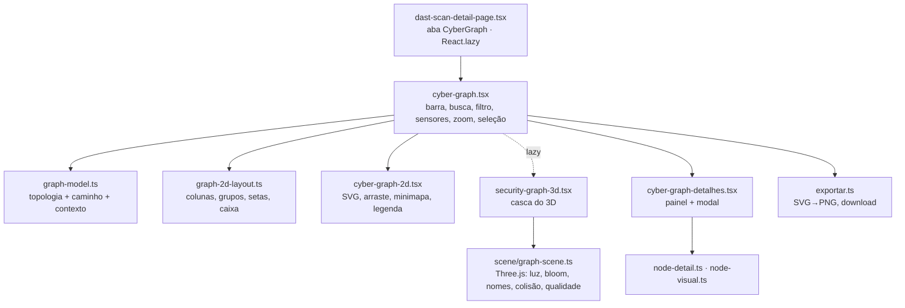

<!--
  O que faz: registra o design do CyberGraph (Security Graph do scan DAST) — arquitetura do módulo,
  linguagem visual, interação, acessibilidade e desempenho.
  Por que existe: o módulo cresceu em várias rodadas; este é o mapa único de "por que é assim".
  Quem consome: equipe do TCC, banca e agentes de código que vão mexer no grafo.
-->

# Design — CyberGraph

> **Estado em 2026-10-31.** Tokens e componentes globais estão em
> [`docs/DESIGN_SYSTEM.md`](docs/DESIGN_SYSTEM.md) e [`docs/FRONTEND_WEB.md`](docs/FRONTEND_WEB.md);
> aqui está só o que é específico do grafo. Sensores: [`DISCOVERY.md`](DISCOVERY.md). Decisão do 3D:
> ADR-048 (`docs/Vulnera/07-Decisoes/`). Prints: `docs/evidencias/security-graph/`.

## O que é

A aba **CyberGraph** do detalhe de um scan DAST mostra o caminho de exposição
**Internet → alvo → endpoint → findings** montado com os dados reais do scan. Responde "por onde um
atacante chega a este achado?" — a lista de Achados responde "o que eu preciso triar?".

| Modo | Para quê | Tecnologia |
| --- | --- | --- |
| **2D** (padrão) | trabalho: ler, buscar, navegar por teclado, exportar | SVG próprio |
| **3D** | apresentação: banca, cliente, visão geral | Three.js, chunk lazy |

Os dois compartilham **uma seleção**, o painel, o modal, a busca e o filtro.

## Arquitetura do módulo

`app/web/src/features/security-graph/`

Princípios:

- **Puro onde dá**: topologia, layout 2D, vizinho por seta, detalhe do nó, qualidade adaptativa e
  resolução de variáveis CSS são funções puras com teste Vitest. A cena Three.js fica fora do React,
  com um único `dispose()`.
- **Contrato estável**: `SecurityGraph { nodes, edges, truncated }`. Quando `GET /dast/scans/:id/graph`
  existir, ele substitui `buildSecurityGraph` sem tocar 2D, 3D, painel ou modal.
- **Sem dependência nova**: lucide-react e three já estavam no projeto; React Flow, dagre e
  html-to-image da spec foram dispensados (layout em colunas é determinístico, e o PNG sai do próprio
  SVG/canvas).

## Linguagem visual

**Uma cor por papel, sempre do token** (`oklch(var(--token))`), nos dois temas:

| Nó | Ícone (lucide) | Cor |
| --- | --- | --- |
| Internet | `Earth` | `--color-chart-2` (azul) |
| Alvo | `Server` | `--color-accent` (íris) |
| Endpoint | `Globe` | `--color-chart-3` (verde) |
| Grupo "Findings (N)" | `ScanSearch` | severidade do pior finding |
| Finding | `Bug` | `--color-severity-*` |
| IP | `Network` | `--color-chart-1` |
| Porta aberta | `Plug` | `--color-chart-2` |
| Tecnologia | `Layers` | `--color-chart-axis` (neutro) |
| Subdomínio / "Subdomínios (N)" | `Waypoints` | `--color-chart-3` |

- Estrutura (Internet, alvo, endpoint, IP, porta, tecnologia, subdomínio) nunca usa cor de
  severidade: vermelho/laranja só significam risco.
- Ativos de descoberta são **ramos do alvo** na coluna dos endpoints. Os filhos estruturais (portas,
  tecnologias do IP, subdomínios) ocupam a coluna do meio, e as CVEs do IP viram um grupo "CVEs (N)"
  como os findings de um endpoint. Ramo com mais de 6 filhos começa recolhido (o nó ganha o anel e a
  contagem do grupo e alterna no clique). A legenda só lista os tipos presentes no grafo.
- CVE tem o **cartão CVSS** no painel e no topo do modal: a nota grande na cor do risco, a faixa
  oficial ("Crítica" inclusive, que o `DastRisk` não tem), versão, vetor e link para o NVD.
- Arestas em degradê da cor da origem para a do destino; o caminho selecionado ganha fluxo animado e
  o resto cai para ~15–30% de opacidade.
- Fundo do palco com grade de pontos (token de borda), como nas referências de "attack path".
- O 3D traduz a mesma linguagem em objetos: globo (Internet), rack (alvo), porta hexagonal (endpoint),
  cristal na cor da severidade (finding), com nomes fixos abaixo de cada objeto.

### Painel e modal

- Borda e faixa superior na cor do nó selecionado; cabeçalho com o **mesmo ícone** do grafo.
- Fichas de metadado com ícone (CWE, confiança, **sensor de origem**, data, parâmetro).
- Caminho de exposição como linha do tempo clicável.
- Modal só leitura, seções em cartões (URL, descrição, solução com borda verde, evidência, triagem,
  referências). Triagem e promoção ficam na aba Achados, com as permissões de lá — o botão
  "Triar em Achados" leva até a linha certa.
- Entrada escalonada com as variantes de `useMotion()` (respeitam movimento reduzido); fechar some
  em ~160 ms.

## Interação

| Ação | 2D | 3D |
| --- | --- | --- |
| Selecionar | clique | clique |
| Detalhes | duplo clique, Shift+Enter, "Expandir detalhes" | duplo clique, Enter |
| Mover | arrastar o fundo | arrastar o fundo gira |
| Reposicionar nó | arrastar o nó | arrastar o objeto (plano de frente para a câmera) |
| Zoom | roda com foco, `+`/`-`, botões | roda com foco, botões |
| Voltar | Recentralizar · Restaurar layout · Ajustar | idem |
| Buscar | busca com sugestões: seleciona, abre o grupo e centraliza | seleciona e foca a câmera |
| Filtrar | chips de severidade | idem |
| Exportar | PNG do grafo inteiro em 2× | PNG da cena com os nomes |

**Faixa de sensores** (`components/dast/dast-sensor-strip.tsx`): na página do scan, acima das abas,
um cartão por sensor (ZAP, headers, certificado SSL/TLS) com status, achados, duração e a mensagem do
sensor — o resumo do certificado ou o motivo legível de uma falha. "Indisponível" em âmbar, "Erro" em
vermelho: não medir nunca parece "tudo certo". No CyberGraph, o selo da barra diz quais fontes
rodaram, cada finding mostra o sensor de origem e o nó do **alvo** mostra o certificado.

**Nova análise**: um passo só — URL do alvo e o checkbox de autorização no mesmo diálogo, com as três
verificações descritas antes de iniciar. Trocar o alvo desmarca a autorização. A demonstração é um
link secundário. Erros chegam como frase acionável (DNS, porta recusada, timeout, alvo já em análise,
"tente novamente em N s" no 429), nunca como código.

## Acessibilidade

- 2D: **um só ponto de Tab** no grafo (roving tabindex); setas andam entre nós (← → colunas,
  ↑ ↓ dentro da coluna); cada nó é `role="button"` com rótulo completo (tipo, nome, risco, contagem).
- 3D: canvas focável (`role="application"`), setas percorrem os nós, Enter abre, Esc limpa.
- O painel é região `aria-live`; a lista de Achados é a alternativa textual com o mesmo conteúdo.
- `prefers-reduced-motion`: sem fluxo animado, sem entrada escalonada, 3D sem giro nem partículas —
  verificado pelo E2E `CG-07` com emulação do Playwright.
- Roda do mouse só dá zoom com o grafo em foco: rolar a página nunca "prende" no canvas.
- Minimapa é **opcional** (botão no grupo de zoom): fixo sobre o grafo, ele sempre pode cobrir um nó
  — o próprio E2E encontrou esse caso.

## Desempenho

- `three` e a cena só baixam ao escolher o 3D; o bundle inicial não cresceu.
- 3D: materiais/geometrias compartilhados, arestas numa única `LineSegments`, partículas instanciadas,
  sombra a cada 2 quadros, DPR ≤ 1,5, RAF pausado fora da tela.
- Colisão de nomes no 3D a cada 4 quadros (projeção + retângulos, sem ler layout por quadro).
- **Qualidade adaptativa**: média de quadro > 25 ms por ~2 s → resolução 1×; se continuar, sem bloom
  e com sombra espaçada; avisa na tela e nunca volta a subir (não pisca).
- Teto de 300 nós; o corte descarta INFO antes de HIGH e a tela avisa.

## Testes

| Camada | Onde |
| --- | --- |
| Vitest (puro) | `graph-model.test.ts`, `graph-2d-layout.test.ts`, `exportar.test.ts`, `scene/node-meshes.test.ts`, `scene/qualidade.test.ts` |
| Playwright | `app/web/e2e/cybergraph.spec.ts` (CG-01…CG-08: grupo, painel, modal, triagem, busca, filtro, arraste, teclado, PNG 2D/3D, movimento reduzido, sensores) |
| Vitest (tela) | `pages/dast-page.test.tsx` (autorização obrigatória, trocar alvo desmarca, demonstração nunca vira real, URL com credencial, mensagens de 409 e 429) |

## Limites conhecidos 🚧

- O grafo ainda é montado no cliente a partir dos findings e dos ativos (`/assets`); sem alerta de
  divergência de exposição até o scan ter `applicationId` ([`DISCOVERY.md`](DISCOVERY.md)).
- Com muitos ramos (endpoints + IP + tecnologias + subdomínios) o enquadramento inicial pode não
  mostrar o topo; abrir um grupo centraliza a vista nele, e a busca e "Ajustar à tela" resolvem o
  resto (o E2E `CG-01` encontrou o caso: o grupo de CVEs do IP abria fora do palco).
- Posições arrastadas vivem só na tela (não são salvas por scan).
- 3D não medido em GPU integrada fraca nem em celular real; a qualidade adaptativa é a rede de
  proteção até essa medição.
