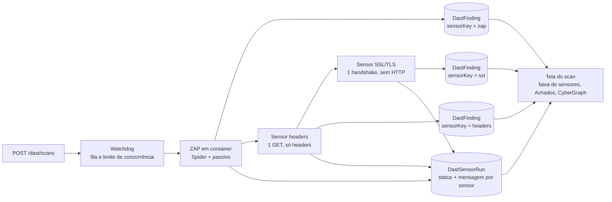
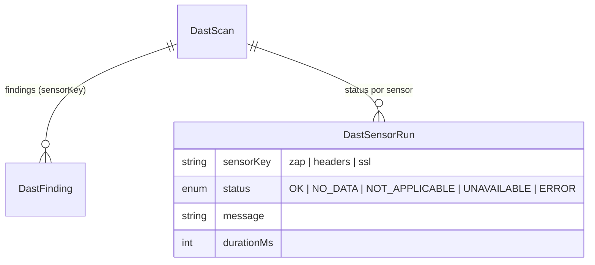

<!--
  O que faz: descreve o módulo Security Intelligence & Discovery — os sensores que descobrem a
  superfície exposta de um alvo e como isso chega ao CyberGraph.
  Por que existe: separa o que já roda do que é plano, com as regras que não se negociam.
  Quem consome: equipe do TCC, banca e agentes de código que vão implementar os próximos sensores.
-->

# Discovery — sensores passivos e superfície exposta

> **Estado em 2026-10-31.** Implementados: **ZAP**, **headers de segurança** e **certificado SSL/TLS**,
> todos disparados por **um único passo** na tela (a pessoa informa o alvo, marca a autorização e
> recebe tudo no fim). Planejados (🚧):
> fingerprint de tecnologia, crt.sh e Shodan InternetDB. Origem: spec "Sensores e Security Graph"
> (2026-10-29). Visual e interação: [`DESIGN.md`](DESIGN.md). Controles: [`SECURITY.md`](SECURITY.md).

## A ideia

O Vulnera olha o alvo **de fora para dentro** (outside-in): o que um atacante vê sem credencial.
Cada técnica de coleta é um **sensor** plugável. Todos rodam no mesmo job do scan, depois do ZAP, e
cada um devolve um **status explícito** — porque "sem dados" nunca pode aparecer como "seguro".



## Contrato de um sensor

`app/api/src/services/sensors/sensor.types.ts`

```ts
interface Sensor {
  key: "zap" | "headers" | "ssl";    // cresce com os próximos sensores
  run(ctx: { targetUrl; simulated; signal }): Promise<{ status; message?; findings }>;
}
```

| Status | Quando | Na tela |
| --- | --- | --- |
| `OK` | mediu (com ou sem achados) | ponto verde + contagem de achados |
| `NO_DATA` | a fonte respondeu, mas sem informação | cinza |
| `NOT_APPLICABLE` | não se aplica ao alvo (ex.: fonte pública para IP privado) | cinza |
| `UNAVAILABLE` | o alvo ou o serviço externo não respondeu | âmbar + aviso no scan |
| `ERROR` | falha inesperada do próprio sensor | vermelho + aviso no scan |

Os achados de um sensor saem no **mesmo formato** dos do ZAP (`CandidateFinding`), com `pluginId` em
namespace (`sensor:<key>:<regra>`) e `sensorKey`. Por isso fingerprint, deduplicação, triagem,
promoção e comparação entre scans **não mudaram**.

## Regras que não se negociam

1. **Só passivo.** Nada de active scan, Nuclei, Nmap, envio de formulário ou login no alvo.
2. **Falha não vira dado simulado.** O scan conclui com aviso; o sensor fica `UNAVAILABLE`/`ERROR`.
3. **Simulado é rotulado.** No modo de demonstração o sensor não toca a rede e a mensagem diz isso.
4. **Achado automatizado nasce `NEW`.** Só vira `Vulnerability` por promoção humana (inclusive CVE
   potencial do InternetDB, quando existir).
5. **Ownership antes de tudo.** `GET /dast/scans/:id/sensors` segue a mesma regra de dono dos findings.

## Sensores

### ✅ ZAP (existente)

Spider + alertas passivos em container `vulnera-zap-<id>`. Registrado como sensor `zap` em
`DastSensorRun` para a faixa da tela mostrar as duas fontes lado a lado.

### ✅ Headers de segurança

`app/api/src/services/sensors/headers.sensor.ts` — um GET à URL do alvo, corpo descartado.

| Regra (`sensor:headers:…`) | Risco | CWE | Dispara quando |
| --- | --- | --- | --- |
| `csp-ausente` | Médio | 693 | sem `Content-Security-Policy` |
| `anti-clickjacking-ausente` | Médio | 1021 | sem `X-Frame-Options` **e** sem `frame-ancestors` na CSP |
| `hsts-ausente` | Baixo | 319 | HTTPS sem `Strict-Transport-Security` |
| `hsts-curto` | Baixo | 319 | `max-age` < 180 dias |
| `nosniff-ausente` | Baixo | 693 | `X-Content-Type-Options` ≠ `nosniff` |
| `referrer-policy-ausente` | Info | 200 | sem `Referrer-Policy` |
| `cookie-sem-httponly` | Baixo | 1004 | cookie sem `HttpOnly` (um achado por cookie) |
| `cookie-sem-secure` | Baixo | 614 | cookie sem `Secure` em HTTPS |
| `cookie-sem-samesite` | Info | 1275 | cookie sem `SameSite` |

Comportamento verificado:

| Situação | Resultado |
| --- | --- |
| Alvo responde | `OK`, achados conforme a tabela (contra o próprio Vulnera em `:8086`: `OK`, 0 achados) |
| Porta fechada / DNS / timeout (10 s) | `UNAVAILABLE` com a causa (`ECONNREFUSED`…), sem achado |
| Redirect para a mesma origem | segue, até 3 saltos |
| Redirect para outro host | **não segue**; avalia o próprio 30x |
| Scan simulado | nenhuma requisição; achados fixos rotulados "simulado" |

Limites conhecidos: mede só a página pedida (não segue login nem rotas internas). O ZAP passivo
também acusa CSP/anti-clickjacking — os dois aparecem, cada um com sua origem; a duplicidade de tema
é intencional para mostrar a fonte.

### ✅ Certificado SSL/TLS

`app/api/src/services/sensors/ssl.sensor.ts` — **um** handshake TLS com o host e a porta do endereço
autorizado, sem requisição HTTP; a conexão fecha logo depois. Aceita protocolos e cifras antigos **só
para conseguir medir** (com o mínimo padrão do Node, um servidor em TLS 1.0 viraria "indisponível" e
esconderia o achado) e lê a validade da cadeia de `socket.authorized`.

| Regra (`sensor:ssl:…`) | Risco | CWE | Dispara quando |
| --- | --- | --- | --- |
| `sem-https` | Médio | 319 | o endereço autorizado é `http://` (não tenta a 443 por conta própria) |
| `certificado-expirado` | Alto | 298 | passou de `valid_to` |
| `certificado-ainda-nao-valido` | Alto | 298 | `valid_from` no futuro |
| `certificado-expira-em-breve` | Baixo | 298 | menos de 30 dias (o título traz os dias) |
| `certificado-nao-confiavel` | Médio | 295 | cadeia não chega a uma AC confiável (autoassinado, intermediária faltando) |
| `certificado-nome-divergente` | Médio | 297 | o host não está no CN/SAN |
| `tls-obsoleto` | Médio | 327 | negociou SSLv3, TLS 1.0 ou 1.1 |
| `chave-fraca` | Médio | 326 | RSA com menos de 2048 bits (curva elíptica não entra) |

A mensagem do sensor resume o certificado (`CN · emissor · válido até AAAA-MM-DD (N dias) · protocolo
· cifra`) e aparece na faixa de sensores e no nó do **alvo** do CyberGraph.

Verificado contra servidores reais (badssl.com, serviço público feito para testar estes casos):

| Alvo | Resultado |
| --- | --- |
| `https://example.com/` | `OK`, sem achado, TLS 1.3 |
| `https://expired.badssl.com/` | `certificado-expirado` |
| `https://self-signed.badssl.com/` | `certificado-nao-confiavel` |
| `https://wrong.host.badssl.com/` | `certificado-nome-divergente` |
| `https://tls-v1-0.badssl.com:1010/` | `tls-obsoleto` |
| domínio inexistente | `UNAVAILABLE` "o domínio não foi encontrado no DNS…" |
| `http://localhost:8086/` | `OK` com `sem-https` |

### Mensagens de falha

`services/sensors/falhas.ts` traduz o código técnico em frase acionável e mantém o código entre
parênteses: `ENOTFOUND` → "o domínio não foi encontrado no DNS — confira se o endereço está certo",
`ECONNREFUSED` → "a porta do alvo recusou a conexão", `ETIMEDOUT` → "não respondeu dentro do tempo
limite", `EPROTO` → "o endereço não respondeu com TLS", e assim por diante. A falha de um sensor vira
aviso no scan ("Análise concluída com avisos") e cartão âmbar/vermelho na faixa de sensores.

### 🚧 Fingerprint de tecnologia

`Server`, `X-Powered-By`, nomes de cookie, `meta generator` — regras próprias em JSON sobre a **mesma
resposta** do sensor de headers (nenhuma requisição a mais). Gera nó de tecnologia e o finding
"versão exposta". Antes de codar, conferir se o add-on *Tech Detection* do ZAP já resolve.

### 🚧 crt.sh

Subdomínios em certificados públicos (`GET https://crt.sh/?q=%25.<domínio>&output=json`). Sem API
oficial nem SLA: timeout de 15 s, 1 retry, cache de 24 h por domínio. `NOT_APPLICABLE` sem
requisição para localhost, IP privado e domínio interno.

### 🚧 Shodan InternetDB

Portas, CPEs e CVEs conhecidos do IP (`GET https://internetdb.shodan.io/<ip>` após resolver o DNS).
CVE entra como finding **"potencial · não validado"**. Grátis só para uso não comercial (ok para o
TCC; uso comercial exige licença — registrar no ADR).

## Modelo de dados



Migration: `app/api/prisma/migrations/20261031000000_add_dast_sensor_runs`. `DastFinding.sensorKey`
tem default `zap`, então scans antigos continuam corretos sem reprocessar.

🚧 Para os próximos sensores entram, conforme a spec: `ObservedAsset` (subdomínio, IP, serviço,
tecnologia) com `parentKey` definindo a aresta, `DastFinding.assetKey` e `DastScan.applicationId /
companyId` — este último é o que habilita o **alerta de divergência de exposição** (Application
declarada interna, mas observada exposta), o diferencial previsto para a banca.

## API

| Rota | Perfis | Devolve |
| --- | --- | --- |
| `GET /dast/scans/:id/findings` | PENTESTER dono, ADMIN | findings com `sensorKey` |
| `GET /dast/scans/:id/sensors` | PENTESTER dono, ADMIN | `{ sensorKey, status, message, startedAt, finishedAt, durationMs }[]` |

🚧 Planejadas na spec: `GET /dast/scans/:id/graph`, `GET /applications/:id/graph` (CLIENT só vê
`Vulnerability` promovida; outra empresa recebe 404) e `GET /dashboard/exposure`.

## Como verificar

```bash
npx jest --runInBand tests/unit/headers.sensor.test.ts tests/unit/ssl.sensor.test.ts tests/integration/dast.test.ts
```

Na tela: **DAST → Nova análise**, informe o alvo, marque a autorização e clique em **Iniciar análise**.
No fim, a página do scan mostra a faixa "Sensores deste scan" (com o resumo do certificado), os achados
de cada origem na aba Achados e no CyberGraph. O E2E `CG-08` em `app/web/e2e/cybergraph.spec.ts`
cobre o caminho com um scan simulado.

## Próximos passos

1. Fingerprint (reaproveita a resposta do sensor de headers).
2. `ObservedAsset` + crt.sh + InternetDB, com rede mockada nos testes para cada status.
3. `applicationId/companyId` no scan e o alerta de divergência.
4. API de grafo por audiência e o CyberGraph consumindo `GET /dast/scans/:id/graph`.
