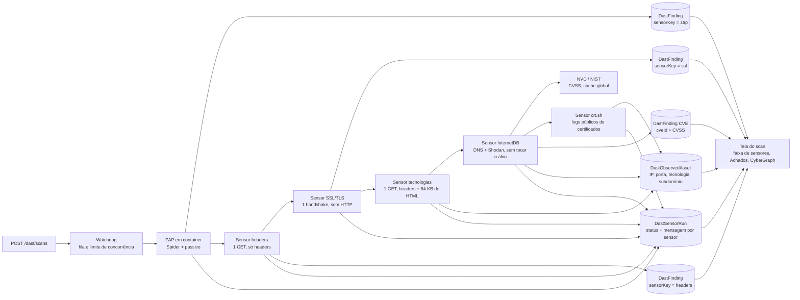
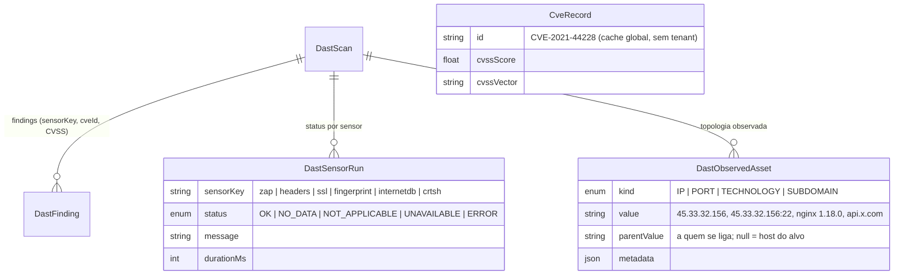

<!--
  O que faz: descreve o módulo Security Intelligence & Discovery — os sensores que descobrem a
  superfície exposta de um alvo e como isso chega ao CyberGraph.
  Por que existe: separa o que já roda do que é plano, com as regras que não se negociam.
  Quem consome: equipe do TCC, banca e agentes de código que vão implementar os próximos sensores.
-->

# Discovery — sensores passivos e superfície exposta

> **Estado em 2026-10-31.** Implementados: **ZAP**, **headers de segurança**, **certificado SSL/TLS**,
> **tecnologias (fingerprint)**, **IP, portas e CVEs (InternetDB + NVD)** e **subdomínios (crt.sh)**,
> todos disparados por **um único passo** na tela (a pessoa informa o alvo, marca a autorização e
> recebe tudo no fim). Planejado (🚧): divergência de exposição (`applicationId/companyId` no scan).
> Origem: spec "Sensores e Security Graph" (2026-10-29). Visual e interação: [`DESIGN.md`](DESIGN.md).
> Controles: [`SECURITY.md`](SECURITY.md).

## A ideia

O Vulnera olha o alvo **de fora para dentro** (outside-in): o que um atacante vê sem credencial.
Cada técnica de coleta é um **sensor** plugável. Todos rodam no mesmo job do scan, depois do ZAP, e
cada um devolve um **status explícito** — porque "sem dados" nunca pode aparecer como "seguro".



## Contrato de um sensor

`app/api/src/services/sensors/sensor.types.ts`

```ts
interface Sensor {
  key: "zap" | "headers" | "ssl" | "fingerprint" | "internetdb" | "crtsh";
  run(ctx: { targetUrl; simulated; signal; pulso }): Promise<{ status; message?; findings; assets? }>;
}
```

`assets` são **topologia, não achado** (IP, porta, tecnologia, subdomínio) e vão para
`DastObservedAsset`. `pulso` mantém o watchdog vivo em sensores lentos (a fila do NVD pode levar
minutos sem chave).

| Status | Quando | Na tela |
| --- | --- | --- |
| `OK` | mediu (com ou sem achados) | ponto verde + contagem de achados |
| `NO_DATA` | a fonte respondeu, mas sem informação | cinza |
| `NOT_APPLICABLE` | não se aplica ao alvo (ex.: fonte pública para IP privado) | cinza |
| `UNAVAILABLE` | o alvo ou o serviço externo não respondeu | âmbar + aviso no scan |
| `ERROR` | falha inesperada do próprio sensor | vermelho + aviso no scan |

Os achados de um sensor saem no **mesmo formato** dos do ZAP (`CandidateFinding`), com `pluginId` em
namespace (`sensor:<key>:<regra>`) e `sensorKey`. Por isso fingerprint, deduplicação, triagem,
promoção e comparação entre scans **não mudaram**.

## Regras que não se negociam

1. **Só passivo.** Nada de active scan, Nuclei, Nmap, envio de formulário ou login no alvo.
2. **Falha não vira dado simulado.** O scan conclui com aviso; o sensor fica `UNAVAILABLE`/`ERROR`.
3. **Simulado é rotulado.** No modo de demonstração o sensor não toca a rede e a mensagem diz isso.
4. **Achado automatizado nasce `NEW`.** Só vira `Vulnerability` por promoção humana (inclusive CVE
   potencial do InternetDB).
5. **Ownership antes de tudo.** `GET /dast/scans/:id/sensors` e `/assets` seguem a mesma regra de
   dono dos findings.
6. **Fora do escopo autorizado, só fonte pública.** Subdomínios e portas descobertos são listados,
   nunca acessados.

## Sensores

### ✅ ZAP (existente)

Spider + alertas passivos em container `vulnera-zap-<id>`. Registrado como sensor `zap` em
`DastSensorRun` para a faixa da tela mostrar as duas fontes lado a lado.

### ✅ Headers de segurança

`app/api/src/services/sensors/headers.sensor.ts` — um GET à URL do alvo, corpo descartado.

| Regra (`sensor:headers:…`) | Risco | CWE | Dispara quando |
| --- | --- | --- | --- |
| `csp-ausente` | Médio | 693 | sem `Content-Security-Policy` |
| `anti-clickjacking-ausente` | Médio | 1021 | sem `X-Frame-Options` **e** sem `frame-ancestors` na CSP |
| `hsts-ausente` | Baixo | 319 | HTTPS sem `Strict-Transport-Security` |
| `hsts-curto` | Baixo | 319 | `max-age` < 180 dias |
| `nosniff-ausente` | Baixo | 693 | `X-Content-Type-Options` ≠ `nosniff` |
| `referrer-policy-ausente` | Info | 200 | sem `Referrer-Policy` |
| `cookie-sem-httponly` | Baixo | 1004 | cookie sem `HttpOnly` (um achado por cookie) |
| `cookie-sem-secure` | Baixo | 614 | cookie sem `Secure` em HTTPS |
| `cookie-sem-samesite` | Info | 1275 | cookie sem `SameSite` |

Comportamento verificado:

| Situação | Resultado |
| --- | --- |
| Alvo responde | `OK`, achados conforme a tabela (contra o próprio Vulnera em `:8086`: `OK`, 0 achados) |
| Porta fechada / DNS / timeout (10 s) | `UNAVAILABLE` com a causa (`ECONNREFUSED`…), sem achado |
| Redirect para a mesma origem | segue, até 3 saltos |
| Redirect para outro host | **não segue**; avalia o próprio 30x |
| Scan simulado | nenhuma requisição; achados fixos rotulados "simulado" |

Limites conhecidos: mede só a página pedida (não segue login nem rotas internas). O ZAP passivo
também acusa CSP/anti-clickjacking — os dois aparecem, cada um com sua origem; a duplicidade de tema
é intencional para mostrar a fonte.

### ✅ Certificado SSL/TLS

`app/api/src/services/sensors/ssl.sensor.ts` — **um** handshake TLS com o host e a porta do endereço
autorizado, sem requisição HTTP; a conexão fecha logo depois. Aceita protocolos e cifras antigos **só
para conseguir medir** (com o mínimo padrão do Node, um servidor em TLS 1.0 viraria "indisponível" e
esconderia o achado) e lê a validade da cadeia de `socket.authorized`.

| Regra (`sensor:ssl:…`) | Risco | CWE | Dispara quando |
| --- | --- | --- | --- |
| `sem-https` | Médio | 319 | o endereço autorizado é `http://` (não tenta a 443 por conta própria) |
| `certificado-expirado` | Alto | 298 | passou de `valid_to` |
| `certificado-ainda-nao-valido` | Alto | 298 | `valid_from` no futuro |
| `certificado-expira-em-breve` | Baixo | 298 | menos de 30 dias (o título traz os dias) |
| `certificado-nao-confiavel` | Médio | 295 | cadeia não chega a uma AC confiável (autoassinado, intermediária faltando) |
| `certificado-nome-divergente` | Médio | 297 | o host não está no CN/SAN |
| `tls-obsoleto` | Médio | 327 | negociou SSLv3, TLS 1.0 ou 1.1 |
| `chave-fraca` | Médio | 326 | RSA com menos de 2048 bits (curva elíptica não entra) |

A mensagem do sensor resume o certificado (`CN · emissor · válido até AAAA-MM-DD (N dias) · protocolo
· cifra`) e aparece na faixa de sensores e no nó do **alvo** do CyberGraph.

Verificado contra servidores reais (badssl.com, serviço público feito para testar estes casos):

| Alvo | Resultado |
| --- | --- |
| `https://example.com/` | `OK`, sem achado, TLS 1.3 |
| `https://expired.badssl.com/` | `certificado-expirado` |
| `https://self-signed.badssl.com/` | `certificado-nao-confiavel` |
| `https://wrong.host.badssl.com/` | `certificado-nome-divergente` |
| `https://tls-v1-0.badssl.com:1010/` | `tls-obsoleto` |
| domínio inexistente | `UNAVAILABLE` "o domínio não foi encontrado no DNS…" |
| `http://localhost:8086/` | `OK` com `sem-https` |

### Mensagens de falha

`services/sensors/falhas.ts` traduz o código técnico em frase acionável e mantém o código entre
parênteses: `ENOTFOUND` → "o domínio não foi encontrado no DNS — confira se o endereço está certo",
`ECONNREFUSED` → "a porta do alvo recusou a conexão", `ETIMEDOUT` → "não respondeu dentro do tempo
limite", `EPROTO` → "o endereço não respondeu com TLS", e assim por diante. A falha de um sensor vira
aviso no scan ("Análise concluída com avisos") e cartão âmbar/vermelho na faixa de sensores.

### ✅ Tecnologias (fingerprint)

`app/api/src/services/sensors/fingerprint.sensor.ts` — um GET à URL do alvo (mesmas regras de
redirect do sensor de headers) e leitura de `Server`, `X-Powered-By`, `X-AspNet-Version`,
`X-Generator`, `X-Drupal-Cache`, nomes de cookie de sessão (`PHPSESSID`, `JSESSIONID`,
`laravel_session`…) e marcas nos primeiros 64 KB do HTML (`<meta name="generator">`, `wp-content`,
`__NEXT_DATA__`, `ng-version`). O comentário de SO entre parênteses (`nginx/1.18.0 (Ubuntu)`) é
ignorado.

Gera **só ativos** `TECHNOLOGY`, nenhum finding: "versão exposta em header" o ZAP passivo já acusa, e
repetir aqui contaria o mesmo problema duas vezes. `NO_DATA` quando a página não anuncia nada — e a
mensagem diz que isso é bom.

> Divergência com o plano anterior deste documento: ele previa reaproveitar a resposta do sensor de
> headers (sem requisição a mais) e gerar o finding "versão exposta". Ficou um GET próprio para os
> sensores continuarem independentes, e sem finding pelo motivo acima.

### ✅ IP, portas e CVEs (InternetDB + NVD)

`app/api/src/services/sensors/internetdb.sensor.ts` + `nvd-cve.service.ts`.

1. Resolve o DNS do alvo e escolhe o primeiro **IPv4 público** (a InternetDB não indexa IPv6).
2. `GET https://internetdb.shodan.io/<ip>` → portas, CPEs, hostnames reversos, tags e CVEs. **Nenhum
   pacote vai ao alvo**: é o que a Shodan já viu publicamente.
3. Cada CVE é enriquecida no **NVD (NIST)**:
   - primeiro **uma consulta por software com versão** (`virtualMatchString` com o CPE): Apache
     2.4.7 trouxe 126 CVEs com CVSS numa consulta de ~1 s;
   - o que sobrar vai por `cveId`, uma a uma, respeitando o limite (5 consultas/30 s sem chave → 6,5 s
     de intervalo; com `NVD_API_KEY`, 0,7 s) e um teto de 25 consultas por scan sem chave (200 com);
   - tudo fica no cache global `CveRecord` (CVE é dado público, sem tenant): 7 dias com CVSS, 1 dia sem.
4. CVSS preferido: v4.0 > v3.1 > v3.0 > v2, e dentro dela a métrica "Primary" do próprio NVD.

| O que vira | Onde |
| --- | --- |
| IP, portas, CPEs | `DastObservedAsset` (`IP`; `PORT` e `TECHNOLOGY` ligados ao IP) |
| Cada CVE | `DastFinding` com `pluginId = sensor:internetdb:CVE-…`, `cveId`, `cvssScore`, `cvssVersion`, `cvssVector`, CWE do NVD, descrição do NVD e link `nvd.nist.gov/vuln/detail/…` |

Risco pelo CVSS (faixas oficiais): ≥ 7 → **Alto** (9–10 aparece como "Crítica" no rótulo do CVSS),
4–6,9 → **Médio**, abaixo → **Baixo**; sem CVSS → **Informativo** (nunca infla risco desconhecido).
Toda CVE sai com confiança `Low`, título "— potencial · não validado", triagem `NEW` e a descrição
explica por quê: a Shodan deduz pela versão anunciada, backport de correção e IP compartilhado (CDN)
geram falso positivo.

| Situação | Status |
| --- | --- |
| IP público consultado | `OK` — "IP x · N portas (…) · M CVEs potenciais, K com dados do NVD" |
| Alvo só resolve para IP privado/local/IPv6 | `NOT_APPLICABLE` — "IP público indisponível… o restante do scan seguiu normalmente"; o IP aparece no grafo, sem portas/CVEs |
| InternetDB sem registro (404) | `NO_DATA` — "não significa que o IP esteja seguro" |
| DNS ou InternetDB falham | `UNAVAILABLE` com o motivo |
| NVD limita (403/429) ou cai | `OK`, as CVEs restantes ficam "CVSS pendente" e a mensagem diz por quê |

Licença: a InternetDB é gratuita para uso não comercial (ok para o TCC; uso comercial exige licença).

### ✅ Subdomínios (crt.sh)

`app/api/src/services/sensors/crtsh.sensor.ts` — `GET https://crt.sh/?q=%25.<domínio>&output=json&exclude=expired`.
Lê até 8 MB da resposta e extrai os `name_value` mesmo de JSON cortado; descarta curinga, o próprio
domínio e nomes de outros domínios; mostra até 50.

- Subdomínios viram ativos `SUBDOMAIN` e **nunca são acessados** — o escopo autorizado é só a URL.
- Nomes que sugerem ambiente interno (`dev`, `staging`, `hml`, `admin`, `vpn`, `jenkins`…, rótulo
  inteiro) viram um finding **Informativo** cada (`sensor:crtsh:subdominio-sensivel`, CWE-200).
- `NOT_APPLICABLE` sem requisição para IP, `localhost`, `host.docker.internal` e nomes internos.
- O crt.sh é instável (502 e conexão encerrada são comuns): timeout de 30 s, **uma** nova tentativa,
  depois `UNAVAILABLE` com o motivo — nunca "nenhum subdomínio".
- 🚧 Sem cache por domínio e sem a Public Suffix List: `app.exemplo.com` consulta `*.app.exemplo.com`,
  não sobe até `exemplo.com`.

## Modelo de dados



Migrations: `20261031000000_add_dast_sensor_runs` e `20261031120000_add_dast_discovery_assets_cve`.
`DastFinding.sensorKey` tem default `zap` e os campos de CVE são opcionais, então scans antigos
continuam corretos sem reprocessar.

> Divergência com a spec: ela previa `ObservedAsset` com `parentKey` e `DastFinding.assetKey`. Ficou
> `DastObservedAsset` com `parentValue` (o valor do pai: o IP de uma porta) e **sem** `assetKey` no
> finding — a CVE se liga ao IP no grafo pelo próprio `sensorKey/cveId`. Se um dia houver mais de um IP
> por scan, o `assetKey` passa a ser necessário.

🚧 Falta `DastScan.applicationId / companyId`, que habilita o **alerta de divergência de exposição**
(Application declarada interna, mas observada exposta).

## API

| Rota | Perfis | Devolve |
| --- | --- | --- |
| `GET /dast/scans/:id/findings` | PENTESTER dono, ADMIN | findings com `sensorKey` |
| `GET /dast/scans/:id/sensors` | PENTESTER dono, ADMIN | `{ sensorKey, status, message, startedAt, finishedAt, durationMs }[]` |
| `GET /dast/scans/:id/assets` | PENTESTER dono, ADMIN | `{ kind, value, parentValue, sensorKey, metadata }[]` |

Findings de CVE trazem também `cveId`, `cvssScore`, `cvssVersion` e `cvssVector` (null nos demais).

🚧 Planejadas na spec: `GET /dast/scans/:id/graph`, `GET /applications/:id/graph` (CLIENT só vê
`Vulnerability` promovida; outra empresa recebe 404) e `GET /dashboard/exposure`.

## Como verificar

```bash
npx jest --runInBand tests/unit/headers.sensor.test.ts tests/unit/ssl.sensor.test.ts tests/unit/nvd-cve.service.test.ts tests/unit/discovery.sensors.test.ts tests/integration/dast.test.ts
```

Verificado contra serviços reais em 2026-10-31 (script direto nos sensores, sem ZAP):

| Alvo | Resultado |
| --- | --- |
| `http://scanme.nmap.org/` — InternetDB + NVD | `OK` em 88 s sem chave: IP 45.33.32.156, portas 22/80/123/31337, 3 CPEs, **131 CVEs, todas com CVSS do NVD** (ex.: CVE-2021-44790 9,8 Alto; CVE-2020-1927 6,1 Médio) |
| idem, só por `cveId` (antes da consulta por CPE) | 25 com CVSS e 106 pendentes em 161 s — motivo da etapa por software |
| `http://scanme.nmap.org/` — fingerprint | `OK`: Apache 2.4.7 (header `Server`) |
| `http://scanme.nmap.org/` — crt.sh | `UNAVAILABLE` "o alvo encerrou a conexão" (crt.sh instável no momento) |
| `http://host.docker.internal:8086/` (scan real pela tela) | os 6 sensores gravados; IP `NOT_APPLICABLE` "IP público indisponível… o restante do scan seguiu normalmente"; crt.sh `NOT_APPLICABLE`; fingerprint `NO_DATA` |

O scan **completo** (com ZAP) contra um IP público não foi rodado: o único alvo autorizado deste
ambiente é o próprio Vulnera, que fica em rede privada.

Na tela: **DAST → Nova análise**, informe o alvo, marque a autorização e clique em **Iniciar análise**.
No fim, a página do scan mostra a faixa "Sensores deste scan" (com o resumo do certificado), os achados
de cada origem na aba Achados e no CyberGraph. O E2E `CG-08` em `app/web/e2e/cybergraph.spec.ts`
cobre o caminho com um scan simulado.

## Próximos passos

1. `applicationId/companyId` no scan e o alerta de divergência.
2. API de grafo por audiência e o CyberGraph consumindo `GET /dast/scans/:id/graph`.
3. Cache por domínio no crt.sh e Public Suffix List.
4. Cruzar a versão do fingerprint com o NVD (hoje só os CPEs da InternetDB viram CVE).
