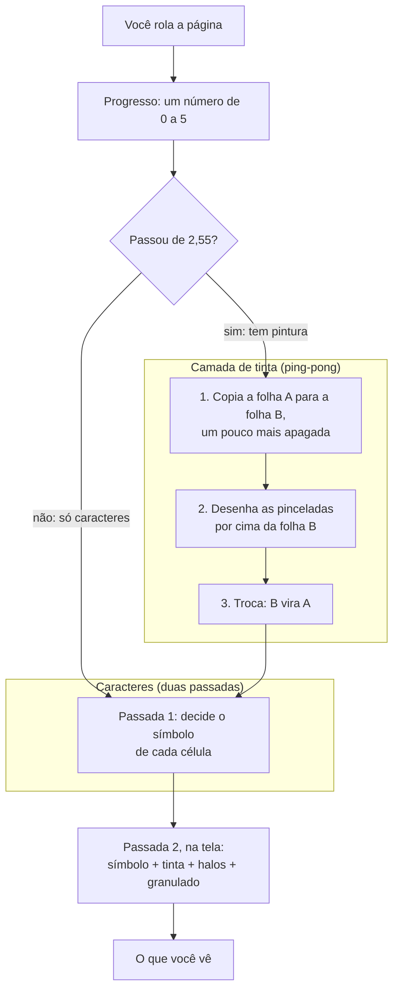

<!--
  O que faz: explica, em linguagem simples, como o fundo animado da landing é
  desenhado — caracteres ASCII nos primeiros atos e pintura nos últimos.
  Por que existe: a banca e os alunos iniciantes vão perguntar "como isso
  funciona?"; a resposta não pode exigir saber o que é um shader.
  Quem consome: Rafael (apresentação), banca, e quem for mexer em
  `app/web/src/components/landing/scene/` ou `app/web/src/three/`.
-->

# Como funciona o fundo da landing

> [!NOTE]
> Este texto é para quem **nunca** programou gráficos. O roteiro do que
> aparece em cada ato está em `docs/LANDING_NARRATIVA.md`; a decisão técnica,
> no ADR-054.

## A ideia em uma frase

O fundo é um desenho que o computador **refaz 60 vezes por segundo**. Enquanto
você rola a página, um número de 0 a 5 diz em que parte da história estamos, e
o desenho muda de acordo com ele.

No começo o fundo é feito de **letras e símbolos** (ASCII). Do meio em diante,
de **pinceladas**. A troca de um para o outro é a parte mais importante: é ali
que a página mostra a bagunça virando ordem.

## Quem faz o desenho

Quem desenha não é o processador comum (CPU), é a **placa de vídeo (GPU)**. A
GPU é ruim em fazer coisas complicadas uma de cada vez, mas ótima em fazer a
**mesma conta simples milhões de vezes ao mesmo tempo**. Um programa pequeno
que roda na GPU se chama **shader**.

Usamos a biblioteca **three.js** só para conversar com a GPU. Não há modelos
3D: tudo é desenhado em retângulos planos que cobrem a tela.

## Palavras que você vai ouvir

| Palavra | O que é, sem enrolar |
|---|---|
| **Shader** | Um programa pequeno que roda na placa de vídeo. Recebe um ponto da tela e responde "que cor vai aqui?". |
| **Célula** | Um quadradinho da grade de caracteres (12 × 18 pixels). Cada célula mostra um símbolo. |
| **Atlas** | Uma imagem com todos os símbolos lado a lado, como uma cartela de adesivos. A GPU recorta o símbolo que precisa. |
| **Partícula** | Um ponto que se move. Aqui, cada pincelada é uma partícula com um rabo. |
| **Campo de fluxo** | Um "mapa de vento": para cada lugar da tela, uma direção. A pincelada anda para onde o vento manda. |
| **Render target** | Uma folha de rascunho que fica na memória da placa de vídeo. Dá para desenhar nela sem mostrar na tela. |
| **Ping-pong** | Usar **duas** folhas de rascunho e alternar: lê de uma, escreve na outra, depois troca. |
| **Draw call** | Um pedido de desenho para a GPU. Poucos pedidos grandes são mais rápidos que muitos pedidos pequenos. |

## Parte 1 — o fundo de caracteres (atos 0, 1 e 2)

O jeito ingênuo seria perguntar, para **cada pixel** da tela: "que símbolo
está aqui, de que cor, e ele pisca?". Só que uma célula tem 216 pixels, e
todos eles dariam a mesma resposta. É repetir a mesma conta 216 vezes.

Por isso o desenho é feito em **duas passadas**:

1. **Passada das células.** A GPU desenha numa folha de rascunho minúscula,
   onde cada pontinho é uma célula inteira. Para cada uma ela decide: qual
   símbolo, qual cor, quão forte. São uns 6 mil pontinhos, não 1,3 milhão.
2. **Passada da tela.** Agora sim, pixel por pixel, mas o trabalho é fácil:
   olhar a folha de rascunho ("minha célula é um `@` vermelho"), recortar o
   `@` do atlas e pintar.

> [!TIP]
> É como montar um mosaico: primeiro você decide a cor de cada pastilha
> (poucas decisões), depois só cola as pastilhas (trabalho repetitivo e fácil).

## Parte 2 — a pintura (atos 3, 4 e 5)

A pintura são milhares de **pinceladas**. Cada uma é uma fitinha fina nas
pontas e mais larga no meio, que anda devagar e some depois de alguns segundos.

**Para onde ela anda?** Para onde o **campo de fluxo** mandar. O campo é uma
fórmula com senos e cossenos que desenha curvas largas e suaves. Perto de cada
grupo de falhas, o vento vira um redemoinho.

**Como a GPU sabe onde cada pincelada está?** Ela não guarda. Ela **calcula**:
"esta pincelada nasceu neste ponto há 1,2 segundo; seguindo o vento durante
1,2 segundo, ela está aqui". Como é uma conta, e não uma lista guardada, não
há nada para perder quando a janela muda de tamanho.

**Por que parece tinta, e não risquinhos?** Por causa da **camada de tinta**:

1. Existe uma folha de rascunho do tamanho da tela.
2. A cada quadro, o que estava nela é copiado para **outra** folha, um pouco
   mais apagado (some 8,5%).
3. As pinceladas do quadro atual são desenhadas por cima.
4. As duas folhas trocam de papel. Isso é o **ping-pong**.

O resultado é um rastro curto atrás de cada pincelada, como tinta fresca.

Três detalhes fazem a tinta parecer tinta de verdade:

- **Massas.** Algumas pinceladas são bem largas e quase transparentes. Elas
  ficam por baixo e pintam o fundo, como a primeira demão de um quadro.
- **Cerdas.** Um pincel é feito de fios, e cada fio leva uma quantidade
  diferente de tinta. Por isso a pincelada tem risquinhos, e a ponta final
  falha, como um pincel que está secando.
- **Relevo.** Onde há mais tinta acumulada, o desenho trata como se fosse mais
  alto. A beirada virada para a luz fica mais clara e a outra, mais escura.
  Além disso, ao copiar de uma folha para a outra, a tinta "escorre" um
  pouquinho para os lados: duas pinceladas que se cruzam se misturam.

> [!IMPORTANT]
> **Por que duas folhas, e não uma só?** Por dois motivos. A GPU não consegue
> ler e escrever a mesma folha ao mesmo tempo. E, apagando "um pouquinho por
> vez" numa folha só, os valores muito pequenos nunca chegam a zero: sobra uma
> mancha fantasma para sempre. Com duas folhas dá para apagar de verdade.

## Parte 3 — a virada (ato 3)

A virada usa as duas partes ao mesmo tempo. Uma onda atravessa a tela da
esquerda para a direita. Onde ela passa:

- o símbolo da célula vai ficando **transparente**;
- uma pincelada **nasce no mesmo lugar**.

As falhas (`%`, `#`, `×`, `@`) viram pinceladas **da mesma cor** e viajam até o
grupo da sua gravidade, nas laterais da tela, onde ficam girando.

O truque para "nascer no mesmo lugar" é simples: as duas partes usam a
**mesma conta de sorteio** para escolher quais células têm falha. Elas nunca
combinam nada entre si; chegam à mesma resposta sozinhas.

## O caminho de um quadro

Depois que a virada termina (progresso acima de 3,45) todas as células estão
apagadas, e a passada 1 nem roda.

## E se o computador não aguentar?

| Situação | O que acontece |
|---|---|
| Computador lento | A pintura percebe que os quadros estão atrasando e **baixa a própria qualidade**: menos resolução e menos pinceladas. |
| Celular (tela com menos de 768 px) | Não há cena animada. Fica um **pôster** de caracteres, parado, que muda de ato com um esmaecer. |
| "Reduzir animações" ligado (no sistema ou no menu de acessibilidade) | O mesmo pôster. Nada se move. |
| "Alto contraste" ligado | Fundo liso, sem nada. Quem pediu contraste máximo recebe contraste máximo. |
| Navegador sem WebGL2, ou erro ao baixar a cena | O pôster. A página funciona igual. |
| Aba escondida ou fundo fora da tela | O desenho **para**, para não gastar bateria. |

> [!NOTE]
> O fundo é **decoração**. Ele não mostra dado real: as falhas, as
> gravidades e as correções são sorteadas. Todo o conteúdo da página está no
> HTML, e um leitor de tela nem fica sabendo que o fundo existe.

## Onde está o código

Arquivos, para quem quiser abrir

| Arquivo (`app/web/src/`) | Papel |
|---|---|
| `components/landing/scene/config.ts` | Todos os números: tamanhos, velocidades, faixas de cada ato. |
| `components/landing/scene/shaders.ts` | As duas passadas dos caracteres e a composição final. |
| `components/landing/scene/pintura.ts` | As pinceladas (o shader e a montagem). |
| `components/landing/scene/pintura-logica.ts` | As regras da pintura em TypeScript puro, com testes. |
| `components/landing/scene/use-landing-scene.ts` | Liga tudo: scroll, loop, tema, descarte. |
| `components/landing/scene/landing-poster.tsx` | O pôster de caracteres (plano B). |
| `three/acumulacao.ts` | A camada de tinta (ping-pong). |
| `three/grade-celulas.ts` · `three/ascii.ts` | A folha das células e o atlas de símbolos. |
| `three/gate.ts` | Decide se a cena pode montar, antes de baixar o three.js. |

