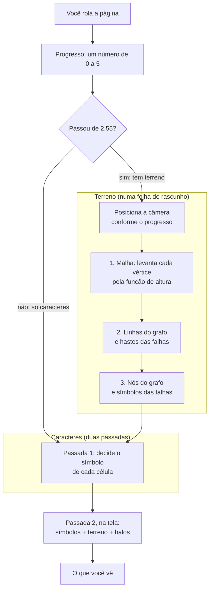

<!--
  O que faz: explica, em linguagem simples, como o fundo animado da landing é
  desenhado — caracteres ASCII nos primeiros atos e um terreno 3D nos últimos.
  Por que existe: a banca e os alunos iniciantes vão perguntar "como isso
  funciona?"; a resposta não pode exigir saber o que é um shader.
  Quem consome: Rafael (apresentação), banca, e quem for mexer em
  `app/web/src/components/landing/scene/` ou `app/web/src/three/`.
-->

# Como funciona o fundo da landing

> [!NOTE]
> Este texto é para quem **nunca** programou gráficos. O roteiro do que
> aparece em cada ato está em `docs/LANDING_NARRATIVA.md`; a decisão técnica,
> no ADR-055.

## A ideia em uma frase

O fundo é um desenho que o computador **refaz 60 vezes por segundo**. Enquanto
você rola a página, um número de 0 a 5 diz em que parte da história estamos, e
o desenho muda de acordo com ele.

No começo o fundo é feito de **letras e símbolos** (ASCII). Do meio em diante,
a mesma grade de letras **ganha altura** e vira um terreno em 3D, com montes.
A troca de um para o outro é a parte mais importante: é ali que a página
mostra a bagunça virando ordem.

## Quem faz o desenho

Quem desenha não é o processador comum (CPU), é a **placa de vídeo (GPU)**. A
GPU é ruim em fazer coisas complicadas uma de cada vez, mas ótima em fazer a
**mesma conta simples milhões de vezes ao mesmo tempo**. Um programa pequeno
que roda na GPU se chama **shader**.

Usamos a biblioteca **three.js** para conversar com a GPU.

## Palavras que você vai ouvir

| Palavra | O que é, sem enrolar |
|---|---|
| **Shader** | Um programa pequeno que roda na placa de vídeo. |
| **Célula** | Um quadradinho da grade de caracteres (12 × 18 pixels). Cada célula mostra um símbolo. |
| **Atlas** | Uma imagem com todos os símbolos lado a lado, como uma cartela de adesivos. A GPU recorta o símbolo que precisa. |
| **Malha** | Uma rede de pontinhos ligados por triângulos. Mexendo nos pontinhos, a rede vira um relevo. |
| **Vértice** | Cada pontinho da malha. |
| **Câmera** | O "olho" da cena 3D. O que está perto dela aparece maior, como na vida real. |
| **Função de altura** | Uma fórmula: você dá um lugar do chão e ela responde "aqui a altura é tanto". |
| **Render target** | Uma folha de rascunho na memória da placa de vídeo. Dá para desenhar nela sem mostrar na tela. |
| **Draw call** | Um pedido de desenho para a GPU. Poucos pedidos grandes são mais rápidos que muitos pequenos. |

## Parte 1 — o fundo de caracteres (atos 0, 1 e 2)

O jeito ingênuo seria perguntar, para **cada pixel** da tela: "que símbolo
está aqui, de que cor, e ele pisca?". Só que uma célula tem 216 pixels, e
todos eles dariam a mesma resposta. É repetir a mesma conta 216 vezes.

Por isso o desenho é feito em **duas passadas**:

1. **Passada das células.** A GPU desenha numa folha de rascunho minúscula,
   onde cada pontinho é uma célula inteira. Para cada uma ela decide: qual
   símbolo, qual cor, quão forte. São uns 6 mil pontinhos, não 1,3 milhão.
2. **Passada da tela.** Agora sim, pixel por pixel, mas o trabalho é fácil:
   olhar a folha de rascunho ("minha célula é um `@` vermelho"), recortar o
   `@` do atlas e pintar.

> [!TIP]
> É como montar um mosaico: primeiro você decide a cor de cada pastilha
> (poucas decisões), depois só cola as pastilhas (trabalho repetitivo e fácil).

## Parte 2 — o terreno (atos 3, 4 e 5)

### O truque do encaixe

O terreno é um "chão" 3D: uma malha plana, deitada. No começo a câmera olha
esse chão **de frente**, na distância exata em que ele tem o tamanho da tela.
Resultado: cada quadradinho do chão fica em cima de um símbolo da página, e
ninguém percebe que já existe uma cena 3D ali.

Aí, conforme você rola, a câmera **inclina**. O chão que era a página vira uma
paisagem vista de cima e de lado.

> [!IMPORTANT]
> A câmera só se mexe porque **você** está rolando. Parou de rolar, ela para.
> E ela só gira: nada vem na sua direção.

### De onde vem o relevo

Não existe um "desenho" do relevo guardado em lugar nenhum. Existe uma
**função de altura**: uma fórmula que recebe um ponto do chão e devolve a
altura dele. A cada quadro, a GPU pergunta essa fórmula para cada vértice da
malha e levanta o vértice até lá.

A fórmula soma três coisas:

1. uma **ondulação calma**, que respira devagar;
2. **quatro montes**, um para cada gravidade de falha. Quanto mais grave, mais
   alto. Eles têm cristas e ravinas para não parecerem um sino liso;
3. as **selas**, uma faixa de terra que liga os dois montes de cada lado.

Como é uma fórmula, mudar o relevo é só mudar um número: "o monte da crítica
agora tem 30% da altura".

### Luz e sombra

- **Luz.** Para cada vértice, a GPU descobre para que lado a encosta está
  virada e compara com o lado de onde vem a luz. Virada para a luz, clara.
  De costas, escura.
- **Sombra.** A partir de cada ponto, a GPU "anda" alguns passos em direção à
  luz. Se no caminho houver um monte mais alto, o ponto está na sombra.
- **Contorno.** A crista que está de lado para a câmera ganha um brilho fino.
  É o que separa o monte do fundo.
- **Neblina.** O que está longe vai ficando da cor do fundo, até sumir.

### As linhas

As linhas do terreno não são fios de verdade. São pintadas na superfície:

- a **grade** é a herança das células (cada quadro vale duas células);
- as **curvas de nível** são as linhas que dão a volta nos montes, como num
  mapa de relevo: cada uma marca uma altitude.

### As falhas

Cada falha é um **cartaz**: um retângulo pequeno, sempre virado para a câmera,
que mostra o símbolo da falha recortado do **mesmo atlas** da Parte 1. Ele
fica preso ao chão por uma haste fina.

## Parte 3 — a virada (ato 3)

A virada usa as duas partes ao mesmo tempo. Uma onda atravessa a tela da
esquerda para a direita. Onde ela passa:

- o símbolo da célula vai ficando **transparente**;
- o terreno **aparece no mesmo lugar**.

As falhas (`%`, `#`, `×`, `@`) se erguem da página e **saltam** para o monte
da sua gravidade, nas laterais da tela.

O truque para "sair do mesmo lugar" é simples: as duas partes usam a **mesma
conta de sorteio** para escolher quais células têm falha. Elas nunca combinam
nada entre si; chegam à mesma resposta sozinhas.

## Parte 4 — corrigir (ato 4)

Do monte mais alto para o mais baixo:

1. uma **faixa verde desce a encosta**, do cume até a base. O que ela já
   passou fica verde;
2. **só depois** o monte afunda;
3. os símbolos das falhas viram `✓`, sobem e somem.

O monte de gravidade baixa não é corrigido, e o de média só pela metade. É de
propósito: num programa de segurança real, você prioriza o que é mais grave e
aceita conviver com um pouco de risco.

## Parte 5 — o clique

Clicar no fundo dispara um **ping**, como o de um radar ou sonar: um anel que
se abre a partir do ponto clicado. O que o anel toca responde:

- nos atos de caracteres, as **falhas escondidas aparecem** por um instante,
  com o símbolo e a cor da gravidade. Você está "escaneando" aquele pedaço,
  que é o que o Vulnera faz;
- no terreno, o anel corre pelo relevo como uma **linha de luz**, subindo e
  descendo as encostas, e os símbolos e os nós por onde ele passa piscam.

A conta é a mesma nos dois: para cada ponto, "a que distância estou do
clique, e a frente do anel já chegou aqui?". No terreno, antes de fazer essa
conta, o ponto clicado na tela é **projetado** no chão 3D: traça-se uma linha
da câmera, passando pelo cursor, até ela tocar o chão.

## Parte 6 — o grafo e o fim da página

Um **grafo** é um desenho de "o que está ligado a quê": bolinhas (os **nós**)
e linhas entre elas (as **arestas**). No fundo ele aparece de dois jeitos:

- **Em cima de cada monte** flutua um nó. Dele sai uma linha para cada falha
  daquele monte. Quando a falha é corrigida, a linha se solta.
- **No fim da página**, depois dos planos, uma **rede** de nós verdes nasce
  sobre a planície e vai se espalhando conforme você rola. É a ideia de que o
  sistema, agora organizado, está sendo vigiado.

Como a GPU não guarda nada, ela precisa descobrir sozinha quem se liga a quem.
O truque: os nós da rede ficam numa grade invisível, e cada um só pode se
ligar aos vizinhos da direita, de trás e da diagonal. Assim os dois lados da
linha chegam à mesma resposta sem procurar.

Também é aqui que o fundo ganha **vida própria**. Até a página parada tem
coisa se mexendo: pontinhos de luz correndo pelas linhas, anéis saindo dos
montes como um sonar, uma faixa de luz varrendo o chão, e os símbolos
balançando. A **câmera**, não: ela continua só obedecendo à rolagem. No fim,
ela dá uma voltinha e abaixa, e o horizonte clareia como um amanhecer.

## O caminho de um quadro

Depois que a virada termina (progresso acima de 3,45) todas as células estão
apagadas, e a passada 1 nem roda.

## E se o computador não aguentar?

| Situação | O que acontece |
|---|---|
| Computador lento | O terreno percebe que os quadros estão atrasando e **baixa a própria qualidade**: menos resolução e malha com menos vértices. |
| Celular (tela com menos de 768 px) | Não há cena animada. Fica um **pôster** de caracteres, parado, que muda de ato com um esmaecer. |
| "Reduzir animações" ligado (no sistema ou no menu de acessibilidade) | O mesmo pôster. Nada se move, e a câmera não existe. |
| "Alto contraste" ligado | Fundo liso, sem nada. Quem pediu contraste máximo recebe contraste máximo. |
| Navegador sem WebGL2, ou erro ao baixar a cena | O pôster. A página funciona igual. |
| Aba escondida ou fundo fora da tela | O desenho **para**, para não gastar bateria. |

> [!NOTE]
> O fundo é **decoração**. Ele não mostra dado real: as falhas, as
> gravidades e as correções são sorteadas. Todo o conteúdo da página está no
> HTML, e um leitor de tela nem fica sabendo que o fundo existe.

## Onde está o código

Arquivos, para quem quiser abrir

| Arquivo (`app/web/src/`) | Papel |
|---|---|
| `components/landing/scene/config.ts` | Todos os números: tamanhos, alturas dos montes, faixas de cada ato. |
| `components/landing/scene/shaders.ts` | As duas passadas dos caracteres e a composição final. |
| `components/landing/scene/terreno-shaders.ts` | Os shaders do terreno: função de altura, luz, sombra, linhas, falhas. |
| `components/landing/scene/terreno.ts` | Monta o terreno: câmera, malha, folha de rascunho, qualidade. |
| `components/landing/scene/terreno-logica.ts` | As regras do terreno em TypeScript puro, com testes. |
| `components/landing/scene/use-landing-scene.ts` | Liga tudo: scroll, loop, tema, descarte. |
| `components/landing/scene/landing-poster.tsx` | O pôster de caracteres (plano B). |
| `three/grade-celulas.ts` · `three/ascii.ts` | A folha das células e o atlas de símbolos. |
| `three/pings.ts` | O clique no fundo (ping de scanner). |
| `three/gate.ts` | Decide se a cena pode montar, antes de baixar o three.js. |

