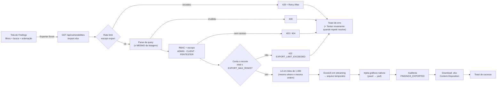
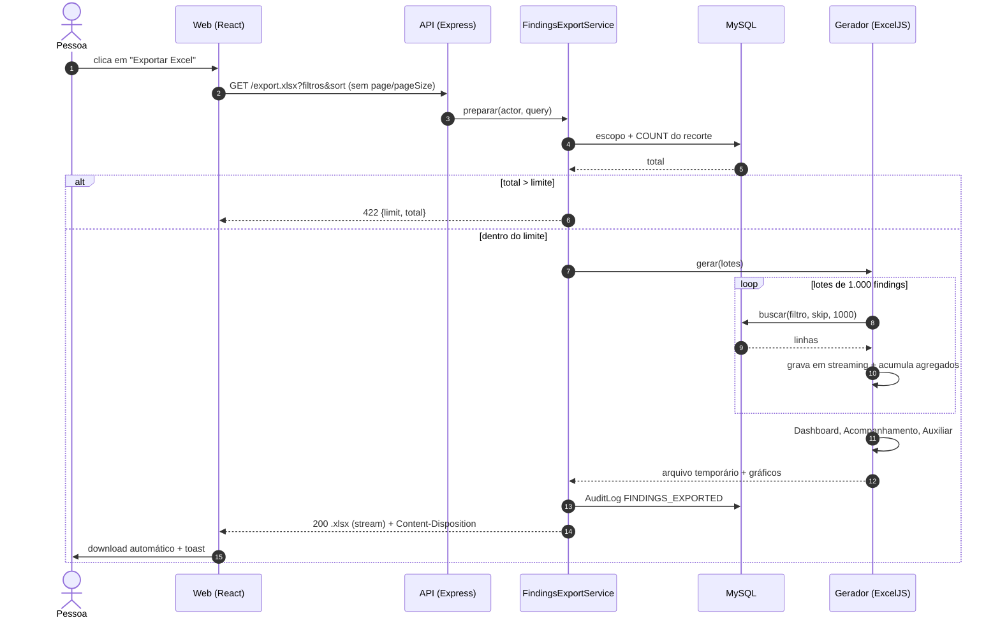
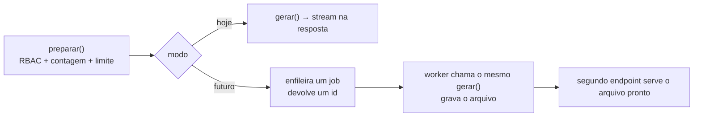

<!-- Guia da exportação Excel de findings: uso, limites, decisões, segurança e validação; consumido por quem usa o produto, por quem o mantém e pela banca. -->

# Exportação Excel de findings

> [!NOTE]
> O botão **Exportar Excel** baixa um `.xlsx` formatado com o **mesmo recorte que a
> tabela mostra** — filtros, busca e ordenação incluídos, não só a página visível.
> O arquivo é montado no **servidor**, respeitando o seu perfil e a sua empresa.
> O CSV continua existindo, ao lado, para BI e importação.

Decisão técnica: [ADR-047](Vulnera/07-Decisoes/ADR-047%20-%20Exportacao%20Excel%20gerada%20no%20servidor.md).
Sintaxe de busca e filtros: [FINDINGS_QUERY.md](FINDINGS_QUERY.md).

---

## 1. Como usar

| Onde | Quem vê | O que exporta |
| --- | --- | --- |
| Página **Findings** (`/findings`) | ADMIN e PENTESTER | O recorte atual. Sem filtro: tudo o que o perfil pode ver. |
| Aba **Findings** de um projeto | ADMIN, PENTESTER e **CLIENT** | O recorte atual **dentro daquele projeto**. |

1. Aplique os filtros, a busca e a ordenação que quiser.
2. Clique em **Exportar Excel**. O botão mostra um spinner enquanto o arquivo é gerado.
3. O download começa sozinho e um aviso confirma, com o nome do arquivo.

O nome do arquivo é `findings_<escopo>_<AAAA-MM-DD_HHmm>.xlsx` (hora de São Paulo):

| `<escopo>` | Quando |
| --- | --- |
| `todos` | nenhum filtro aplicado |
| `filtrado` | há filtro, busca ou intervalo de datas |
| o nome do projeto, em minúsculas e sem acento | o filtro pede **um** projeto (por exemplo, a aba do projeto) |

### Estados do botão

| Situação | O que a pessoa vê |
| --- | --- |
| Lista ainda carregando | Botão desabilitado |
| Recorte com **0** findings | Botão desabilitado e o aviso **"Nenhum finding para exportar"** ao lado |
| Gerando | Spinner, botão ocupado; novos cliques são ignorados |
| Sucesso | Download automático + aviso "Planilha exportada" |
| Falha que repetir resolve | Aviso de erro com **Tentar novamente** (reenvia o recorte do clique original) |
| Falha sem remédio (limite, permissão) | Aviso de erro **sem** o botão — repetir não ajudaria |

---

## 2. O que vem no arquivo

| Aba | Conteúdo |
| --- | --- |
| **Resumo** | Quando e por quem foi gerado, perfil, **data de referência**, total exportado, **filtros aplicados** (em português) e as regras de leitura. |
| **Findings** | Uma linha por finding, 23 colunas: ID, título, severidade, status, ativo (aplicação), projeto, empresa, OWASP, CVSS, VRS e prioridade, SLA, aceite de risco, responsável, origem, **CWE**, datas de detecção e atualização, descrição, impacto e recomendação. Cabeçalho congelado, autofiltro e zebra. |
| **Dashboard** | Cartões (total, por severidade, abertos × resolvidos, % e idade média dos abertos) e **4 gráficos nativos do Excel**: severidade, status, top 10 ativos e evolução no tempo. Cabe numa página A4 paisagem. |
| **Acompanhamento** | Uma linha por finding para controlar a correção. **Células amarelas são suas** (responsável, status, prazo, resolução, prioridade, comentários); as demais são calculadas e protegidas. Dias em aberto e situação do SLA com cores. |
| **Auxiliar** *(oculta)* | Apoio do ranking de ativos e da evolução no tempo. |

> [!TIP]
> Os números do Dashboard são **fórmulas** sobre a aba Findings: se você editar os
> dados, eles se recalculam. Toda fórmula também leva o resultado gravado, então o
> arquivo aparece certo em visualizadores que não recalculam (prévia do e-mail, Excel Online).

Como "aberto" e "resolvido" são contados

| Status no sistema | Rótulo no arquivo | Grupo no Dashboard |
| --- | --- | --- |
| `OPEN` | Aberto | **Aberto** |
| `IN_PROGRESS` | Em andamento | **Aberto** |
| `FIXED` | Corrigido | **Resolvido** |
| `CLOSED` | Fechado | **Resolvido** |

Aceite de risco vigente **não** é um status: o finding continua contando como aberto e a coluna "Aceite de risco" mostra *Sim*.

Como o Acompanhamento é pré-preenchido

| Coluna | De onde vem |
| --- | --- |
| Responsável | O responsável do finding, quando há |
| Status de remediação | O status atual do finding |
| Prazo (SLA) | O prazo efetivo do SLA, quando há (`slaDueAt`) |
| Data de resolução | A primeira transição para *Corrigido*, lida do histórico de auditoria. **Vazia** quando o finding resolvido não tem esse registro — nada é inventado. |
| Prioridade | A faixa do VRS (Imediato · Urgente · Planejado · Monitorar) |

**Dias em aberto** = (data de resolução, ou a data de referência) − data de detecção, em dias corridos.
**Situação do SLA**: *Sem prazo* · *No prazo* · *Vencendo* (faltam até N dias; N é a célula
"Alerta de vencimento", padrão 7) · *Vencido* · *Resolvido s/ data*.

A proteção da aba é sem senha e existe para evitar o clique acidental nas fórmulas. Ela
**impede ordenar** a tabela (o Excel recusa ordenar com células bloqueadas); use os filtros.

---

## 3. Como funciona

**Dois pontos que importam:**

- **Uma única definição de filtro.** O parse da query (`utils/vulnerability-query.util.ts`) e o escopo de
  acesso (`VulnerabilityService.montarFiltro`) são os mesmos da listagem, e a leitura usa `repository.buscar`
  — o mesmo `where`, a mesma ordenação (inclusive severidade via SQL). Não existe um segundo construtor de
  filtro que pudesse divergir da tela. `page` e `pageSize` são ignorados: exportar é o recorte inteiro.
- **Nada vai ao cliente antes de o arquivo estar completo.** O gerador escreve num arquivo temporário (o
  `yauzl` precisa de acesso aleatório para costurar os gráficos). Por isso falha na geração vira um status
  HTTP honesto — nunca um download "200" que termina truncado.

---

## 4. Limites e configuração

| Variável (`app/api/.env.example`) | Padrão | Efeito |
| --- | --- | --- |
| `EXPORT_MAX_ROWS` | `50000` | Teto de linhas por arquivo. Acima disso: `422 EXPORT_LIMIT_EXCEEDED` com `limit` e `total`. Valor inválido cai no padrão, nunca em "sem limite". |
| `RATE_LIMIT_EXPORT_PER_MINUTE` | `6` | Escopo `export` do rate limit, **por usuário**, com rajada de 2. Ver [RATE_LIMITING.md](RATE_LIMITING.md). |

| Resposta da API | Mensagem na tela | "Tentar novamente"? |
| --- | --- | --- |
| `422` limite excedido | "O recorte tem 63.000 findings e o limite por exportação é 50.000. Aplique mais filtros…" | não |
| `429` rate limit | "Muitas exportações seguidas — aguarde N segundos" | sim |
| `403` / `404` | "Sem acesso a este recorte" | não |
| `400` | "Filtro inválido" | não |
| `409` os dados mudaram durante a geração | "Os dados mudaram" | sim |
| rede, `5xx` | "Não foi possível exportar" | sim |

> [!IMPORTANT]
> O servidor expõe `Content-Disposition` e `Retry-After` via CORS (`exposedHeaders`). Sem isso o
> navegador esconde os headers: o arquivo perde o escopo no nome e a mensagem de rate limit perde os
> segundos. O E2E detecta a regressão.

### Desempenho medido

| Cenário | Resultado |
| --- | --- |
| Volumes típicos (centenas de linhas) | ≈ 0,3 s para gerar |
| **50.000 linhas** pela rota real | `200`, arquivo de **10,5 MB**, 50.000 linhas, **+145–170 MB** de memória sobre a base do processo de teste |
| Gerador isolado, 50.000 linhas | 17–22 s numa máquina livre; **28–51 s** na máquina de desenvolvimento, disputada por outros processos |
| Pior atraso do event loop durante a geração | **1,7 s** (p99 311 ms) — o gerador cede o controle a cada 500 linhas |

> [!WARNING]
> Os tempos de parede da máquina de desenvolvimento variaram 2× entre execuções idênticas (VS Code, Snyk e
> Docker disputando CPU). Trate o gerador como **~1.500–3.000 linhas/s** e, no limite de 50.000,
> espere **de dezenas de segundos a alguns minutos** de espera na tela. Não foi medido no Render Free.
> Se isso for incômodo, reduza `EXPORT_MAX_ROWS` ou implemente o modo assíncrono (seção 8).

---

## 5. Decisões

### A biblioteca

O ExcelJS **não cria gráficos**. Nenhuma biblioteca Node única atendeu a todo o requisito, então comparamos
as alternativas com uma prova de conceito (50.000 linhas, abertas no LibreOffice):

| Critério | ExcelJS em streaming | **ExcelJS + injeção de gráfico (escolhida)** | XlsxWriter (Python) |
| --- | --- | --- | --- |
| Gráfico nativo | não | **sim**, XML escrito por nós | sim, API nativa |
| Streaming, formatação condicional, validação, proteção, nomes, impressão | sim | **sim** | sim |
| `quotePrefix` | ignorado em silêncio | ignorado (usamos formato texto) | nativo |
| Infra | Node puro | **Node puro** (+ `yazl` e `yauzl`) | Python na API e no CI |

Escolhemos Node puro para **não acrescentar uma segunda linguagem** à API. O custo: manter o XML dos
gráficos (`utils/findings-xlsx/graficos.ts`) e validar a compatibilidade — ver a seção 7.

### Outras decisões

Fórmulas portáveis, data de referência, top 10 e valor em cache

- **Só fórmulas que funcionam no Excel, no Excel Online e no LibreOffice** (`COUNTIF(S)`, `SUMPRODUCT`,
  `LARGE`, `INDEX/MATCH`, `IF`). Nada de `UNIQUE`, `FILTER`, `LET` ou `LAMBDA`. Os intervalos são
  **nomes definidos** (`f_Sev`, `f_Status`…), legíveis e ajustáveis num só lugar.
- **Data de referência fixa.** Toda idade e todo SLA apontam para **uma célula** do Resumo, com a data da
  geração como **valor**. `TODAY()` é volátil: o mesmo arquivo mostraria números diferentes a cada dia e o
  do dia da geração nunca mais seria reproduzível. Para acompanhamento vivo, troque a célula por `=HOJE()`.
  Dias são **corridos**.
- **Top 10 de ativos sem `UNIQUE`.** A aba Auxiliar lista os **50 ativos mais frequentes** (nomes como
  valor); contagem, desempate e ranking são fórmulas. Trade-off: se você **renomear** um ativo na aba
  Findings, o novo nome não entra no ranking. A contagem usa `SUMPRODUCT(--(f_Ativo=nome))` e não `COUNTIF`,
  porque `COUNTIF` trata `*`, `?` e `~` como curingas e nome de aplicação é texto livre.
- **Todo resultado de fórmula é gravado em cache.** O LibreOffice e as prévias **não recalculam** um arquivo
  que traz o valor (medido). Sem cache, apareceria 0 ou vazio.
- **Acompanhamento com ID e título como valor**, não fórmula: `INDEX/MATCH` em 50 mil por 50 mil linhas
  seriam ~2,5 bilhões de comparações, e `=Findings!A2` quebraria no primeiro filtro da aba de dados.

Por que o servidor, se o PDF e o CSV são gerados no navegador

O [ADR-003](Vulnera/07-Decisoes/ADR-003%20-%20PDF%20gerado%20no%20cliente.md) manda gerar PDF no cliente.
O CSV segue essa linha (pagina a listagem e monta uma string, até 10.000 linhas). O Excel não cabe nela:
abas, fórmulas com cache, gráficos nativos, proteção e impressão exigem um pacote OOXML inteiro, e o
limite precisa ser do produto, com erro claro, não da memória de uma aba. A exportação é uma **leitura
autenticada em massa**, então o servidor também é onde cabe auditá-la.

---

## 6. Segurança

| Risco | Como é tratado |
| --- | --- |
| **Vazamento entre empresas** | O escopo é imposto no servidor pelo mesmo caminho da listagem. `companyId` de quem não é ADMIN é **descartado**. Projeto de outra empresa → `403`. Testado nos dois sentidos, inclusive manipulando parâmetros. |
| **Nome de filtro que revela outro tenant** | Os nomes na aba Resumo só são resolvidos para ids com finding **dentro do escopo**. Id fora dele aparece **cru**, como o usuário o enviou. |
| **Injeção de fórmula** | Todo texto é gravado como **string**, nunca como fórmula. Valor que começa com `=`, `+`, `-`, `@`, TAB, CR ou LF recebe o **formato Texto** (`@`): o dado fica **intacto** (sem aspa visível) e editar a célula não a transforma em fórmula. Vale para título, ativo, projeto, responsável e até para o nome do ativo no ranking. |
| **Caracteres que corrompem o arquivo** | Controles ilegais em XML e substitutos UTF-16 soltos são **removidos**; `CRLF`/`CR` viram `LF` (o do Excel). |
| **Limite de 32.767 caracteres por célula** | Texto acima de 32.700 é cortado com o marcador explícito `[… truncado: N caracteres omitidos]`. Nunca em silêncio; a contagem vai para a auditoria. |
| **Header HTTP** | O `<escopo>` do nome só carrega `a-z0-9-` (slug); `Content-Type` correto, `Cache-Control: no-store`, `X-Content-Type-Options: nosniff`. O front saneia de novo o nome que recebe. |
| **Dados além da tela** | Só o que o detalhe do finding já mostra àquele perfil. |
| **Rastro** | `FINDINGS_EXPORTED` no AuditLog: quem, quando, filtros, quantidade, campos truncados. Gravado **antes** de entregar — sem trilha, sem arquivo. Recusas (400/403/404/422) não geram trilha. |
| **Abuso** | Escopo `export` do rate limit, por usuário. |

> [!WARNING]
> O formato Texto não protege quem **salva uma aba como CSV e reabre**. É um limite do CSV, que nenhum
> `.xlsx` consegue impedir.

---

## 7. Validação

| Verificação | Resultado |
| --- | --- |
| Testes unitários (texto, fuso, agregados, filtros, config) | 48 |
| Integração contra o MySQL, **lendo o `.xlsx` de volta**: filtro, busca, ordenação, contagem = listagem, Dashboard = Findings, injeção, truncamento, nulos, vazio, 1.250 findings em 2 lotes, RBAC/tenancy, CORS, auditoria | 25 + 4 (limite) + 1 (rate limit) |
| Front (Vitest): botão, estados, retry, mensagens de erro, toast | 30 |
| **E2E no Chrome real**, contra a stack Docker: download cross-origin com o nome do servidor, contagem = tela, PENTESTER, CLIENT no projeto, falha de rede e retry | 5, repetido 3× |
| Teste de mutação nos guardas (descarte de `companyId`, formato Texto, paginação, clique duplo) | os testes falham quando o guarda é quebrado |
| **Paridade de recálculo no LibreOffice**: valores em cache × recálculo forçado, todas as abas, 3 arquivos reais + 1 sintético | **0 diferenças**; o controle com cache adulterado detectou `999 → 300` |
| Pacote lido por um segundo parser (`openpyxl`): XML bem-formado, relacionamentos e tipos íntegros, gráficos, validações, proteção | sem avisos |
| Inspeção visual (LibreOffice → PDF → imagem) de todas as abas, com dados reais dos três perfis | conferida |

Capturas da interface e da planilha: [evidencias/excel-export](evidencias/excel-export/README.md).

> [!CAUTION]
> **Não validado:** a abertura no **Excel desktop** e no **Excel Online** (não há como automatizar aqui).
> O XML dos gráficos é escrito por nós; o LibreOffice e o `openpyxl` o aceitam, mas só o Excel
> confirma que abre **sem aviso de reparo**. Confira manualmente antes de entregar ao cliente.

---

## 8. Ponto de extensão: modo assíncrono *(não implementado)*

Hoje a requisição espera a geração. Para volumes maiores o corte natural está em
`FindingsExportService`:

`preparar` continua igual, e `gerar` já escreve num **arquivo** — nada em `utils/findings-xlsx/` depende de HTTP.

---

## 9. Limitações conhecidas

- **Impressão da aba Findings:** 23 colunas em "1 página de largura" ficam com letra miúda. O Dashboard e o
  Acompanhamento foram dimensionados para A4 paisagem; para imprimir a lista, selecione as colunas desejadas.
- **Altura de linha limitada a 160 pt.** Texto maior continua inteiro na célula, mas a grade não o mostra todo.
- **Ordenar a aba Acompanhamento é bloqueado** pela proteção (use os filtros).
- **Ranking de ativos** não acompanha a renomeação de um ativo na aba Findings.
- **Datas** vão no fuso `America/Sao_Paulo`; o Excel não guarda fuso.
- O gerador roda na mesma thread da API: o limite de linhas e o rate limit são a proteção.

## 10. Onde está o código

| Camada | Arquivos |
| --- | --- |
| Rota e controller | `routes/vulnerability.routes.ts` · `controllers/findings-export.controller.ts` |
| Regra (RBAC, limite, auditoria) | `services/findings-export.service.ts` · `services/vulnerability.service.ts` (`prepararExportacao`, `lerLotesParaExportacao`) |
| Gerador | `utils/findings-xlsx/` — `planilha.ts` (abas), `graficos.ts` + `injetor.ts` (gráficos nativos), `texto.ts` (sanitização), `tempo.ts` (fuso), `agregados.ts` (números e cache), `filtros.ts` (Resumo e nome) |
| Filtro compartilhado | `utils/vulnerability-query.util.ts` |
| Front | `components/findings/botao-exportar-excel.tsx` · `hooks/use-findings-excel-export.ts` · `lib/findings-excel.ts` · `components/ui/toast.tsx` (ação "Tentar novamente") |
| Testes | `tests/integration/findings-export*.test.ts` · `tests/unit/findings-xlsx-*.test.ts` · `app/web/e2e/exportar-excel.spec.ts` |
