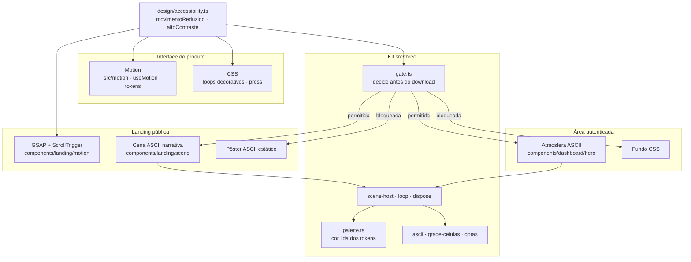

<!--
  O que faz: explica a arquitetura e a implementação visual do frontend web.
  Por que existe: permite manter a mesma linguagem entre módulos e revisar o
  comportamento da interface sem depender do histórico de uma sessão.
  Quem consome: Rafael, equipe do TCC e próximos agentes de frontend.
-->

# Frontend web do Vulnera

**Estado em 2026-11-04** (fim do refactor `web-motion-3d`, ADR-050). O
frontend está em `app/web/` e é uma SPA React + TypeScript construída com Vite.
Tailwind usa os tokens próprios em `src/styles/tokens.css`; os componentes de
interface ficam em `src/components/ui/`. Motion anima a interface; GSAP com
ScrollTrigger anima só a narrativa da landing; three.js desenha o fundo
decorativo (a cena ASCII da landing e a atmosfera da plataforma, pelo kit
`src/three/`) e, desde 2026-11-09, o mapa 3D da superfície de ataque do
Exposure Graph da empresa (`/exposure-graph`, também pelo kit; ADR-051). O
CyberGraph do scan e o grafo da empresa são SVG, com cinco layouts
(`src/features/security-graph/`); o modo 3D do CyberGraph saiu (ADR-051).
Tudo que usa three é carregado sob demanda. Os gráficos analíticos usam os componentes de
`src/components/metrics/`.

Este documento descreve o código implementado. As especificações de tokens e
das telas anteriores continuam em [DESIGN_SYSTEM.md](DESIGN_SYSTEM.md) e
[DASHBOARD_VISUAL.md](DASHBOARD_VISUAL.md) (este último é histórico). A decisão
do fundo único está em
[ADR-041](Vulnera/07-Decisoes/ADR-041%20-%20Atmosfera%20unica%20no%20layout%20autenticado.md),
e as camadas de animação e o kit three.js em
[ADR-050](Vulnera/07-Decisoes/ADR-050%20-%20Camadas%20de%20movimento%20e%20kit%20three.js%20imperativo%20no%20web.md).
O roteiro da cena e da atmosfera ASCII está em
[LANDING_NARRATIVA.md](LANDING_NARRATIVA.md).

## Entrada, rotas e dados

`src/main.tsx` monta, nessa ordem, `ThemeProvider`, TanStack Query,
`BrowserRouter`, `ToastProvider` e `ConfiguracaoDeMovimento` (o `MotionConfig`
que leva o movimento reduzido a todo componente `motion`). `src/App.tsx`
registra as rotas. As telas autenticadas passam por `ProtectedRoute`; quase
todas usam `AppLayout`, que fornece navegação, cabeçalho, alternância de tema,
área principal e transição entre rotas. `/onboarding` usa um fluxo protegido de
tela inteira. `/dast/scans/:id/report` também é uma tela cheia separada do
layout.

`/sast-sca` e `/sast-sca/imports/:id` (ADR-052) têm os papéis do DAST (ADMIN e
PENTESTER). O item do menu tem o selo **new** (`novo: true` em `sidebar.tsx`),
que é fixo e só sai quando alguém o remove do código (D17.3). A página do
projeto ganha a aba **SAST/SCA**, oculta para CLIENT. O PDF da importação e o
`downloadBlob` são importados sob demanda, para que o `pdf-lib` não entre no
chunk da página (o mesmo problema do WEB-FUT-01).

Cada página é um chunk próprio, carregado por `paginaLazy`
(`src/lib/lazy-page.ts`) sob o `LimiteDeRota`
(`src/components/layout/route-boundary.tsx`): skeleton enquanto baixa e uma
tela de recuperação só para a falha de download (rede caída, deploy novo).
Erro de render continua subindo. Ficam no chunk principal apenas `AppLayout`,
`ProtectedRoute` e a landing, que faz o próprio `lazy()`. Login e cadastro vêm
num só lote para que a troca animada entre eles nunca espere download. O
styleguide só existe no servidor de desenvolvimento.

A barra lateral segue a prévia aprovada em 2026-10-16: marca VULNERA SECURITY,
ícones de traço fino e grupos Visão geral, Operação e Administração. Os grupos
sem links permitidos ao papel são omitidos; os destinos e permissões continuam
os mesmos. O item ativo usa fundo violeta suave, indicador lateral e
`aria-current="page"`, inclusive nos detalhes de um recurso. Watchlists fixadas
continuam acessíveis. O desktop usa largura de 216px e rolagem interna em
telas baixas; no celular, os grupos usam o Drawer existente e fecham após
navegar. Inter e estilos são restritos a `sidebar.tsx`/`sidebar.css`, com cores
dos tokens existentes para os dois temas. As demais propostas dos comparativos
de Dashboard, Aplicações e Projetos permanecem estudos visuais.

No Docker Compose, o frontend de `http://localhost:8086` serve o `dist/`
compilado dentro da imagem. Alterar `src/` ou gerar o build no host não
atualiza esse container. Para disponibilizar uma alteração no endereço local,
execute `docker compose up -d --build --no-deps web` e confira os arquivos
JavaScript/CSS efetivamente servidos antes de informar que a mudança está
disponível. O servidor Vite temporário usado em validação é uma execução
separada do frontend Docker.

As páginas chamam módulos em `src/lib/api/`. O `apiClient` Axios anexa o access
token, centraliza o refresh e põe requisições simultâneas em uma fila enquanto
o token é renovado. TanStack Query guarda os dados do servidor por chave de
query; Zustand mantém a sessão. Filtros que precisam sobreviver ao botão
Voltar ou ser compartilháveis ficam na URL, como no painel de aplicação e na
busca de findings. Os números exibidos vêm dessas queries; decoração não cria
dados de negócio. O backend continua sendo a autoridade de permissões, regras
e escopo de empresa.

### Carregamento e recuperação ao navegar

O cliente de queries mantém leituras frescas por 30 segundos e executa até
duas retentativas para falhas transitórias Axios. Em 429, respeita
`retryAfterSeconds` do JSON, com fallback para Retry-After, mais 250 ms;
prazos acima de 30 segundos encerram a tentativa automática. Cancelamentos,
401/403/404 e gravações não são repetidos. `networkMode: always` evita que as
leituras fiquem pausadas sem feedback quando o navegador informa estar offline.

O cabeçalho autenticado mostra um spinner e “Carregando dados…” após 200 ms,
sem bloquear navegação ou deslocar a barra. No mobile o texto é acessível ao
leitor de tela; com movimento reduzido o indicador fica estático. Skeletons
reservam o conteúdo durante a carga inicial. O elemento de `useOutlet` preserva
o contexto da página em saída na transição.

Métricas de Insights e Comparativo são buscadas só ao abrir essas abas; Postura
e Evolução compartilham a série temporal. A janela do período permanece igual
ao trocar somente a aba. Gravações invalidam listas/detalhes/quadro/métricas
afetados, e sair ou trocar de usuário limpa o cache da sessão. O botão “Tentar
novamente” do detalhe de finding refaz a consulta. Decisão e limites em ADR-044.

## Camadas de animação

Cada biblioteca tem um papel, e a pergunta "o movimento está reduzido?" tem uma
fonte só (`src/design/accessibility.ts`: sistema **ou** menu de acessibilidade).

| Situação | Landing | Plataforma |
|---|---|---|
| WebGL2, tela ≥ 768 px, sem preferência | cena ASCII a 60 fps | atmosfera ASCII a 60 fps |
| Movimento reduzido (sistema ou menu) | pôster do ato atual, troca por fade | fundo CSS parado |
| Alto contraste do menu | fundo liso, sem pôster | fundo CSS |
| Tela < 768 px, sem WebGL2 ou falha do chunk | pôster | fundo CSS |

## Fundo único da área autenticada

`AppLayout` monta `operations-backdrop.css` e `DashboardAtmosphere` uma vez,
como camadas sem interação sob `operations-content`. A base CSS desenha uma
grade técnica sutil e luzes radiais nos tokens OKLCH dos dois temas. O
`AmbientHostContext` garante no máximo um canvas por navegação autenticada.

Por cima, quando o gate do kit permite, a atmosfera ASCII
(`components/dashboard/hero/use-dashboard-scene.ts`, números em
`atmosfera-config.ts`): as curvas das ondas antigas desenhadas em glifos,
aurora violeta → ciano → magenta, brilho na cabeça da chuva, hover discreto
(só mouse e caneta) e uma varredura na troca de página e a cada 36 s. Não há
dígitos, porque no produto número é dado. O teto de opacidade (0,30 no tema
escuro, 0,24 no claro) mantém o texto primário e o secundário em AA com um
glifo cruzando a letra (teste ATM-01). Cabeçalhos soltos sobre o fundo usam o
véu `.atmosfera-veu`. Os KPIs do Dashboard e os cards de severidade de Findings
são opacos onde há texto e translúcidos só na borda direita.

O canvas tem `aria-hidden` e `pointer-events: none` e escuta o ponteiro na
`window`. A renderização usa duas passadas (lógica por célula, glifo por
pixel), roda a 60 fps com DPR ≤ 1,5, pausa com a aba oculta e descarta
renderer, texturas, render targets, RAF, listeners e observers no cleanup.
O buffer acompanha o tamanho visível do canvas, limitado a `min(100dvh, 60rem)`.
Falha de WebGL ou do download mantém o fundo CSS e o conteúdo.

O botão **Pausar animações** de Findings envia o evento local
`vulnera:ambient-pause` ao `AppLayout`. Ao sair da página, o efeito limpa a
pausa. O evento só controla decoração, sem tocar queries, filtros ou dados.

## Identidade dos módulos

`module-surfaces.css` fornece três marcas optativas: `data-ops-hero` para o
cabeçalho, `data-ops-surface` para superfícies de dados e `data-ops-lift` para
cards interativos. Variantes de hero usam **os mesmos tokens**, alterando
composição, luz e borda conforme o contexto. Aplicação destaca superfície de
ataque; Projeto mostra pipeline; Finding sinaliza ameaça; DAST acrescenta um
radar CSS discreto; SAST/SCA desenha linhas de código estilizadas (uma delas
na cor de severidade alta); Playbooks lembra uma base de conhecimento; Maturidade e
Governança mantêm a hierarquia própria. O scan ativo recebe um pequeno pulso
CSS ao lado de seu progresso real. Não há paleta nem cena 3D por módulo.

Dashboard, inventário de Aplicações, lista de Projetos, Findings, Remediação e
SLA já tinham componentes e movimentos próprios; o layout agora lhes dá a
mesma atmosfera. Os detalhes de aplicação, projeto, finding, edição, scan,
playbook e maturidade ganharam cabeçalhos e superfícies coerentes. O wizard de
Nova análise usa essa hierarquia dentro do layout. Onboarding reutiliza o
fundo CSS fora dele para preservar seu fluxo de tela inteira. Páginas públicas,
styleguide e relatório DAST não foram redesenhados.

## Movimento e acessibilidade

`src/motion/tokens.ts` espelha as durações e curvas de `tokens.css`;
`src/motion/use-motion.ts` entrega variantes já adaptadas à preferência do
sistema. `src/motion/components.tsx` concentra entrada escalonada, transição
de rota, contadores e overlays. Nova análise e Onboarding usam
`AnimatePresence` com a variante `troca` ao mudar de etapa; o formulário segue
funcional durante a saída e entrada do conteúdo. Os demais módulos reutilizam
os componentes Motion existentes para listas, filtros, cards e feedback das
mutations. Não há durações arbitrárias por página.

Quando `prefers-reduced-motion` está ativo **ou** a pessoa liga "Reduzir
animações" no menu de acessibilidade, nenhuma cena WebGL monta (a landing mostra
o pôster), os loops CSS param, o GSAP da landing refaz as animações em versão
de fade curto e as variantes de Motion removem deslocamento e escala. O alto
contraste do menu também impede a montagem das cenas, porque o teto de
opacidade dos glifos foi calculado para AA e o alto contraste promete 7:1. A pergunta "o movimento está reduzido?" tem uma resposta
só: `movimentoReduzido()` / `useMovimentoReduzido()` em
`src/design/accessibility.ts` — não consulte a media query direto. Valores e
conteúdo permanecem legíveis. A decoração usa `aria-hidden` e
`pointer-events: none`; a navegação mantém link de pulo, landmarks, foco e
controles semânticos. Em tabelas estreitas, o conteúdo rola horizontalmente
quando necessário em vez de cortar colunas; listas que já possuíam cards
mobile continuam usando o mesmo DOM.

## Menu de acessibilidade

Botão no canto superior direito de todas as telas (cabeçalho do `AppLayout`,
barra da landing, e fixo via `ComMenuAcessibilidade` nas rotas sem cabeçalho).
O painel (`src/design/accessibility-menu.tsx`) ajusta tamanho do texto (100 a
200%), alto contraste, reduzir animações, sublinhar links, espaçamento de texto
(WCAG 1.4.12) e foco reforçado. As escolhas ficam no `localStorage`
(`vulnera:a11y`) e viram atributos no `<html>`; o script inline do `index.html`
as aplica antes do primeiro paint. Tabela de opções e contraste em
`docs/DESIGN_SYSTEM.md` §4; decisão no ADR-049. Ao criar uma tela, verifique-a
também com texto a 200% e alto contraste — `e2e/acessibilidade.spec.ts` varre as
principais com `axe-core`.

## Tema e política de scripts

O script mínimo em `index.html` define `data-theme` antes do primeiro paint.
Depois, `ThemeProvider` assume as trocas e acompanha a preferência do sistema
quando o modo escolhido é `system`. Em `vite preview`, a CSP permite esse
script por hash. `config/csp.ts` normaliza CRLF/CR para LF antes de calcular o
hash, como faz o parser HTML do navegador; isso também permite o primeiro
paint correto em checkout Windows. `src/test/csp.test.ts` cobre a regra.

## Como manter e verificar

Ao criar uma tela autenticada, registre a rota sob `AppLayout` em `App.tsx`,
use componentes de `src/components/ui/`, tokens semânticos, dados da API e as
variantes de `useMotion()`. A página não deve montar outra atmosfera. Uma cena
three.js nova entra pelo kit: `useCenaPermitida` antes do `lazy()`, cor lida
por `three/palette.ts`, `aria-hidden` e `pointer-events: none`, e teste de
contraste do texto sobre ela. Escolha
`data-ops-hero` apenas quando um cabeçalho destacado ajudar o fluxo, sem
repetir um conjunto fixo de KPIs. Teste também estados de loading, vazio, erro,
tema claro/escuro, 375/768/1440 px e movimento reduzido.

Na raiz do repositório, `docker compose up -d --build` inicia DB, API, web e
MailHog; a entrada web é `http://localhost:8086`. As credenciais da base de
demonstração estão em [DEMO.md](DEMO.md). Em `app/web/`, rode
`npm run lint`, `npm run check:contrast`, `npm test -- --maxWorkers=1` e
`npm run build`. O resultado específico desta entrega, inclusive limites
observados no navegador, está em
[`output/frontend-visual-overhaul-report.md`](../output/frontend-visual-overhaul-report.md).
