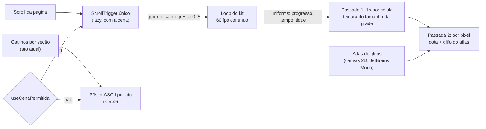

<!--
  O que faz: roteiro da cena narrativa ASCII da landing pública — o que cada
  ato mostra, em que seção, em que faixa do scroll e como degrada — e da
  atmosfera ASCII discreta da área autenticada.
  Por que existe: a cena conta uma história que precisa ser entendida por
  quem nunca usou uma ferramenta de segurança; o roteiro vem antes do código.
  Quem consome: Rafael, banca/apresentação e quem mexer em
  `app/web/src/components/landing/scene/` ou na atmosfera do dashboard.
-->

# Landing narrativa — roteiro da cena

> [!NOTE]
> **Estado (2026-11-04):** implementado e validado no container `:8086`
> (refactor `web-motion-3d`, encerrado na Fase 6; decisão no ADR-050). A
> primeira versão, um campo de **pontos** WebGL, foi substituída por uma cena de **caracteres ASCII**
> depois do retorno do Rafael (os pontos pareciam genéricos e pesados). O
> roteiro dos seis atos não mudou; mudou o material. Ver §8.

## 1. A ideia em uma frase

Enquanto a pessoa rola a página, um campo de caracteres de terminal atrás do
texto conta a mesma história que o texto conta: **o sistema funciona → tem
falhas → o Vulnera encontra → organiza → ajuda a corrigir → fica estável.**

A estética é de terminal "hacker" — glifos monoespaçados, varredura em blocos,
acentos neon ciano/magenta sobre a paleta violeta da marca —, inspirada na
linguagem visual de interfaces de hacking como a do jogo *Watch Dogs 2*.

> [!WARNING]
> **Só a linguagem visual é referência.** Nenhum logo, fonte proprietária,
> ícone, nome ou asset do jogo (Ubisoft/DedSec) é usado. Os glifos são
> caracteres Unicode comuns desenhados com a JetBrains Mono (licença OFL),
> já presente no projeto.

Não há números de negócio nem nomes na cena. Ela é uma **ilustração do
conceito**, não um painel de dados. As cores de severidade significam o mesmo
que no produto, mas nenhum glifo representa um finding real — severidade e
correção são sorteadas.

> [!IMPORTANT]
> A cena é decoração: `aria-hidden`, sem foco, `pointer-events: none`. Todo o
> conteúdo continua no HTML. Quem não vê a cena (leitor de tela, movimento
> reduzido, navegador sem WebGL) não perde nenhuma informação.

## 2. Para quem é

O público da apresentação inclui alunos iniciantes de Desenvolvimento de
Sistemas. Por isso:

- cada ato tem **uma ideia só**, que se entende sem saber o que é CVSS;
- a mudança entre atos acompanha o scroll — quem para de rolar vê a cena
  parar junto;
- nada pisca rápido nem voa na direção da tela (sem câmera em movimento). O
  "cintilar" dos caracteres troca poucos glifos, 8 vezes por segundo.

## 3. Os seis atos

A página não muda de estrutura: as seções HTML rolam normalmente, sem
scroll-jacking, sem biblioteca de smooth scroll e sem bloco fixado. A cena
fica num canvas fixo atrás do conteúdo e lê um único número, o **progresso
narrativo**, de `0` (topo) a `5` (último ato). O progresso inteiro `k` é
alcançado quando a seção que abre o ato `k` (`section[data-ato="k"]`) chega ao
meio da tela; entre duas seções, ele cresce em linha reta.

| Ato | Ideia | Seções HTML | Estado da cena | Pôster (fallback) |
|---|---|---|---|---|
| **0 · Funciona** | "O sistema está rodando." | Hero | Campo calmo: rampa `. · : - + =` e binário `0 1`, esparso no centro (atrás do título) e mais cheio nas laterais (vinheta). | O mesmo campo, parado. |
| **1 · Mas tem falhas** | "Nem tudo está bem — e não dá pra ver de longe." | O problema | ≈ 4,5% das células viram `!` e pulsam de leve, ainda sem cor de severidade. | `!` nas mesmas células. |
| **2 · Encontrar** | "O Vulnera varre e acha." | Como funciona | Uma varredura vertical em blocos `░▒▓█` ciano, com franja magenta, atravessa a tela; ao passar, cada `!` revela o glifo e a cor da severidade (`%` baixa, `#` média, `×` alta, `@` crítica). | Varredura parada no meio, severidades já reveladas. |
| **3 · Organizar** | "Cada falha vai para o seu lugar." | Recursos, Comparativo, Demo | As falhas saem da grade e formam quatro grupos nas laterais, onde não há texto: menos graves à esquerda, mais graves à direita. | Os quatro grupos. |
| **4 · Corrigir** | "Corrigido, sai da lista." | Maturidade | Começa pelo mais grave: crítica e alta sempre, média pela metade, baixa nunca. O que foi corrigido vira `✓` verde e o grupo se dissolve. | `✓` nas células corrigidas; baixa e metade da média seguem nos grupos. |
| **5 · Estável** | "Sob controle." | Planos, FAQ, Time, Chamada final | Campo calmo de novo, com `✓` assentados e o risco residual (baixa) em acompanhamento. | Idem. |

> [!TIP]
> O "baixa nunca é corrigida" é deliberado: mostra **priorização** e risco
> residual aceito, que é como um programa de segurança real funciona.

## 4. Como cada ato degrada

| Situação | O que a pessoa vê |
|---|---|
| WebGL2, sem movimento reduzido, tela ≥ 768 px | A cena WebGL completa. |
| Movimento reduzido (do sistema ou do menu de acessibilidade) | O pôster ASCII do ato atual. A troca de ato é um **crossfade** (só opacidade, `--duration-slow`); nenhum glifo anda, não há pulso nem varredura. |
| Sem WebGL2, sem canvas 2D para o atlas, ou falha ao baixar a cena | O pôster, com a mesma troca por ato. |
| Contexto WebGL perdido no meio da sessão | A cena some e o pôster, que sempre esteve embaixo, assume. |
| Tela < 768 px | O pôster (decidido por medição — §6). |
| Alto contraste do menu de acessibilidade | Fundo liso: sem cena e sem pôster. O teto de opacidade dos glifos foi calculado para AA, e o alto contraste promete 7:1 (ADR-049). |

O pôster é um `<pre>` com um `` por glifo, gerado por
`scene/layout.ts`, que espelha a regra do shader célula por célula (mesmas
proporções, vinheta, centros dos grupos e regra de correção). O sorteio do
pôster usa um hash inteiro próprio, reprodutível em qualquer navegador.

## 5. Técnica

- **Duas passadas, nenhuma geometria por caractere.** A tela é dividida em
  células (12 px CSS de largura × DPR; a altura sai da proporção da fonte).
  A passada 1 roda **uma vez por célula** numa textura do tamanho da grade
  (`src/three/grade-celulas.ts`) e decide glifo, cor e alfa pelo ato. A
  passada 2 roda por pixel e só lê a célula, aplica a gota e carimba a
  cobertura do atlas (`src/three/ascii.ts`). Antes era uma passada só, com a
  lógica inteira repetida em cada pixel (~250× por célula).
- **Movimento contínuo a 60 fps.** O campo respira, o "!" pulsa em curva
  suave e a chuva da plataforma desce sem degraus; só a troca de glifo e o
  glitch seguem em tiques (trocar caractere é discreto). Substitui o render
  sob demanda a 30 fps em tiques, que passava sensação de lag.
- **Sem estado React por quadro.** O progresso vai de um ScrollTrigger para um
  `gsap.quickTo` e dele para um uniform.
- **Kit compartilhado.** Hospedeiro (DPR ≤ 1,5, low-power, perda de contexto),
  loop, descarte e paleta vêm de `src/three/`. As cores são lidas dos tokens
  em runtime (`--vx-accent`, `--vx-cyan`, `--vx-magenta`,
  `--color-severity-*`, `--color-success`) e trocam junto com o tema.
- **Canvas novo por montagem**, criado pelo hook dentro do hospedeiro: o
  `forceContextLoss` do descarte não envenena a remontagem do StrictMode.
- Detalhes visuais: scanlines a cada 3 linhas de pixel e, raramente, uma faixa
  de "glitch" que desloca duas células — os dois só no WebGL.

## 5.1 Gota d'água (clique no fundo)

Um clique no fundo — e **só** clique: nada segue o ponteiro — deixa cair uma
gota, e ondulações circulares se espalham pelo campo de caracteres, na landing
e na área autenticada (`src/three/gotas.ts`).

| Parte | Como funciona |
|---|---|
| Quem conta como "fundo" | O canvas segue `pointer-events: none`; o clique é ouvido na janela e ignorado quando o alvo é interativo (link, botão, campo, item de menu, aba, diálogo), quando é o botão direito ou quando vem do teclado (`detail = 0`). |
| Física | Até 6 gotas simultâneas; frente a 320 px/s, pacote gaussiano de 70 px, cristas a cada 34 px, some em 2,4 s, perde força com tempo e distância. |
| Visual | A onda **refrata** a grade (a leitura das células é deslocada, como texto visto pela água) e a crista desenha um anel de glifos da rampa — puxado para o ciano na landing, na cor de tinta na plataforma. |
| Contraste | O anel nunca passa do alfa de destaque (landing) nem do teto do campo (plataforma): a garantia de AA não muda com a gota. |
| Custo | A cena já desenha todo quadro; sem gota viva o laço das ondas nem roda (desvio por uniform). Medido: 60 fps com a gota, na landing e na plataforma. |
| Movimento reduzido | A cena nem monta; não há gota. |

## 6. Cores e legibilidade

- Texto sobre a cena mantém **AA**. Os blocos de conteúdo ganham uma
  superfície (`.vx-superficie`, 94% da cor de fundo): a cena aparece inteira
  nas margens e entre as seções e fica atenuada atrás das letras.
- `scene-contrast.test.ts` calcula o pior caso — dois glifos em destaque e a
  varredura empilhados atrás da superfície — para cada cor de texto × cada cor
  da cena (paleta, ciano, magenta, severidades, resolvido), nos dois temas,
  lendo as cores reais de `landing.css` e `tokens.css`. Exige ≥ 4,5:1.
- `--vx-text-3` reprovava AA mesmo sobre o fundo puro (4,19:1 no escuro,
  3,65:1 no claro) antes da cena; foi ajustado só na luminosidade.
- O ciano/magenta neon existe como token da landing (`--vx-cyan`,
  `--vx-magenta`), com versões escuras no tema claro.

## 7. Decisões tomadas por medição

| Decisão | Medida | Evidência |
|---|---|---|
| Pôster abaixo de 768 px | Fração da tela livre das superfícies, atos 0→5: **375 px** 54% e depois 15% em todos; **768 px** 55/38/48% e 16/14/18%; **1440 px** 79/59/59/40/35/40%. Em 375 px a cena ficaria escondida em 5 dos 6 atos, gastando GPU de celular para nada. 768 px fica no limite (atos 3–5 parecidos com 375); manteve-se o corte padrão do kit (ADR-041) — registrado para reavaliar com aparelho real. | `output/web-motion-3d/landing-ascii/fase4-landing-matrix.json` (`areaLivrePorAto`) |
| ~~Render sob demanda com tiques~~ (substituída em 2026-11-03) | Parado no rodapé: 23 quadros em 3 s (antes: 181 desenhos em 3 s com o hero fora da tela). Economizava GPU, mas o movimento em degraus parecia lag. | `landing-ascii/landing-perf-fase4.json` × `baseline/landing-perf-baseline.json` |
| Duas passadas + 60 fps contínuo | Rolando a landing com o fundo a 60 fps numa passada só: **31 fps, 51% dos quadros > 25 ms**. Com as duas passadas: o fundo custa ~3 fps na rolagem (controle sem canvas: ~45 fps × ~42 com). Parada, com gota e na plataforma (inclusive rolando Findings): **60 fps, 0% de engasgo**. | `fluidez/*.json`, `diag-desenhos.cjs` |
| Loop do kit com tolerância ao jitter | Comparar com o intervalo exato pulava quadros de 33,2 ms e alternava 33/50 ms (engasgo). Aceitar 85% do intervalo mantém a cadência — teste KIT-09. | `src/three/loop.ts` |
| Pôster desmontado com a cena pronta | Escondido mas montado, o pôster (~5 mil ``) re-renderizava a cada troca de ato durante a rolagem. | teste LAND-11 |
| Barra da landing sem `backdrop-blur` | Com a cena animando atrás, o desfoque era refeito todo quadro: rolagem de 38–47 → 50–51 fps e picos de 150 → 90 ms. | `diag-desenhos.cjs` (`CSS_EXTRA`) |
| Fim da intro 3D | A intro levava 7,4 s com long tasks de até 451 ms e ignorava movimento reduzido. Agora: 0 long tasks na rolagem. | `baseline/landing-perf-intro.json` |
| Rolagem | **57,2 / 57,7 fps** de média (mínimo 49) contra 43,2 / 38,6 (mínimo 22) no baseline — mesma máquina, mesmo protocolo, GPU Iris Xe. | idem |
| Hash do pôster com avalanche completa | O hash inicial dava 98% de `0` no binário (sais correlacionados, r = −0,5); com o fmix32 do MurmurHash3, \|r\| < 0,03. | teste NAR-11 |

## 8. Atmosfera ASCII da área autenticada

A mesma técnica, num canvas global no layout (decoração, nada sobre dado),
substituiu as ondas e órbitas do dashboard. Em 2026-11-03 o Rafael achou a
primeira versão "sem vida"; a atual devolve forma, cor e movimento sem voltar
ao fundo antigo (números em `components/dashboard/hero/atmosfera-config.ts`):

| Camada | O que faz |
|---|---|
| **Ondas em ASCII** | As 6 curvas do fundo antigo (`sen(x·2,3 + t·0,22) + cos(x·4,1 − t·0,13)`), desenhadas com glifos escolhidos pela inclinação (`-` `~` `/` `\`), esmaecendo entre células; um brilho percorre cada curva e há poeira fina entre elas. |
| **Aurora** | Matiz lento violeta → ciano → magenta que tinge os glifos, mais uma lavagem de cor de 5% do teto por trás deles. |
| **Brilho** | A cabeça de cada fluxo de "chuva" (`:` `|`) acende com halo ciano. |
| **Hover discreto** | Perto do ponteiro (150 px, só mouse/caneta) aparecem mais glifos e eles acendem; o ponto segue suavizado. Sem clique: a gota ficou só na landing. |
| **Varredura** | Uma faixa `=`/`-` desce pela tela na troca de página e, sozinha, a cada 36 s (nunca "spammando"). |
| **Campo** | ~20% das células com a rampa `. · : - +`, respirando devagar. |

Regras que continuam valendo:

- **sem dígitos**: no produto número é dado, e um `0`/`1` ao lado de um KPI,
  breadcrumb ou aba seria lido como tal (ATM-02 e CENA-06);
- teto de opacidade 0,30 (escuro) e 0,24 (claro), em qualquer cor da aurora:
  o texto primário e o secundário seguem AA mesmo com um glifo cruzando a
  letra — conta feita por `atmosfera-contrast.test.ts` (ATM-01) com as cores
  reais de `tokens.css`; o ciano e o magenta são tokens
  (`--color-ambient-cyan`, `--color-ambient-magenta`), as mesmas cores da
  landing em OKLCH;
- cabeçalhos de página soltos sobre o fundo têm o véu desfocado
  (`.atmosfera-veu`), que protege também o texto muted;
- KPIs do Dashboard e cards de severidade de Findings são opacos onde há
  texto e translúcidos só na borda direita, onde a atmosfera aparece;
- duas passadas (lógica por célula, glifo por pixel) a 60 fps; medido
  56–60 fps parado e rolando, 0% de quadros > 25 ms;
- movimento reduzido (sistema ou menu), alto contraste do menu, tela < 768 px
  ou sem WebGL2: o chunk de three nem é baixado e fica o fundo CSS.

## 9. Histórico

| Data | Mudança |
|---|---|
| 2026-10-23 | Roteiro dos seis atos (Fase 4.1) e primeira implementação com campo de **pontos** WebGL e pôster SVG. |
| 2026-10-27 | Pontos substituídos por **caracteres ASCII** (estética de terminal, neon) na landing e na área autenticada, a pedido do Rafael. Pôster passa a ser `<pre>`. |
| 2026-10-30 | Hash do pôster corrigido; atmosfera do produto sem dígitos; medições finais (§7). |
| 2026-11-03 | Fundo mais visível a pedido do Rafael (landing: glifos 0,48/0,60/0,45 e vinheta mais cheia, superfície do texto 92% → 94%; plataforma: ~3× mais tinta, véu atrás dos cabeçalhos) e **gota d'água** no clique (§5.1). |
| 2026-11-03 | **Fluidez** (pedido do Rafael: o fundo passava sensação de lag): 60 fps contínuo, duas passadas, loop sem engasgo de cadência, pôster desmontado com a cena pronta, barra da landing sem `backdrop-blur` (§7). |
| 2026-11-03 | Atmosfera da plataforma "com vida" (pedido do Rafael): ondas ASCII, aurora violeta/ciano/magenta, brilho na chuva, hover discreto, varredura na troca de página e a cada 36 s; gota removida da plataforma (§8). |
| 2026-11-04 | Merge de `dev` com o menu de acessibilidade (ADR-049): "Reduzir animações" do menu também troca a cena pelo pôster e refaz o GSAP; o alto contraste deixa o fundo liso (§4). Fechamento do refactor no ADR-050. |

### Boas práticas consultadas (2026-10-27)

| Prática | Como está na cena |
|---|---|
| WebGL sempre atrás do texto; título e CTA legíveis de imediato | Superfície AA atrás dos blocos; vinheta deixa o centro do hero esparso |
| Comunicar o comportamento do sistema, não brilho aleatório | A cena conta a narrativa da página, ato a ato |
| Uma linguagem visual dominante, sem empilhar efeitos | Só glifos; sem bloom nem pós-processamento |
| "Se nada anima, não renderize todo quadro" | Agora a cena anima sempre (pedido de fluidez); o custo caiu com as duas passadas e o loop pausa com a aba oculta e o canvas fora da tela |
| DPR limitado, pôster primeiro, reduced-motion, perda de contexto | DPR ≤ 1,5; pôster ASCII; gate do kit; canvas novo por montagem |
| `mediump` em GPU móvel | `precision: "mediump"` no material |

Fontes: [Utsubo — 100 Three.js tips (2026)](https://www.utsubo.com/blog/threejs-best-practices-100-tips) ·
[WebGL landing steering](https://www.ui-skills.com/skills/mengto/webgl-landing-steering/) ·
[Recriando os design systems de Stripe, Linear e Vercel](https://opendesigner.io/pt-br/blog/recreating-stripe-linear-vercel-design-systems-with-design-md)
(guias práticos, não pesquisa acadêmica; os números de contraste e
desempenho vêm dos nossos testes e medições).
