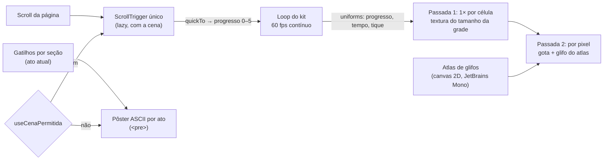
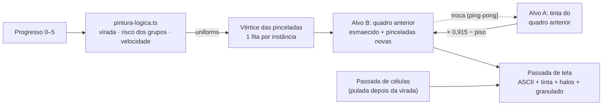
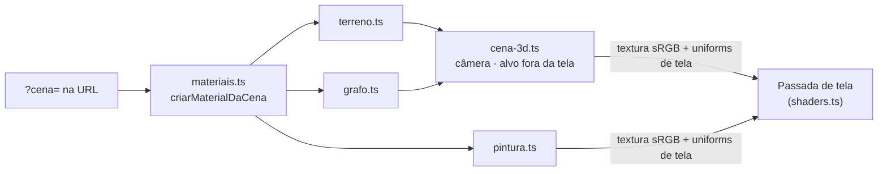
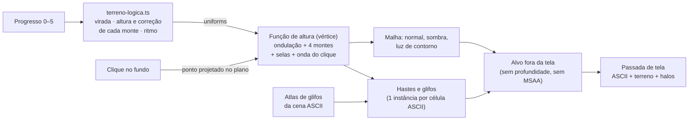

<!--
  O que faz: roteiro da cena narrativa da landing pública (ASCII nos atos 0–2,
  terreno 3D nos atos 3–5) — o que cada ato mostra, em que seção, em que faixa do
  scroll e como degrada — e da atmosfera ASCII discreta da área autenticada.
  Por que existe: a cena conta uma história que precisa ser entendida por
  quem nunca usou uma ferramenta de segurança; o roteiro vem antes do código.
  Quem consome: Rafael, banca/apresentação e quem mexer em
  `app/web/src/components/landing/scene/` ou na atmosfera do dashboard.
-->

# Landing narrativa — roteiro da cena

> [!NOTE]
> **Estado (2026-11-04):** implementado e validado no container `:8086`
> (refactor `web-motion-3d`, encerrado na Fase 6; decisão no ADR-050). A
> primeira versão, um campo de **pontos** WebGL, foi substituída por uma cena de **caracteres ASCII**
> depois do retorno do Rafael (os pontos pareciam genéricos e pesados). O
> roteiro dos seis atos não mudou; mudou o material. Ver §8.

> [!NOTE]
> **Estado (2026-11-15):** os atos 3–5 passaram de ASCII para **pintura**
> (direção "Do ASCII para a pintura", estilo expressivo, aprovada pelo Rafael
> num protótipo; ADR-054). De novo o roteiro não mudou, mudou o material. As
> §3, §4 e §5 abaixo descrevem a cena atual; a técnica, o orçamento medido e a
> degradação da pintura estão na **§10**. O pôster (fallback) continua
> contando os seis atos em ASCII.

> [!NOTE]
> **Estado (2026-11-16):** a pintura foi **substituída por um terreno
> topográfico em 3D** (decisão do Rafael depois de comparar três materiais na
> página; ADR-055, que supersede o ADR-054). As §2, §3, §4 e §5.1 abaixo já
> descrevem a cena atual; a técnica e as medições do terreno estão na **§12**.
> As §10 e §11 ficam como histórico.

## 1. A ideia em uma frase

Enquanto a pessoa rola a página, um campo de caracteres de terminal atrás do
texto conta a mesma história que o texto conta: **o sistema funciona → tem
falhas → o Vulnera encontra → organiza → ajuda a corrigir → fica estável.**

A estética é de terminal "hacker" — glifos monoespaçados, varredura em blocos,
acentos neon ciano/magenta sobre a paleta violeta da marca —, inspirada na
linguagem visual de interfaces de hacking como a do jogo *Watch Dogs 2*.

> [!WARNING]
> **Só a linguagem visual é referência.** Nenhum logo, fonte proprietária,
> ícone, nome ou asset do jogo (Ubisoft/DedSec) é usado. Os glifos são
> caracteres Unicode comuns desenhados com a JetBrains Mono (licença OFL),
> já presente no projeto.

Não há números de negócio nem nomes na cena. Ela é uma **ilustração do
conceito**, não um painel de dados. As cores de severidade significam o mesmo
que no produto, mas nenhum glifo representa um finding real — severidade e
correção são sorteadas.

> [!IMPORTANT]
> A cena é decoração: `aria-hidden`, sem foco, `pointer-events: none`. Todo o
> conteúdo continua no HTML. Quem não vê a cena (leitor de tela, movimento
> reduzido, navegador sem WebGL) não perde nenhuma informação.

## 2. Para quem é

O público da apresentação inclui alunos iniciantes de Desenvolvimento de
Sistemas. Por isso:

- cada ato tem **uma ideia só**, que se entende sem saber o que é CVSS;
- a mudança entre atos acompanha o scroll — quem para de rolar vê a cena
  parar junto;
- nada pisca rápido nem voa na direção da tela (a câmera do terreno só inclina, e só com o scroll — ver a nota abaixo). O
  "cintilar" dos caracteres troca poucos glifos, 8 vezes por segundo.

> [!NOTE]
> **Regra revista em 2026-11-16 (ADR-055).** Até aqui valia "sem câmera em
> movimento". Com o terreno 3D, a câmera inclina 46° ao longo da virada. O que
> se mantém da intenção: o movimento é do scroll (parou de rolar, a câmera
> para), nada vem na direção de quem lê, e com "reduzir animações" a cena nem
> monta.

## 3. Os seis atos

> [!NOTE]
> **Epílogo (2026-11-16).** O progresso narrativo não para mais em 5. O ato 5
> abre em "Planos", mas a página ainda tem FAQ, Time e a chamada final, e o
> fundo ficava parado nesse trecho todo. Agora ele segue de **5 a 6**, e o 6 é
> alcançado no fim da rolagem. O que acontece nesse trecho está na §12.7. Não
> é um sétimo ato: o pôster e os `data-ato` continuam com seis.

A página não muda de estrutura: as seções HTML rolam normalmente, sem
scroll-jacking, sem biblioteca de smooth scroll e sem bloco fixado. A cena
fica num canvas fixo atrás do conteúdo e lê um único número, o **progresso
narrativo**, de `0` (topo) a `5` (último ato). O progresso inteiro `k` é
alcançado quando a seção que abre o ato `k` (`section[data-ato="k"]`) chega ao
meio da tela; entre duas seções, ele cresce em linha reta.

| Ato | Ideia | Seções HTML | Estado da cena | Pôster (fallback) |
|---|---|---|---|---|
| **0 · Funciona** | "O sistema está rodando." | Hero | Campo calmo: rampa `. · : - + =` e binário `0 1`, esparso no centro (atrás do título) e mais cheio nas laterais (vinheta). | O mesmo campo, parado. |
| **1 · Mas tem falhas** | "Nem tudo está bem — e não dá pra ver de longe." | O problema | ≈ 4,5% das células viram `!` e pulsam de leve, ainda sem cor de severidade. | `!` nas mesmas células. |
| **2 · Encontrar** | "O Vulnera varre e acha." | Como funciona | Uma varredura vertical em blocos `░▒▓█` ciano, com franja magenta, atravessa a tela; ao passar, cada `!` revela o glifo e a cor da severidade (`%` baixa, `#` média, `×` alta, `@` crítica). | Varredura parada no meio, severidades já reveladas. |
| **3 · Organizar** | "Cada falha vai para o seu lugar." | Recursos, Comparativo, Demo | **A virada:** em onda da esquerda para a direita, a grade de caracteres inclina, ondula e vira um terreno 3D. Cada glifo de falha se ergue numa haste e salta para o monte da sua severidade; quatro montes crescem nas laterais (menos graves à esquerda, mais graves à direita), com curvas de nível. Crítica é o mais alto. | Os quatro grupos, em ASCII. |
| **4 · Corrigir** | "Corrigido, sai da lista." | Maturidade | Terreno. Do mais alto para o mais baixo: uma faixa verde desce a encosta e só então o monte afunda; os glifos viram `✓`, sobem e somem. Crítica e alta sempre, média pela metade, baixa nunca. | `✓` nas células corrigidas; baixa e metade da média seguem nos grupos. |
| **5 · Estável** | "Sob controle." | Planos, FAQ, Time, Chamada final | Terreno. Planície calma, ondulação 45% mais lenta, luz quente; ficam o morro de baixa e meio morro de média (risco residual aceito). | Campo calmo, `✓` assentados e a baixa em acompanhamento. |

> [!TIP]
> O "baixa nunca é corrigida" é deliberado: mostra **priorização** e risco
> residual aceito, que é como um programa de segurança real funciona.

## 4. Como cada ato degrada

| Situação | O que a pessoa vê |
|---|---|
| WebGL2, sem movimento reduzido, tela ≥ 768 px | A cena WebGL completa: ASCII nos atos 0–2, terreno 3D nos atos 3–5. |
| Máquina que não segura a cadência no terreno | O terreno desce de degrau sozinho: DPR 1,5 com malha de 30 px, depois DPR 1 com malha de 40 px (§12.4). |
| Movimento reduzido (do sistema ou do menu de acessibilidade) | O pôster ASCII do ato atual. A troca de ato é um **crossfade** (só opacidade, `--duration-slow`); nenhum glifo anda, não há pulso nem varredura. |
| Sem WebGL2, sem canvas 2D para o atlas, ou falha ao baixar a cena | O pôster, com a mesma troca por ato. |
| Contexto WebGL perdido no meio da sessão | A cena some e o pôster, que sempre esteve embaixo, assume. |
| Tela < 768 px | O pôster (decidido por medição — §6). |
| Alto contraste do menu de acessibilidade | Fundo liso: sem cena e sem pôster. O teto de opacidade dos glifos foi calculado para AA, e o alto contraste promete 7:1 (ADR-049). |

O pôster é um `<pre>` com um `` por glifo, gerado por
`scene/layout.ts`, que espelha a regra do shader célula por célula (mesmas
proporções, vinheta, centros dos grupos e regra de correção). O sorteio do
pôster usa um hash inteiro próprio, reprodutível em qualquer navegador.

## 5. Técnica

- **Duas passadas, nenhuma geometria por caractere.** A tela é dividida em
  células (12 px CSS de largura × DPR; a altura sai da proporção da fonte).
  A passada 1 roda **uma vez por célula** numa textura do tamanho da grade
  (`src/three/grade-celulas.ts`) e decide glifo, cor e alfa pelo ato. A
  passada 2 roda por pixel e só lê a célula, aplica a gota e carimba a
  cobertura do atlas (`src/three/ascii.ts`). Antes era uma passada só, com a
  lógica inteira repetida em cada pixel (~250× por célula).
- **Movimento contínuo a 60 fps.** O campo respira, o "!" pulsa em curva
  suave e a chuva da plataforma desce sem degraus; só a troca de glifo e o
  glitch seguem em tiques (trocar caractere é discreto). Substitui o render
  sob demanda a 30 fps em tiques, que passava sensação de lag.
- **Sem estado React por quadro.** O progresso vai de um ScrollTrigger para um
  `gsap.quickTo` e dele para um uniform.
- **Kit compartilhado.** Hospedeiro (DPR ≤ 1,5, low-power, perda de contexto),
  loop, descarte e paleta vêm de `src/three/`. As cores são lidas dos tokens
  em runtime (`--vx-accent`, `--vx-cyan`, `--vx-magenta`,
  `--color-severity-*`, `--color-success`) e trocam junto com o tema.
- **Canvas novo por montagem**, criado pelo hook dentro do hospedeiro: o
  `forceContextLoss` do descarte não envenena a remontagem do StrictMode.
- Detalhes visuais: scanlines a cada 3 linhas de pixel e, raramente, uma faixa
  de "glitch" que desloca duas células — os dois só no WebGL.

## 5.1 Gota d'água (clique no fundo)

Um clique no fundo — e **só** clique: nada segue o ponteiro — deixa cair uma
gota, e ondulações circulares se espalham pelo campo de caracteres, na landing
e na área autenticada (`src/three/gotas.ts`).

| Parte | Como funciona |
|---|---|
| Quem conta como "fundo" | O canvas segue `pointer-events: none`; o clique é ouvido na janela e ignorado quando o alvo é interativo (link, botão, campo, item de menu, aba, diálogo), quando é o botão direito ou quando vem do teclado (`detail = 0`). |
| Física | Até 6 gotas simultâneas; frente a 320 px/s, pacote gaussiano de 70 px, cristas a cada 34 px, some em 2,4 s, perde força com tempo e distância. |
| Visual | Nos atos ASCII, a onda **refrata** a grade (a leitura das células é deslocada, como texto visto pela água) e a crista desenha um anel de glifos da rampa, puxado para o ciano. |
| No terreno (atos 3–5) | O ponto clicado é projetado no plano e vira uma **onda sísmica** na função de altura: anéis que levantam a malha de verdade (13 px de amplitude), com os glifos balançando em cima. Mesma velocidade e duração da gota; sem onda viva o laço nem roda no vértice. |
| Contraste | O anel nunca passa do alfa de destaque (landing) nem do teto do campo (plataforma): a garantia de AA não muda com a gota. |
| Custo | A cena já desenha todo quadro; sem gota viva o laço das ondas nem roda (desvio por uniform). Medido: 60 fps com a gota, na landing e na plataforma. |
| Movimento reduzido | A cena nem monta; não há gota. |

## 6. Cores e legibilidade

- Texto sobre a cena mantém **AA**. Os blocos de conteúdo ganham uma
  superfície (`.vx-superficie`, 94% da cor de fundo): a cena aparece inteira
  nas margens e entre as seções e fica atenuada atrás das letras.
- `scene-contrast.test.ts` calcula o pior caso — dois glifos em destaque e a
  varredura empilhados atrás da superfície — para cada cor de texto × cada cor
  da cena (paleta, ciano, magenta, severidades, resolvido), nos dois temas,
  lendo as cores reais de `landing.css` e `tokens.css`. Exige ≥ 4,5:1.
- `--vx-text-3` reprovava AA mesmo sobre o fundo puro (4,19:1 no escuro,
  3,65:1 no claro) antes da cena; foi ajustado só na luminosidade.
- O ciano/magenta neon existe como token da landing (`--vx-cyan`,
  `--vx-magenta`), com versões escuras no tema claro.

## 7. Decisões tomadas por medição

| Decisão | Medida | Evidência |
|---|---|---|
| Pôster abaixo de 768 px | Fração da tela livre das superfícies, atos 0→5: **375 px** 54% e depois 15% em todos; **768 px** 55/38/48% e 16/14/18%; **1440 px** 79/59/59/40/35/40%. Em 375 px a cena ficaria escondida em 5 dos 6 atos, gastando GPU de celular para nada. 768 px fica no limite (atos 3–5 parecidos com 375); manteve-se o corte padrão do kit (ADR-041) — registrado para reavaliar com aparelho real. | `output/web-motion-3d/landing-ascii/fase4-landing-matrix.json` (`areaLivrePorAto`) |
| ~~Render sob demanda com tiques~~ (substituída em 2026-11-03) | Parado no rodapé: 23 quadros em 3 s (antes: 181 desenhos em 3 s com o hero fora da tela). Economizava GPU, mas o movimento em degraus parecia lag. | `landing-ascii/landing-perf-fase4.json` × `baseline/landing-perf-baseline.json` |
| Duas passadas + 60 fps contínuo | Rolando a landing com o fundo a 60 fps numa passada só: **31 fps, 51% dos quadros > 25 ms**. Com as duas passadas: o fundo custa ~3 fps na rolagem (controle sem canvas: ~45 fps × ~42 com). Parada, com gota e na plataforma (inclusive rolando Findings): **60 fps, 0% de engasgo**. | `fluidez/*.json`, `diag-desenhos.cjs` |
| Loop do kit com tolerância ao jitter | Comparar com o intervalo exato pulava quadros de 33,2 ms e alternava 33/50 ms (engasgo). Aceitar 85% do intervalo mantém a cadência — teste KIT-09. | `src/three/loop.ts` |
| Pôster desmontado com a cena pronta | Escondido mas montado, o pôster (~5 mil ``) re-renderizava a cada troca de ato durante a rolagem. | teste LAND-11 |
| Barra da landing sem `backdrop-blur` | Com a cena animando atrás, o desfoque era refeito todo quadro: rolagem de 38–47 → 50–51 fps e picos de 150 → 90 ms. | `diag-desenhos.cjs` (`CSS_EXTRA`) |
| Fim da intro 3D | A intro levava 7,4 s com long tasks de até 451 ms e ignorava movimento reduzido. Agora: 0 long tasks na rolagem. | `baseline/landing-perf-intro.json` |
| Rolagem | **57,2 / 57,7 fps** de média (mínimo 49) contra 43,2 / 38,6 (mínimo 22) no baseline — mesma máquina, mesmo protocolo, GPU Iris Xe. | idem |
| Hash do pôster com avalanche completa | O hash inicial dava 98% de `0` no binário (sais correlacionados, r = −0,5); com o fmix32 do MurmurHash3, \|r\| < 0,03. | teste NAR-11 |

## 7.1 Animações das seções (2026-11-04)

O fundo conta a história; as seções na frente dele não podem competir com
ele nem animar todas do mesmo jeito.

| Regra | Onde |
|---|---|
| **Glitch só no hero e na chamada final.** Os outros títulos de seção se **decodificam** uma vez ao entrar na tela: cada letra passa por glifos de terminal (`#%&*+=/\<>_-:`) até assentar. A letra original segura a largura, então o título não treme. | `TituloDecodificado` em `ui.tsx`; tempos em `DECODIFICACAO_LANDING` |
| **Entrada conforme o conteúdo.** `subir` para cards e listas em sequência; `fade` para o cabeçalho da seção (o título já se move por dentro); `mascara` (recorte de cima para baixo) para mockup e tabela: Demo, Comparação e a planilha do Problema. | `Reveal variante=…` |
| **Loops param fora da tela.** Seção ou rodapé fora da viewport ganha `data-fora-da-tela`, e o CSS pausa pulso, piscar e seta. | `usePausarLoopsForaDaTela` |
| **Uma biblioteca por seção.** A chamada final ficou só com GSAP (título preso à rolagem); o hover e o toque do botão são CSS (`.vx-cta-escala`), com valores que espelham `ESCALA_LANDING`. | `final-cta.tsx`, `landing.css` |

Movimento reduzido (sistema ou menu): o título não decodifica, as três
variantes de entrada viram fade e o botão não escala. Provas: ENT-01..07
(`landing-entradas.test.tsx`).

**Boot do hero (2026-11-04).** Na primeira visita da sessão, quatro linhas de
terminal (`> vulnera init`, `[ ok ] carregando sensores`, …) aparecem em
~1 s antes da entrada do título (`sections/hero-boot.tsx`, tempos em
`BOOT_LANDING`). Pula com o botão "PULAR", qualquer tecla, clique ou rolagem.
Não toca com movimento reduzido (sistema ou menu), quando a página abre numa
âncora (`#demo`) nem de novo na mesma sessão. As linhas são `aria-hidden` e
não trazem número: o título fica no DOM o tempo todo, só a entrada visual
espera. É o substituto curto da intro 3D de 7 s removida no ADR-050
(BOOT-01..04).

**Plano recomendado com moldura ASCII (2026-11-04).** O card "MAIS POPULAR"
do Pricing tem uma moldura `=-·-` com cantos `+`, 12 px para fora, cujos
glifos circulam pelo perímetro no sentido horário (`BordaAscii` em
`pricing.tsx`, `.vx-borda-ascii` em `landing.css`). É só `transform` em CSS;
para com movimento reduzido e com a seção fora da tela. Os outros planos
continuam sem moldura (ENT-08).

**Transição entre seções (2026-11-04).** Quando o ato da cena muda, uma
faixa de `=` / `-` cruza a tela no sentido da rolagem, a mesma linguagem da
varredura da plataforma (§8): frente nítida em ciano, rastro de 7 linhas,
easing smoothstep, entrada e saída sem corte (`TRANSICAO_CENA` em
`scene/config.ts`, 1,1 s, no máximo uma a cada 0,8 s). Fica no shader da
primeira passada, com alfa máximo igual ao do feixe, já coberto pelo teste de
contraste (ENT-09). Sem cena (movimento reduzido, tela estreita, alto
contraste), não há varredura.

⚠️ A máscara fica num filho do elemento observado. Na primeira versão o
recorte estava no próprio alvo do `whileInView`: o Chrome desconta o
`clip-path` do alvo na interseção, o recorte fechado nunca "entrava na tela", e
a planilha do Problema, a tabela dos Diferenciais e a Demo sumiam (ENT-07).

## 8. Atmosfera ASCII da área autenticada

A mesma técnica, num canvas global no layout (decoração, nada sobre dado),
substituiu as ondas e órbitas do dashboard. Em 2026-11-03 o Rafael achou a
primeira versão "sem vida"; a atual devolve forma, cor e movimento sem voltar
ao fundo antigo (números em `components/dashboard/hero/atmosfera-config.ts`):

| Camada | O que faz |
|---|---|
| **Ondas em ASCII** | As 6 curvas do fundo antigo (`sen(x·2,3 + t·0,22) + cos(x·4,1 − t·0,13)`), desenhadas com glifos escolhidos pela inclinação (`-` `~` `/` `\`), esmaecendo entre células; um brilho percorre cada curva e há poeira fina entre elas. |
| **Aurora** | Matiz lento violeta → ciano → magenta que tinge os glifos, mais uma lavagem de cor de 5% do teto por trás deles. |
| **Brilho** | A cabeça de cada fluxo de "chuva" (`:` `|`) acende com halo ciano. |
| **Hover discreto** | Perto do ponteiro (150 px, só mouse/caneta) aparecem mais glifos e eles acendem; o ponto segue suavizado. Sem clique: a gota ficou só na landing. |
| **Varredura** | Uma faixa `=`/`-` desce pela tela na troca de página e, sozinha, a cada 36 s (nunca "spammando"). |
| **Campo** | ~20% das células com a rampa `. · : - +`, respirando devagar. |

Regras que continuam valendo:

- **sem dígitos**: no produto número é dado, e um `0`/`1` ao lado de um KPI,
  breadcrumb ou aba seria lido como tal (ATM-02 e CENA-06);
- teto de opacidade 0,30 (escuro) e 0,24 (claro), em qualquer cor da aurora:
  o texto primário e o secundário seguem AA mesmo com um glifo cruzando a
  letra — conta feita por `atmosfera-contrast.test.ts` (ATM-01) com as cores
  reais de `tokens.css`; o ciano e o magenta são tokens
  (`--color-ambient-cyan`, `--color-ambient-magenta`), as mesmas cores da
  landing em OKLCH;
- cabeçalhos de página soltos sobre o fundo têm o véu desfocado
  (`.atmosfera-veu`), que protege também o texto muted;
- KPIs do Dashboard e cards de severidade de Findings são opacos onde há
  texto e translúcidos só na borda direita, onde a atmosfera aparece;
- duas passadas (lógica por célula, glifo por pixel) a 60 fps; medido
  56–60 fps parado e rolando, 0% de quadros > 25 ms;
- movimento reduzido (sistema ou menu), alto contraste do menu, tela < 768 px
  ou sem WebGL2: o chunk de three nem é baixado e fica o fundo CSS.

## 9. Histórico

| Data | Mudança |
|---|---|
| 2026-10-23 | Roteiro dos seis atos (Fase 4.1) e primeira implementação com campo de **pontos** WebGL e pôster SVG. |
| 2026-10-27 | Pontos substituídos por **caracteres ASCII** (estética de terminal, neon) na landing e na área autenticada, a pedido do Rafael. Pôster passa a ser `<pre>`. |
| 2026-10-30 | Hash do pôster corrigido; atmosfera do produto sem dígitos; medições finais (§7). |
| 2026-11-03 | Fundo mais visível a pedido do Rafael (landing: glifos 0,48/0,60/0,45 e vinheta mais cheia, superfície do texto 92% → 94%; plataforma: ~3× mais tinta, véu atrás dos cabeçalhos) e **gota d'água** no clique (§5.1). |
| 2026-11-03 | **Fluidez** (pedido do Rafael: o fundo passava sensação de lag): 60 fps contínuo, duas passadas, loop sem engasgo de cadência, pôster desmontado com a cena pronta, barra da landing sem `backdrop-blur` (§7). |
| 2026-11-03 | Atmosfera da plataforma "com vida" (pedido do Rafael): ondas ASCII, aurora violeta/ciano/magenta, brilho na chuva, hover discreto, varredura na troca de página e a cada 36 s; gota removida da plataforma (§8). |
| 2026-11-04 | Merge de `dev` com o menu de acessibilidade (ADR-049): "Reduzir animações" do menu também troca a cena pelo pôster e refaz o GSAP; o alto contraste deixa o fundo liso (§4). Fechamento do refactor no ADR-050. |
| 2026-11-04 | Seções menos monótonas (§7.1): glitch só no hero e na chamada final, títulos que se decodificam, entrada por tipo de conteúdo, loops pausados fora da tela e chamada final só com GSAP + CSS. |
| 2026-11-04 | Boot de terminal de ~1 s no hero, uma vez por sessão, pulável e ausente com movimento reduzido (§7.1). |
| 2026-11-04 | Moldura ASCII animada no plano recomendado e varredura de glifos na troca de seção, no sentido da rolagem (§7.1). |
| 2026-11-15 | **Do ASCII para a pintura** (pedido do Rafael, ADR-054): atos 0–2 mais densos (célula 12 × 18 px, fonte a 13 px) e atos 3–5 em pinceladas que seguem um campo de fluxo, com camada de tinta em ping-pong, halos e granulado (§10). Pôster com a mesma célula. Conteúdo das seções revisado contra o código. |
| 2026-11-16 | Tinta com mais corpo (pedido do Rafael): massas largas por baixo, cerdas e pincel seco, mistura molhada e relevo iluminado (§10.6). |
| 2026-11-16 | **Três materiais para os atos 3–5** (pedido do Rafael: explorar mais o three.js): terreno topográfico (padrão) e grafo de nós, em 3D com câmera em perspectiva, ao lado da pintura; escolha por `?cena=` enquanto ele compara (§11). |
| 2026-11-16 | **Terreno escolhido como material final** (ADR-055): pintura, grafo e `?cena=` removidos. Terreno com erosão, sombra projetada, luz de contorno, neblina com cor, correção em varredura e onda sísmica no clique; regra de câmera do §2 revista (§12). |
| 2026-11-16 | **Epílogo e grafo sobre o terreno** (pedido do Rafael: o fundo parava depois de Maturidade): o progresso segue de 5 a 6 até o fim da página, com rede de monitoramento, órbita da câmera e horizonte que amanhece; nó sobre cada monte ligado aos glifos; pulsos, sonar e varredura de luz animam com a página parada (§12.7). |

### Boas práticas consultadas (2026-10-27)

| Prática | Como está na cena |
|---|---|
| WebGL sempre atrás do texto; título e CTA legíveis de imediato | Superfície AA atrás dos blocos; vinheta deixa o centro do hero esparso |
| Comunicar o comportamento do sistema, não brilho aleatório | A cena conta a narrativa da página, ato a ato |
| Uma linguagem visual dominante, sem empilhar efeitos | Só glifos; sem bloom nem pós-processamento |
| "Se nada anima, não renderize todo quadro" | Agora a cena anima sempre (pedido de fluidez); o custo caiu com as duas passadas e o loop pausa com a aba oculta e o canvas fora da tela |
| DPR limitado, pôster primeiro, reduced-motion, perda de contexto | DPR ≤ 1,5; pôster ASCII; gate do kit; canvas novo por montagem |
| `mediump` em GPU móvel | `precision: "mediump"` no material |

Fontes: [Utsubo — 100 Three.js tips (2026)](https://www.utsubo.com/blog/threejs-best-practices-100-tips) ·
[WebGL landing steering](https://www.ui-skills.com/skills/mengto/webgl-landing-steering/) ·
[Recriando os design systems de Stripe, Linear e Vercel](https://opendesigner.io/pt-br/blog/recreating-stripe-linear-vercel-design-systems-with-design-md)
(guias práticos, não pesquisa acadêmica; os números de contraste e
desempenho vêm dos nossos testes e medições).

## 10. Pintura — atos 3 a 5 (2026-11-15, ADR-054)

> [!WARNING]
> **Histórico.** A pintura foi substituída pelo terreno em 2026-11-16
> (ADR-055, §12) e o código dela foi removido. O que desta seção continua
> valendo: as faixas de progresso de cada momento (§10.1) e a onda da virada.

> [!TIP]
> Quer a versão sem jargão? Leia `docs/COMO_FUNCIONA_O_FUNDO.md`.

### 10.1 O que se vê

| Momento | Progresso | O que acontece |
|---|---|---|
| **Virada** | 2,55 → 3,45 | Uma onda cruza a tela da esquerda para a direita. Em cada célula o glifo esmaece e uma pincelada nasce no lugar; na frente da onda as pinceladas nascem mais largas e mais claras. |
| **Chegada aos grupos** | 3,0 → 3,75 | As pinceladas de falha deixam a célula de origem e chegam em espiral ao grupo da sua severidade, onde passam a girar. Menos graves giram num sentido, mais graves no outro. |
| **Corrigir** | 3,75 → 4,6 | Crítica primeiro, depois alta, depois a metade sorteada da média. A pincelada fica verde, sobe e se dissolve. Baixa nunca. |
| **Estável** | 4,5 → 5 | Fluxo 45% mais lento, luz quente de cima, baixa 40% mais discreta. |

A virada usa uma onda mais marcada que a do protótipo (peso 1,1 na posição
horizontal e 0,35 no ruído, contra 0,4 e 0,4): em tela grande ela lê como uma
frente que avança, e não como um esmaecer geral.

### 10.2 Como é desenhado

| Parte | Como funciona |
|---|---|
| **Pinceladas** | Uma malha instanciada, uma draw call. ~6.500 fitas numa tela de 1440 × 900 (escala com a área, entre 3.500 e 9.000), em grade com jitter, mais densas nas bordas. Largura 1,4–4,4 px, comprimento 12–38 px, vida 1,8–4,4 s; a largura segue `sen(π · idade / vida)`: nada pisca nem salta. |
| **Campo de fluxo** | `a = 1,7·sen(x·0,0042 + t·0,12) + 1,3·cos(y·0,0057 − t·0,09) + 0,9·sen((x−y)·0,0021 + t·0,05)`, congelado no instante em que a pincelada nasce. Perto de um grupo com risco em aberto o fluxo vira redemoinho. |
| **Posição sem estado** | O vértice integra o campo a partir do ponto de nascimento (6 passos). Não há textura de posição nem alvo em ponto flutuante. |
| **Falhas** | Uma instância por célula ASCII × 3, com o mesmo hash do shader de células: a pincelada nasce exatamente onde o glifo esmaece. |
| **Camada de tinta** | `src/three/acumulacao.ts`: dois alvos RGBA8 em ping-pong. A tinta desbota 8,5% por quadro (corrigido pelo tempo do quadro) e cada pincelada pinta com alfa 0,4. |
| **Cor partida** | 5 matizes (`--vx-indigo`, `--vx-accent`, `--vx-accent-soft`, `--vx-cyan`, `--vx-magenta` mais raro) × 3 tons, por manchas grandes que derivam devagar. Tudo lido dos tokens em runtime. |
| **Relevo** | Em 45% das pinceladas, um filete claro de 0,7 px fora do centro, e a borda oposta 20% mais escura. |
| **Halos e granulado** | Na passada de tela: uma luz suave atrás de cada grupo, proporcional ao risco que resta, e uma trama fina modulando a tinta. |
| **Gota no clique** | Nos atos ASCII, o anel de glifos de sempre. Sobre a pintura, a gota só refrata a tinta e clareia a crista. |

### 10.3 Orçamento medido

> [!WARNING]
> Medido numa **NVIDIA RTX 3060 Ti**, Chrome com janela, 1440 × 900. O alvo
> do orçamento é uma GPU integrada **classe Iris Xe**, que **não estava
> disponível** nesta sessão. Os números abaixo provam que não há long task nem
> engasgo de CPU e dão o custo relativo de GPU; **não** provam os 55 fps na
> Iris Xe. Para medir nela: `node output/landing-pintura/medir.cjs` (com o app
> no ar em `:5179`, ou passando a base como primeiro argumento).

| Trecho | DPR 1 (tela e tinta a 1×) | DPR 2 (tela a 1,5×, tinta a 2×) |
|---|---|---|
| Parado, ato 0 (ASCII) | 60 fps · 0 quadro(s) > 25 ms · 0 long task(s) · GPU 1,546 ms | 59,8 fps · 0 quadro(s) > 25 ms · 0 long task(s) · GPU 1,891 ms |
| Parado, ato 2 (ASCII) | 60 fps · 0 quadro(s) > 25 ms · 0 long task(s) · GPU 1,083 ms | 60 fps · 0 quadro(s) > 25 ms · 0 long task(s) · GPU 1,516 ms |
| Parado, ato 3 (pintura) | 60,1 fps · 0 quadro(s) > 25 ms · 0 long task(s) · GPU 2,548 ms | 59,9 fps · 0 quadro(s) > 25 ms · 0 long task(s) · GPU 3,385 ms |
| Parado, ato 5 (pintura) | 59,7 fps · 0 quadro(s) > 25 ms · 0 long task(s) · GPU 2,597 ms | 59,8 fps · 0 quadro(s) > 25 ms · 0 long task(s) · GPU 4,056 ms |
| Rolando a virada (2,4 → 3,6) | 57,5 fps · 2 quadro(s) > 25 ms · 0 long task(s) · GPU 1,345 ms | 57,7 fps · 1 quadro(s) > 25 ms · 0 long task(s) · GPU 2,056 ms |
| Rolando a página inteira | 59,5 fps · 4 quadro(s) > 25 ms · 0 long task(s) · GPU 1,301 ms | 59,5 fps · 4 quadro(s) > 25 ms · 0 long task(s) · GPU 2,102 ms |

O tempo de GPU é o da cena inteira por quadro (`EXT_disjoint_timer_query_webgl2`);
serve para comparar trechos, não como número absoluto. A pintura custa cerca
de duas vezes o ASCII.

| Item | Antes (`dev`) | Depois |
|---|---|---|
| Chunk lazy da cena (`landing-scene-canvas`) | 15,61 kB (gzip 6,52) | 30,36 kB (gzip 11,88) |
| Chunk da landing (`landing-root`) | 185,29 kB (gzip 66,95) | 189,73 kB (gzip 68,56) |
| Bundle inicial (`index`) | 492,77 kB (gzip 160,20) | 492,80 kB (gzip 160,22) |

### 10.4 Degraus de qualidade

| Degrau | DPR da tinta | Pinceladas |
|---|---|---|
| 0 (padrão) | até 2 | 100% |
| 1 | até 1,5 | 75% |
| 2 | 1 | 50% |

A pintura desce um degrau quando 90 quadros seguidos passam de 1/48 s (um
quadro rápido desconta dois lentos, então um engasgo isolado da página não
conta). Não sobe de volta na mesma visita. A tela continua em DPR ≤ 1,5
(ADR-050); só a camada de tinta vai além.

### 10.5 Legibilidade

`scene-contrast.test.ts` (CTR-04) calcula o pior caso da tinta atrás da
superfície do texto: cada cor da pintura (5 matizes, severidades, verde da
correção, luz quente) × cada tom (escuro, médio, claro e o filete do relevo),
com a tinta no teto de alfa (0,9) por cima de um halo no máximo (0,16),
atenuada pela superfície de 94%. Exige ≥ 4,5:1 para todo texto, nos dois temas.

### 10.6 Tinta com mais corpo (2026-11-16)

Retorno do Rafael depois da primeira entrega: "melhore a tinta". A pintura lia
como traços finos soltos sobre o preto. Quatro mudanças, todas com número em
`PINTURA` (`scene/config.ts`):

| Mudança | O que faz | Onde |
|---|---|---|
| **Massas** | 16% das pinceladas do fundo são largas (7–15 px), longas (46–110 px) e translúcidas (alfa 0,24), um tom abaixo. Ficam por baixo e dão um fundo pintado. | vértice de `pintura.ts` |
| **Cerdas e pincel seco** | Estrias ao longo da pincelada em duas frequências (cada fio carrega uma quantidade de tinta); na metade final a cauda falha entre os fios. | fragmento de `pintura.ts` |
| **Mistura molhada** | Ao esmaecer, 22% do quadro anterior se espalha para os quatro vizinhos: pinceladas que se cruzam se fundem. Opção `difusao` do kit; o padrão é 0 (cópia exata). | `three/acumulacao.ts` |
| **Relevo iluminado** | Na composição, o alfa acumulado vale como espessura: a borda voltada para a luz (cima, esquerda) clareia e a oposta escurece. Duas leituras a mais por pixel. | `scene/shaders.ts` |

O teto de alfa da tinta e o teste de contraste (CTR-04) não mudaram: o relevo
clareia no máximo 30% em direção ao branco, dentro do tom "filete" (60%) que o
teste já cobre.

Medição com a tinta nova (mesma máquina e protocolo da §10.3; os números da
tabela da §10.3 são da primeira versão):

| Trecho | DPR 1 | DPR 2 |
|---|---|---|
| Parado, ato 3 (pintura) | 60 fps · 0 quadros > 25 ms · 0 long tasks | 59,8 fps · 0 · 0 |
| Parado, ato 5 (pintura) | 60 fps · 0 · 0 | 60 fps · 0 · 0 |
| Rolando a virada | 57,7 fps · 2 quadros > 25 ms · 0 long tasks | 56,4 fps · 3 · 0 |
| Rolando a página inteira | 59,4 fps · 4 · 0 | 59,7 fps · 2 · 0 |

> [!WARNING]
> Continua valendo o aviso da §10.3: medido numa RTX 3060 Ti, não numa Iris
> Xe. A mistura molhada e o relevo somam seis leituras de textura por pixel;
> numa GPU integrada isso pesa mais do que aqui. O tamanho dos chunks não foi
> medido de novo depois desta mudança.

## 11. Três materiais para os atos 3–5 (2026-11-16)

> [!WARNING]
> **Histórico.** A comparação terminou no mesmo dia: o Rafael escolheu o
> terreno (ADR-055, §12). O `?cena=`, o grafo e a pintura foram removidos.

> [!IMPORTANT]
> **Em avaliação.** Depois de ver a pintura na página, o Rafael disse não ter
> certeza se gostou e pediu para explorar mais o three.js. Os atos 3–5 passaram
> a ter três materiais, escolhidos pela URL, para comparar no navegador. A
> escolha definitiva ainda não foi feita; quando for, vira ADR e os outros dois
> saem (ou ficam, se a decisão for essa).

| URL | Material | O que a célula vira |
|---|---|---|
| `/` ou `/?cena=terreno` | **Terreno** (padrão) | A grade ganha relevo: um mapa topográfico do risco. |
| `/?cena=grafo` | **Grafo** | As células viram nós no espaço, ligados por arestas. |
| `/?cena=pintura` | **Pintura** (§10) | Pinceladas num campo de fluxo. |

O roteiro, a virada em onda, as faixas de progresso de cada ato (§10.1) e o
pôster de fallback são os mesmos nos três. Atos 0–2 não mudam.

### 11.1 Como os três convivem

Os três entregam a mesma coisa à cena — uma textura com alfa pré-multiplicado
e os mesmos uniforms de tela (interface `Pintura`) — então a passada de
composição e o hook não sabem qual está ativo. O teto de alfa, os halos, o
granulado e a gota do clique valem para os três.

### 11.2 O mundo 3D (terreno e grafo)

| Parte | Como funciona |
|---|---|
| **Unidades** | px CSS, origem no centro da tela. Sem inclinação, o plano z = 0 é a própria tela: a célula ASCII cai exatamente em cima do seu glifo. É isso que faz a virada ler como transformação. |
| **Câmera** | Perspectiva (35°), a uma distância em que o plano preenche a tela. Ela gira em volta do eixo horizontal conforme a virada avança: 46° no terreno, 14° no grafo. |
| **Sem profundidade nem MSAA** | O terreno é desenhado do fundo para a frente (ordem do pintor); linhas, nós e glifos têm a borda suavizada na conta. |
| **Sem estado** | Posição, cor e ligação saem do número da instância (a célula ASCII) no vértice. Nenhum buffer por nó, nenhuma textura de posição. |
| **Mesmas falhas** | O mesmo hash por célula do shader ASCII: o `@` que estava na página é o que sobe para o monte ou voa para o aglomerado. |

> [!WARNING]
> **A câmera se move.** A §2 deste roteiro dizia "sem câmera em movimento". Nas
> cenas 3D ela inclina, mas presa ao scroll: parou de rolar, a câmera para; e
> nada vem na direção de quem lê. Com "reduzir animações" a cena nem monta
> (pôster). Se a decisão final for 3D, a §2 precisa ser reescrita junto.

### 11.3 Terreno

| Ato | O que acontece |
|---|---|
| **3 · Organizar** | A grade inclina e ondula. Cada glifo de falha se ergue numa haste e salta para o monte da sua severidade; os quatro montes crescem nas laterais, com curvas de nível. Crítica é o mais alto (196 px), baixa o mais baixo (74 px). |
| **4 · Corrigir** | Do mais alto para o mais baixo, o monte fica verde e afunda. Os glifos viram `✓`, sobem e somem. |
| **5 · Estável** | Planície calma, luz quente; fica um morro de baixa e metade do de média. |

A altura é uma função (`altura()` em `terreno.ts`): ondulação mais quatro
montes analíticos de crista serrilhada. A grade e as curvas de nível são
desenhadas no fragmento com a largura medida em pixels de tela (`fwidth`):
ficam nítidas de perto e somem antes de virar moiré ao longe. Os glifos são
cartazes que amostram o mesmo atlas da cena ASCII.

### 11.4 Grafo

| Ato | O que acontece |
|---|---|
| **3 · Organizar** | 20% das células viram "poeira" (o sistema que funciona) em várias profundidades, ligadas a vizinhos. Cada falha voa até um de quatro aglomerados que giram: nó central → 5 nós intermediários → falhas. Os dois grupos de cada lado se ligam. |
| **4 · Corrigir** | A falha fica verde, a aresta se solta, o nó sobe e some. O grupo resolvido perde os intermediários e fica com o nó central, verde. |
| **5 · Estável** | Giro mais lento, luz quente, o aglomerado de baixa continua, discreto. |

A estrutura é uma árvore de propósito: a ligação precisa ser calculável dos
dois lados sem busca. A ideia conversa com o Exposure Graph do produto (alvo →
endpoint → achados), mas é ilustração: nenhum nó é dado real.

### 11.5 Medição (RTX 3060 Ti, 1440 × 900, build de produção)

| Material | Parado no ato 3 | Rolando a virada | Rolando a página | Long tasks |
|---|---|---|---|---|
| Terreno, DPR 1 | 59,8 fps | 57,9 fps | 59,6 fps | 0 |
| Terreno, DPR 2 | 60,1 fps | 58,0 fps | 59,6 fps | 0 |
| Grafo, DPR 1 | 59,8 fps | 58,2 fps | 59,5 fps | 0 |
| Grafo, DPR 2 | 59,9 fps | 57,9 fps | 59,6 fps | 0 |

Maior intervalo entre quadros na virada: 50 ms nos quatro casos. Vale o aviso
da §10.3: **não medido em Iris Xe**. As cenas 3D não têm camada de acumulação
nem relevo por pixel, então a expectativa é custarem menos que a pintura, mas
o tempo de GPU medido aqui oscila demais (0,9 a 3,1 ms) para afirmar isso.

Capturas em `docs/evidencias/landing-pintura/terreno/` e `.../grafo/`.

## 12. Terreno — o material final dos atos 3–5 (2026-11-16, ADR-055)

> [!TIP]
> Quer a versão sem jargão? Leia `docs/COMO_FUNCIONA_O_FUNDO.md`.

### 12.1 O que se vê

| Momento | Progresso | O que acontece |
|---|---|---|
| **Virada** | 2,55 → 3,45 | Uma onda cruza a tela da esquerda para a direita: o glifo esmaece e a grade do terreno aparece no lugar. A câmera inclina de 0° a 46° e o relevo começa a ondular. |
| **Chegada aos montes** | 3,0 → 3,75 | Cada glifo de falha se ergue numa haste e salta em arco da célula de origem até um ponto do monte da sua severidade. Os montes crescem junto: baixa 74 px, média 108, alta 150, crítica 196. |
| **Corrigir** | 3,75 → 4,6 | Crítica primeiro, depois alta, depois a média. Em cada monte, a faixa verde desce do cume à base (ou à meia encosta, na média) nos primeiros 55% da correção dele; o monte só começa a afundar aos 45%. Os glifos viram `✓`, sobem e somem. |
| **Estável** | 4,5 → 5 | Ondulação 45% mais lenta, luz quente, baixa 40% mais discreta. O verde some do que sobrou da média. |

### 12.2 Como é desenhado

| Parte | Como funciona |
|---|---|
| **Mundo** | px CSS, origem no centro da tela. Câmera em perspectiva (35°) à distância em que o plano z = 0 preenche a tela: sem inclinação, a célula ASCII cai em cima do seu glifo. |
| **Malha** | Plano de 1,8 × a largura por 2,8 × a altura da tela (inclinado, o fundo encolhe e a frente cresce), um vértice a cada 24 px. Desenhada do fundo para a frente: o preenchimento translúcido da encosta da frente vela a de trás sem buffer de profundidade. |
| **Altura** | `altura(p)` no vértice: ondulação em duas escalas + quatro montes + as selas que ligam os dois de cada lado + a onda do clique. Cada monte tem contorno deslocado por ruído, um pico secundário e cristas em três escalas. |
| **Luz** | Por vértice. Normal por diferença finita (3 avaliações da altura), sombra projetada por uma marcha de 8 passos em direção à luz (até 240 px, só contra os montes) e luz de contorno pelo ângulo entre a normal e a câmera. |
| **Linhas** | No fragmento, com a largura em px de tela (`fwidth`): grade de 24 × 36 px (duas células ASCII) e uma curva de nível a cada 15 px de altitude. Apagam-se quando ficam mais juntas que ~2 px (sem moiré). |
| **Correção** | O vértice passa a altitude relativa dentro do monte; o fragmento compara com a frente da varredura. Acima da frente, verde; na frente, uma faixa de luz. |
| **Neblina** | Ao longe a cor puxa para o índigo misturado ao fundo da página e depois some; o terreno não termina numa aresta. |
| **Falhas** | Um cartaz por célula ASCII (só as que têm falha desenham), com o mesmo hash do shader de células e o mesmo atlas: o glifo sai exatamente de onde estava. Uma haste fina prende cada um ao chão. |
| **Cores** | `--vx-accent` (chão), `--vx-cyan` (acento), `--vx-indigo` (sombra e neblina), `--vx-bg` (de onde parte o preenchimento, nos dois temas), severidades, `--vx-success` e `--vx-yellow` (luz do ato 5). Lidas dos tokens em runtime. |
| **Composição** | A passada de tela lê o alvo, aplica o teto de alfa (0,9), soma os halos atrás dos montes (projetados na tela a cada quadro) e põe o ASCII por cima durante a virada. |

Três draw calls no alvo (malha, hastes, glifos), mais a passada de células
(pulada depois da virada) e a passada de tela.

### 12.3 Orçamento medido

> [!WARNING]
> Medido numa **NVIDIA RTX 3060 Ti**, Chrome com janela, 1440 × 900, build de
> produção no container. O alvo do orçamento é uma GPU integrada **classe Iris
> Xe**, que **não estava disponível**. Os números provam que não há long task
> nem engasgo de CPU; **não** provam os 55 fps na Iris Xe. Para medir nela:
> `node output/landing-pintura/medir.cjs http://localhost:8086`.

| Trecho | DPR 1 | DPR 2 (tela a 1,5×, terreno a 2×) |
|---|---|---|
| Parado, ato 0 (ASCII) | 60,1 fps · 0 quadros > 25 ms | 59,8 fps · 0 |
| Parado, ato 3 (terreno) | 60,3 fps · 0 | 60,1 fps · 0 |
| Parado, ato 5 (terreno) | 60,2 fps · 0 | 60,1 fps · 0 |
| Rolando a virada (2,4 → 3,6) | 57,6 fps · 2 quadros > 25 ms · maior intervalo 33 ms | 58,6 fps · 1 · 50 ms |
| Rolando a página inteira | 59,4 fps · 5 · 33 ms | 59,5 fps · 4 · 33 ms |

Long tasks (> 50 ms): **0** em todos os trechos. O tempo de GPU por quadro
medido aqui oscila entre 1,4 e 4,3 ms sem padrão claro; não serve para
comparar com o ASCII.

| Item | `dev` (antes da branch) | Com o terreno |
|---|---|---|
| Chunk lazy da cena (`landing-scene-canvas`) | 15,61 kB (gzip 6,52) | 36,77 kB (gzip 14,09) |
| Chunk da landing (`landing-root`) | 185,29 kB (gzip 66,95) | 189,82 kB (gzip 68,64) |
| Bundle inicial (`index`) | 492,77 kB (gzip 160,20) | 492,80 kB (gzip 160,20) |

### 12.4 Degraus de qualidade

| Degrau | DPR do terreno | Malha |
|---|---|---|
| 0 (padrão) | até 2 | um vértice a cada 24 px |
| 1 | até 1,5 | 30 px |
| 2 | 1 | 40 px |

Desce um degrau quando 90 quadros seguidos passam de 1/48 s (um quadro rápido
desconta dois lentos). Não sobe de volta na mesma visita. A tela continua em
DPR ≤ 1,5 (ADR-050); só o alvo do terreno vai além.

### 12.5 Legibilidade

`scene-contrast.test.ts` (CTR-04) calcula o pior caso do terreno atrás da
superfície do texto: cada cor que ele usa, pura e no tom claro das linhas
iluminadas (30% em direção ao branco), com a camada no teto de alfa (0,9) por
cima de um halo no máximo (0,16), atenuada pela superfície de 94%. Exige
≥ 4,5:1 para todo texto, nos dois temas.

### 12.7 Epílogo, grafo sobre o terreno e vida contínua (2026-11-16)

Pedido do Rafael no mesmo dia: "adicione mais animações; quando rolo depois de
Maturidade de Segurança, o fundo para. Tente usar o grafo também." Três
respostas, todas dentro do terreno:

**1. Epílogo — a história vai até o rodapé.**

| Progresso | O que acontece |
|---|---|
| 4,7 → 5,9 | **Rede de monitoramento.** Nós verdes nascem flutuando sobre a planície e se ligam por arestas, espalhando-se da esquerda para a direita (a mesma onda da virada). É o "sob controle" desenhado: o que foi organizado agora é vigiado. |
| 3,45 → 6 | A câmera **orbita** 5° em volta do terreno. Começa só depois da virada, para a célula continuar em cima do glifo enquanto os dois se cruzam. |
| 5 → 6 | A câmera **baixa** mais 7° em direção ao horizonte, e a neblina do fundo puxa para a luz quente: o horizonte **amanhece** na chamada final. |

O hook acrescenta um marco no fim da rolagem (`use-landing-scene.ts`), e
`mapearProgresso` — que não mudou — passa a devolver até 6.

**2. O grafo voltou, como camada do terreno.** Descartado como material
(§12.6), ele ficou como o que liga as coisas:

| Elemento | Como funciona |
|---|---|
| **Nó do monte** | Um nó com anel flutua 42 px acima de cada cume, na cor da severidade; fica verde conforme o grupo é corrigido e permanece depois que o monte afunda (é o que restou a vigiar). |
| **Nó ↔ glifos** | Uma aresta liga o nó a cada glifo do monte: aparece quando o glifo pousa e se solta quando ele é corrigido. |
| **Monte ↔ monte** | Os dois nós de cada lado se ligam. |
| **Rede do epílogo** | Treliça de 84 px sobre o plano, com jitter; 55% dos pontos viram nó, cada um ligado a três vizinhos fixos (direita, fundo, diagonal). A ligação é calculável dos dois lados sem busca. |

Duas draw calls a mais (arestas e nós), as duas instanciadas e sem buffer por
nó. No total o alvo do terreno recebe cinco: malha, arestas, hastes, nós,
glifos.

**3. Vida contínua — anima com a página parada.**

| Animação | Detalhe |
|---|---|
| **Pulsos nas arestas** | Um ponto de luz corre de uma ponta à outra: em metade das arestas da rede, em parte das que ligam nó e glifo, e nas que ligam os montes. |
| **Sonar** | A cada 6 s um anel sai de cada monte e corre pelo chão, na cor dele; quanto mais risco em aberto, mais forte. O monte resolvido cala. |
| **Varredura de luz** | A cada 9 s uma faixa atravessa o relevo do fundo para a frente, acendendo a grade. Ganha força no ato 5. |
| **Glifos e nós** | O glifo balança na haste; o nó do monte sobe e desce, e o anel dele pulsa. |

Tudo isso é decoração e some com "reduzir animações" (a cena nem monta).

Medição com o epílogo e o grafo (mesma máquina e protocolo da §12.3, que
mostra os números de antes):

| Trecho | DPR 1 | DPR 2 |
|---|---|---|
| Parado, ato 3 (terreno) | 60,2 fps · 0 quadros > 25 ms | 60,3 fps · 0 |
| Parado, ato 5 (terreno) | 60,0 fps · 0 | 60,1 fps · 0 |
| Parado, epílogo (rede) | 59,9 fps · 0 | 59,9 fps · 0 |
| Rolando a virada | 58,1 fps · 1 quadro > 25 ms · maior intervalo 33 ms | 56,8 fps · 4 · 150 ms |
| Rolando a página inteira | 59,4 fps · 5 · 33 ms | 59,7 fps · 2 · 33 ms |

Long tasks: **0** em todos os trechos. O intervalo de 150 ms na virada em DPR
2 é o engasgo de conteúdo já registrado (LP-FUT-02): aparece na primeira vez
que a região depois de "Recursos" entra na tela e reproduz com a cena
desligada. O chunk lazy da cena foi para **45,91 kB** (gzip 16,71); o bundle
inicial continua em 492,80 kB. Continua valendo o aviso da §12.3: **não
medido em Iris Xe**.

### 12.6 O que foi descartado

| Alternativa | Estado |
|---|---|
| Pintura (§10) | Removida. Uma amostra das capturas em `docs/evidencias/landing-terreno/alternativas/`. |
| Grafo (§11) | Removido como material. Voltou no mesmo dia como camada sobre o terreno (§12.7). |
| `src/three/acumulacao.ts` (camada em ping-pong) | Removido do kit: só a pintura usava. |
