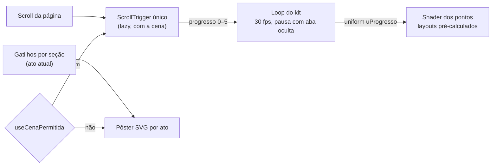

<!--
  O que faz: roteiro da cena 3D narrativa da landing pública — o que cada
  ato mostra, em que seção, em que faixa do scroll e como degrada.
  Por que existe: a cena conta uma história que precisa ser entendida por
  quem nunca usou uma ferramenta de segurança; o roteiro vem antes do código.
  Quem consome: Rafael, banca/apresentação e quem mexer em
  `app/web/src/components/landing/scene/`.
-->

# Landing narrativa — roteiro da cena

> [!NOTE]
> **Estado (2026-10-23):** roteiro escrito na Fase 4.1 do refactor
> `web-motion-3d` e implementado na Fase 4.2. As seções 6 e 7 registram o que
> foi medido.

## 1. A ideia em uma frase

Enquanto a pessoa rola a página, um campo de pontos atrás do texto conta a
mesma história que o texto conta: **o sistema funciona → tem falhas → o
Vulnera encontra → organiza → ajuda a corrigir → fica estável.**

Cada ponto é uma "peça" de um sistema qualquer. Não há números nem nomes na
cena. Ela é uma **ilustração do conceito**, não um painel de dados. As cores de
severidade (vermelho, laranja, âmbar, azul) significam o mesmo que no produto,
mas os pontos não representam nenhum finding real.

> [!IMPORTANT]
> A cena é decoração: `aria-hidden`, sem foco, `pointer-events: none`. Todo o
> conteúdo continua no HTML. Quem não vê a cena (leitor de tela, movimento
> reduzido, navegador sem WebGL) não perde nenhuma informação.

## 2. Para quem é

O público da apresentação inclui alunos iniciantes de Desenvolvimento de
Sistemas. Por isso:

- cada ato tem **uma ideia só**, que se entende sem saber o que é CVSS;
- a mudança entre atos é lenta e acompanha o scroll — quem para de rolar vê a
  cena parar junto;
- nada pisca rápido, nada voa na direção da tela (sem câmera em movimento).

## 3. Os seis atos

A página não muda de estrutura: as seções HTML rolam normalmente, sem
scroll-jacking, sem biblioteca de smooth scroll e sem bloco fixado. A cena fica
num canvas fixo atrás do conteúdo e lê um único número, o **progresso
narrativo**, que vai de `0` (topo) a `5` (último ato). O progresso inteiro `k`
é alcançado quando a seção que abre o ato `k` chega ao meio da tela; entre duas
seções, ele cresce em linha reta.

| Ato | Ideia | Seções HTML | Progresso | Estado da cena | Pôster estático (fallback) |
|---|---|---|---|---|---|
| **0 · Funciona** | "O sistema está rodando." | Hero | 0 | Grade calma de pontos violeta, respirando devagar. | Grade de pontos uniforme. |
| **1 · Mas tem falhas** | "Nem tudo está bem — e não dá pra ver de longe." | O problema | 0 → 1 | Alguns pontos (≈ 1 em 7) começam a pulsar de leve, ainda sem cor de severidade. | Mesma grade; os pontos com falha aparecem com um anel. |
| **2 · Encontrar** | "O Vulnera varre e acha." | Como funciona | 1 → 2 | Um feixe vertical atravessa a tela da esquerda para a direita; ao passar, revela a cor de severidade de cada ponto com falha. | Grade com os pontos com falha já coloridos e o feixe parado no meio. |
| **3 · Organizar** | "Cada falha vai para o seu lugar." | Recursos, Comparativo, Demo | 2 → 3 | Os pontos com falha saem da grade e se agrupam em quatro nuvens nas laterais, onde não há texto: as menos graves (azul, âmbar) à esquerda, as mais graves (laranja, vermelho) à direita. Os pontos saudáveis ficam na grade, mais apagados. | Os quatro grupos nas laterais. |
| **4 · Corrigir** | "Corrigido, volta pro lugar." | Maturidade | 3 → 4 | A maior parte dos pontos agrupados (os mais graves primeiro) volta para a grade e muda para o verde de "resolvido". | Grade com pontos verdes e poucos grupos restantes. |
| **5 · Estável** | "Sob controle." | Planos, FAQ, Time, Chamada final | 4 → 5 | Grade calma de novo, com os pontos verdes assentados e só alguns ainda em acompanhamento. | Grade com pontos verdes. |

## 4. Como cada ato degrada

| Situação | O que a pessoa vê |
|---|---|
| WebGL2 disponível, sem movimento reduzido, tela ≥ 768 px | A cena WebGL completa. |
| Movimento reduzido | O pôster estático do ato atual. A troca de ato é um **crossfade** curto (só opacidade, `--duration-fast`); nenhum ponto se desloca, não há pulso nem feixe andando. |
| Sem WebGL2, ou falha ao baixar a cena | O pôster estático, com a mesma troca por ato. |
| Contexto WebGL perdido no meio da sessão | A cena some e o pôster, que sempre esteve embaixo, fica sozinho. |
| Tela < 768 px | O pôster estático (decidido por medição — seção 6). |

O pôster é SVG gerado pelo mesmo algoritmo de posições da cena (mesma
semente). Por isso grade, grupos e pontos corrigidos ficam nos mesmos lugares
nas duas versões.

## 5. Cores e legibilidade

- **Pontos saudáveis e feixe:** paleta da landing (`--vx-accent`,
  `--vx-accent-soft`, em `landing.css`).
- **Severidade e "resolvido":** os tokens do produto (`--color-severity-*`,
  `--color-success`, em `tokens.css`), nos dois temas.
- A cena lê essas cores em runtime pelo resolvedor do kit
  (`src/three/palette.ts`) e troca junto com o tema. Não há cor em hex no
  código da cena.
- Texto sobre a cena precisa manter **AA**. Só limitar a opacidade dos pontos
  não basta: o rótulo violeta pequeno (`--vx-accent`, 4,88:1 sobre o fundo no
  tema escuro) só suportaria pontos a 3,5% — invisíveis. Por isso os blocos de
  conteúdo ganham uma **superfície** (`.vx-superficie`, 92% da cor de fundo):
  a cena aparece inteira nas margens e entre as seções e fica atenuada atrás
  das letras.
- O teste `scene-contrast.test.ts` faz a conta do pior caso — dois pontos em
  destaque sobrepostos mais o feixe, atrás da superfície — para cada cor de
  texto × cada cor da cena, nos dois temas, lendo as cores reais de
  `landing.css` e `tokens.css`. Exige ≥ 4,5:1.
- A medição achou um problema anterior à cena: `--vx-text-3` reprovava AA até
  sobre o fundo puro (4,19:1 no escuro, 3,65:1 no claro). Ele foi ajustado só
  na luminosidade OKLCH, mantendo a matiz.

## 5.1 Acabamento sem poluir (boas práticas aplicadas)

Pesquisa feita em 2026-10-27 (fontes no fim). O que guiou a cena:

| Prática | Como está na cena |
|---|---|
| WebGL sempre atrás do texto; título e CTA legíveis em menos de 3 s; movimento de baixa amplitude, secundário ao texto | Superfície AA atrás dos blocos; centro do hero limpo; paralaxe de poucos pixels |
| "Comunicar o comportamento do sistema, não brilho aleatório" | A cena conta a narrativa da página, ato a ato |
| Uma linguagem visual dominante, sem empilhar efeitos | Só pontos e um feixe; sem bloom, pós-processamento ou textura |
| Profundidade sutil | Cada ponto tem uma camada (`aProfundidade`): tamanho, opacidade e paralaxe proporcionais — volume sem mover câmera |
| "Se nada anima, não renderize todo quadro" | Render sob demanda: só desenha quando progresso, ponteiro, tema ou tamanho mudam, ou durante o pulso do ato 1 |
| Movimento por uniform no vertex shader, sem reenviar posições | Layouts pré-calculados; a CPU atualiza 3 uniforms |
| DPR limitado, pôster primeiro, reduced-motion, perda de contexto, descarte em troca de rota | DPR ≤ 1,5; pôster SVG; gate do kit; `forceContextLoss` + canvas novo por montagem |
| `mediump` em GPU móvel | `precision: "mediump"` nos dois materiais |

Fontes: [Utsubo — 100 Three.js tips (2026)](https://www.utsubo.com/blog/threejs-best-practices-100-tips) ·
[WebGL landing steering](https://www.ui-skills.com/skills/mengto/webgl-landing-steering/) ·
[Recriando os design systems de Stripe, Linear e Vercel](https://opendesigner.io/pt-br/blog/recreating-stripe-linear-vercel-design-systems-with-design-md)
(guias práticos, não pesquisa acadêmica; os números de contraste vêm do nosso teste).

## 6. Decisões tomadas por medição

<!-- Preenchido na implementação (Fase 4.2). -->

Ver `output/web-motion-3d/FASE-4.md` para os números.

## 7. Arquitetura (resumo)

- Um canvas só (`montarCena` do kit), fixo atrás do conteúdo.
- As posições de cada ato são calculadas **uma vez** em atributos do
  `BufferGeometry`; a GPU interpola pelo uniform de progresso. Nenhum vértice
  é movido na CPU a cada quadro e nenhum `setState` do React acontece por
  quadro.
- A quantidade de pontos depende do aparelho (largura da tela e
  `navigator.hardwareConcurrency`).
