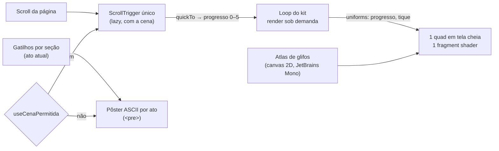

<!--
  O que faz: roteiro da cena narrativa ASCII da landing pública — o que cada
  ato mostra, em que seção, em que faixa do scroll e como degrada — e da
  atmosfera ASCII discreta da área autenticada.
  Por que existe: a cena conta uma história que precisa ser entendida por
  quem nunca usou uma ferramenta de segurança; o roteiro vem antes do código.
  Quem consome: Rafael, banca/apresentação e quem mexer em
  `app/web/src/components/landing/scene/` ou na atmosfera do dashboard.
-->

# Landing narrativa — roteiro da cena

> [!NOTE]
> **Estado (2026-10-30):** implementado e validado no container `:8086`
> (Fase 4 do refactor `web-motion-3d`). A primeira versão, um campo de
> **pontos** WebGL, foi substituída por uma cena de **caracteres ASCII**
> depois do retorno do Rafael (os pontos pareciam genéricos e pesados). O
> roteiro dos seis atos não mudou; mudou o material. Ver §8.

## 1. A ideia em uma frase

Enquanto a pessoa rola a página, um campo de caracteres de terminal atrás do
texto conta a mesma história que o texto conta: **o sistema funciona → tem
falhas → o Vulnera encontra → organiza → ajuda a corrigir → fica estável.**

A estética é de terminal "hacker" — glifos monoespaçados, varredura em blocos,
acentos neon ciano/magenta sobre a paleta violeta da marca —, inspirada na
linguagem visual de interfaces de hacking como a do jogo *Watch Dogs 2*.

> [!WARNING]
> **Só a linguagem visual é referência.** Nenhum logo, fonte proprietária,
> ícone, nome ou asset do jogo (Ubisoft/DedSec) é usado. Os glifos são
> caracteres Unicode comuns desenhados com a JetBrains Mono (licença OFL),
> já presente no projeto.

Não há números de negócio nem nomes na cena. Ela é uma **ilustração do
conceito**, não um painel de dados. As cores de severidade significam o mesmo
que no produto, mas nenhum glifo representa um finding real — severidade e
correção são sorteadas.

> [!IMPORTANT]
> A cena é decoração: `aria-hidden`, sem foco, `pointer-events: none`. Todo o
> conteúdo continua no HTML. Quem não vê a cena (leitor de tela, movimento
> reduzido, navegador sem WebGL) não perde nenhuma informação.

## 2. Para quem é

O público da apresentação inclui alunos iniciantes de Desenvolvimento de
Sistemas. Por isso:

- cada ato tem **uma ideia só**, que se entende sem saber o que é CVSS;
- a mudança entre atos acompanha o scroll — quem para de rolar vê a cena
  parar junto;
- nada pisca rápido nem voa na direção da tela (sem câmera em movimento). O
  "cintilar" dos caracteres troca poucos glifos, 8 vezes por segundo.

## 3. Os seis atos

A página não muda de estrutura: as seções HTML rolam normalmente, sem
scroll-jacking, sem biblioteca de smooth scroll e sem bloco fixado. A cena
fica num canvas fixo atrás do conteúdo e lê um único número, o **progresso
narrativo**, de `0` (topo) a `5` (último ato). O progresso inteiro `k` é
alcançado quando a seção que abre o ato `k` (`section[data-ato="k"]`) chega ao
meio da tela; entre duas seções, ele cresce em linha reta.

| Ato | Ideia | Seções HTML | Estado da cena | Pôster (fallback) |
|---|---|---|---|---|
| **0 · Funciona** | "O sistema está rodando." | Hero | Campo calmo: rampa `. · : - + =` e binário `0 1`, esparso no centro (atrás do título) e mais cheio nas laterais (vinheta). | O mesmo campo, parado. |
| **1 · Mas tem falhas** | "Nem tudo está bem — e não dá pra ver de longe." | O problema | ≈ 4,5% das células viram `!` e pulsam de leve, ainda sem cor de severidade. | `!` nas mesmas células. |
| **2 · Encontrar** | "O Vulnera varre e acha." | Como funciona | Uma varredura vertical em blocos `░▒▓█` ciano, com franja magenta, atravessa a tela; ao passar, cada `!` revela o glifo e a cor da severidade (`%` baixa, `#` média, `×` alta, `@` crítica). | Varredura parada no meio, severidades já reveladas. |
| **3 · Organizar** | "Cada falha vai para o seu lugar." | Recursos, Comparativo, Demo | As falhas saem da grade e formam quatro grupos nas laterais, onde não há texto: menos graves à esquerda, mais graves à direita. | Os quatro grupos. |
| **4 · Corrigir** | "Corrigido, sai da lista." | Maturidade | Começa pelo mais grave: crítica e alta sempre, média pela metade, baixa nunca. O que foi corrigido vira `✓` verde e o grupo se dissolve. | `✓` nas células corrigidas; baixa e metade da média seguem nos grupos. |
| **5 · Estável** | "Sob controle." | Planos, FAQ, Time, Chamada final | Campo calmo de novo, com `✓` assentados e o risco residual (baixa) em acompanhamento. | Idem. |

> [!TIP]
> O "baixa nunca é corrigida" é deliberado: mostra **priorização** e risco
> residual aceito, que é como um programa de segurança real funciona.

## 4. Como cada ato degrada

| Situação | O que a pessoa vê |
|---|---|
| WebGL2, sem movimento reduzido, tela ≥ 768 px | A cena WebGL completa. |
| Movimento reduzido | O pôster ASCII do ato atual. A troca de ato é um **crossfade** (só opacidade, `--duration-slow`); nenhum glifo anda, não há pulso nem varredura. |
| Sem WebGL2, sem canvas 2D para o atlas, ou falha ao baixar a cena | O pôster, com a mesma troca por ato. |
| Contexto WebGL perdido no meio da sessão | A cena some e o pôster, que sempre esteve embaixo, assume. |
| Tela < 768 px | O pôster (decidido por medição — §6). |

O pôster é um `<pre>` com um `` por glifo, gerado por
`scene/layout.ts`, que espelha a regra do shader célula por célula (mesmas
proporções, vinheta, centros dos grupos e regra de correção). O sorteio do
pôster usa um hash inteiro próprio, reprodutível em qualquer navegador.

## 5. Técnica

- **Um quad, uma draw call.** A tela é dividida em células (12 px CSS de
  largura × DPR; a altura sai da proporção da fonte). Para cada pixel o
  fragment shader descobre a célula, decide o glifo e a cor pelo ato e lê a
  cobertura no atlas (`src/three/ascii.ts`). Não há geometria por caractere.
- **Render sob demanda.** O loop do kit roda a 30 fps no máximo, mas só
  desenha quando o progresso muda, quando muda o tique (8/s, o "cintilar"), o
  tema ou o tamanho. Parada, a cena custa 8 quadros por segundo.
- **Sem estado React por quadro.** O progresso vai de um ScrollTrigger para um
  `gsap.quickTo` e dele para um uniform.
- **Kit compartilhado.** Hospedeiro (DPR ≤ 1,5, low-power, perda de contexto),
  loop, descarte e paleta vêm de `src/three/`. As cores são lidas dos tokens
  em runtime (`--vx-accent`, `--vx-cyan`, `--vx-magenta`,
  `--color-severity-*`, `--color-success`) e trocam junto com o tema.
- **Canvas novo por montagem**, criado pelo hook dentro do hospedeiro: o
  `forceContextLoss` do descarte não envenena a remontagem do StrictMode.
- Detalhes visuais: scanlines a cada 3 linhas de pixel e, raramente, uma faixa
  de "glitch" que desloca duas células — os dois só no WebGL.

## 6. Cores e legibilidade

- Texto sobre a cena mantém **AA**. Os blocos de conteúdo ganham uma
  superfície (`.vx-superficie`, 92% da cor de fundo): a cena aparece inteira
  nas margens e entre as seções e fica atenuada atrás das letras.
- `scene-contrast.test.ts` calcula o pior caso — dois glifos em destaque e a
  varredura empilhados atrás da superfície — para cada cor de texto × cada cor
  da cena (paleta, ciano, magenta, severidades, resolvido), nos dois temas,
  lendo as cores reais de `landing.css` e `tokens.css`. Exige ≥ 4,5:1.
- `--vx-text-3` reprovava AA mesmo sobre o fundo puro (4,19:1 no escuro,
  3,65:1 no claro) antes da cena; foi ajustado só na luminosidade.
- O ciano/magenta neon existe como token da landing (`--vx-cyan`,
  `--vx-magenta`), com versões escuras no tema claro.

## 7. Decisões tomadas por medição

| Decisão | Medida | Evidência |
|---|---|---|
| Pôster abaixo de 768 px | Fração da tela livre das superfícies, atos 0→5: **375 px** 54% e depois 15% em todos; **768 px** 55/38/48% e 16/14/18%; **1440 px** 79/59/59/40/35/40%. Em 375 px a cena ficaria escondida em 5 dos 6 atos, gastando GPU de celular para nada. 768 px fica no limite (atos 3–5 parecidos com 375); manteve-se o corte padrão do kit (ADR-041) — registrado para reavaliar com aparelho real. | `output/web-motion-3d/landing-ascii/fase4-landing-matrix.json` (`areaLivrePorAto`) |
| Render sob demanda com tiques | Parado no rodapé: **23 quadros em 3 s** (antes: 181 desenhos em 3 s com o hero fora da tela). | `landing-ascii/landing-perf-fase4.json` × `baseline/landing-perf-baseline.json` |
| Fim da intro 3D | A intro levava 7,4 s com long tasks de até 451 ms e ignorava movimento reduzido. Agora: 0 long tasks na rolagem. | `baseline/landing-perf-intro.json` |
| Rolagem | **57,2 / 57,7 fps** de média (mínimo 49) contra 43,2 / 38,6 (mínimo 22) no baseline — mesma máquina, mesmo protocolo, GPU Iris Xe. | idem |
| Hash do pôster com avalanche completa | O hash inicial dava 98% de `0` no binário (sais correlacionados, r = −0,5); com o fmix32 do MurmurHash3, \|r\| < 0,03. | teste NAR-11 |

## 8. Atmosfera ASCII da área autenticada

A mesma técnica, em versão **discreta**, substituiu as ondas e órbitas do
dashboard (um canvas global no layout, decoração, nada sobre dado):

- campo esparso (~12% das células) com a rampa `. · : - +` e poucas colunas
  de "chuva" em `:` e `|`, mais presentes no topo;
- **sem dígitos**: no produto número é dado, e um `0`/`1` ao lado de um KPI,
  breadcrumb ou aba seria lido como tal (teste CENA-06);
- 14 px por célula, **4 tiques por segundo**, opacidade máxima 0,24 (escuro) e
  0,16 (claro), cores `--color-ambient-ink` e `--color-ambient-muted`;
- as superfícies do produto (hero, KPIs, cards de severidade) ficam quase
  opacas até a borda: a atmosfera aparece nos vãos e margens, nunca atrás de
  texto ou número;
- movimento reduzido, tela < 768 px ou sem WebGL2: o chunk de three nem é
  baixado e fica o fundo CSS.

## 9. Histórico

| Data | Mudança |
|---|---|
| 2026-10-23 | Roteiro dos seis atos (Fase 4.1) e primeira implementação com campo de **pontos** WebGL e pôster SVG. |
| 2026-10-27 | Pontos substituídos por **caracteres ASCII** (estética de terminal, neon) na landing e na área autenticada, a pedido do Rafael. Pôster passa a ser `<pre>`. |
| 2026-10-30 | Hash do pôster corrigido; atmosfera do produto sem dígitos; medições finais (§7). |

### Boas práticas consultadas (2026-10-27)

| Prática | Como está na cena |
|---|---|
| WebGL sempre atrás do texto; título e CTA legíveis de imediato | Superfície AA atrás dos blocos; vinheta deixa o centro do hero esparso |
| Comunicar o comportamento do sistema, não brilho aleatório | A cena conta a narrativa da página, ato a ato |
| Uma linguagem visual dominante, sem empilhar efeitos | Só glifos; sem bloom nem pós-processamento |
| "Se nada anima, não renderize todo quadro" | Render sob demanda com tiques |
| DPR limitado, pôster primeiro, reduced-motion, perda de contexto | DPR ≤ 1,5; pôster ASCII; gate do kit; canvas novo por montagem |
| `mediump` em GPU móvel | `precision: "mediump"` no material |

Fontes: [Utsubo — 100 Three.js tips (2026)](https://www.utsubo.com/blog/threejs-best-practices-100-tips) ·
[WebGL landing steering](https://www.ui-skills.com/skills/mengto/webgl-landing-steering/) ·
[Recriando os design systems de Stripe, Linear e Vercel](https://opendesigner.io/pt-br/blog/recreating-stripe-linear-vercel-design-systems-with-design-md)
(guias práticos, não pesquisa acadêmica; os números de contraste e
desempenho vêm dos nossos testes e medições).
