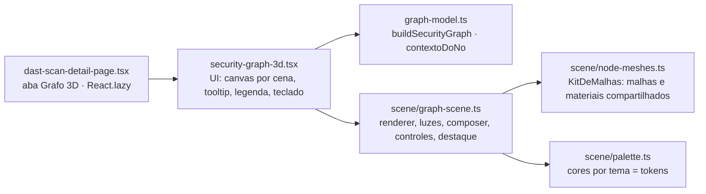
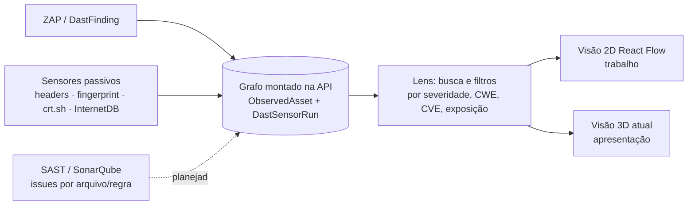

# Relatório do turno da noite — Grafo 3D do scan DAST

**Data:** 2026-10-30 · **Branch:** `feat/security-graph` (base `dev` em `44f9c58`) · **Leitura:** ~4 min

## 1. Resumo executivo

O detalhe de um scan DAST ganhou a aba **Grafo 3D**: o caminho de exposição
**Internet → alvo → endpoint → finding**, desenhado com os findings reais do scan.
A primeira versão (esferas e cubos lisos) foi reconstruída como cena de apresentação:

- **Objetos com identidade:** globo com clearcoat, meridianos emissivos, atmosfera e satélite em órbita
  (Internet); rack de servidor com lâminas metálicas arredondadas e LEDs de atividade (alvo); porta hexagonal
  metálica com núcleo emissivo (endpoint); cristal facetado iridescente na cor da severidade, com halo
  pulsante no HIGH (finding).
- **Luz e material:** PBR com ambiente procedural (`RoomEnvironment` + PMREM), luz de três pontos
  (key quente com sombra suave, fill frio, rim na cor da marca), tone mapping ACES e piso com grade polar e sombra.
- **Pós-processamento:** MSAA 4×, contorno de hover/seleção (`OutlinePass`), bloom HDR (`UnrealBloomPass`)
  só no que é emissivo de propósito.
- **Interação:** OrbitControls com amortecimento, giro de apresentação que pausa sob o mouse, tooltip,
  clique que acende o caminho até a Internet e apaga o resto, foco de câmera no nó, "Recentralizar",
  teclado (setas e Esc) e anúncio `aria-live`.

Prints antes/depois: `docs/evidencias/security-graph/` (`00-antes…` × `01-visao-geral…`).

## 2. O que mudou

| Arquivo | Papel |
| --- | --- |
| `app/web/src/features/security-graph/graph-model.ts` | Topologia pura (testável): nós, arestas, teto de 300, contexto de um nó |
| `…/scene/node-meshes.ts` | Fábrica de malhas por tipo; geometrias e materiais **compartilhados** (1 por tipo/severidade) |
| `…/scene/graph-scene.ts` | Ciclo de vida do three sem React; único ponto de `dispose()` |
| `…/scene/palette.ts` | Cores por tema espelhando os tokens; força do bloom por tema |
| `…/security-graph-3d.tsx` | Casca React: cria um canvas por cena, liga teclado e legenda |
| `app/web/src/pages/dast-scan-detail-page.tsx` | Aba nova, só com WebGL disponível |

**Otimizações:** materiais e geometrias compartilhados; arestas numa única `LineSegments` com cor por vértice;
partículas num `InstancedMesh` (1 draw call); raycast no máximo uma vez por quadro; sombra a cada 2 quadros;
DPR ≤ 1,5; RAF pausado com a aba oculta ou o canvas fora da tela; enquadramento pela caixa do grafo e pela
proporção do canvas.

**Bugs achados e corrigidos durante a validação:**

1. Trocar o tema deixava a cena esticada (o canvas herdava a largura do renderer anterior).
2. Abrir a aba ~16 vezes estourava o limite de contextos WebGL ("Too many active WebGL contexts").
   Agora há um canvas por cena e `forceContextLoss()` no `dispose`; 26 aberturas seguidas, 0 avisos.
3. A roda do mouse sobre a cena prendia a rolagem da página. O zoom agora só vale com a cena em foco.
4. Cristais estouravam em branco no bloom. Ajustei clearcoat e threshold.
5. O botão "Recentralizar" saía do lugar (`press` redefine `position`) e a legenda cobria o botão no celular.

## 3. Validação

| Verificação | Resultado |
| --- | --- |
| `tsc --noEmit` | ✅ sem erros nos arquivos versionados (o único erro é do `e2e/exposure-remediation-lifecycle.spec.ts`, não rastreado e anterior) |
| `npm run lint` | ✅ 0 erros; 9 avisos anteriores, nenhum nos arquivos novos |
| `npm run check:contrast` | ✅ todos os pares WCAG AA |
| `vitest run` (web inteiro) | ✅ 405/407. As 2 falhas estão em `findings-table.test.tsx`, **não rastreado** e sem relação com o grafo |
| Testes novos | ✅ 7: topologia, truncamento, contexto do nó, fábrica de malhas, materiais compartilhados, layout |
| `vite build` | ✅ three e cena só em chunks lazy; `index-*.js` igual (1.771,8 kB) |
| Navegador (Docker :8086) | ✅ hover, clique, caminho, teclado, tema claro/escuro, 375 px, rolagem, console limpo |
| FPS | ✅ 60,2 FPS / pior quadro 16,8 ms com 24 **e** com 300 nós |

## 4. Pendências e dívidas técnicas

Fiz tudo o que dava para fazer nesta entrega. O que ficou aberto não dá para fechar nesta máquina ou depende das fases seguintes da spec:

- **`prefers-reduced-motion` não foi emulado no navegador.** O caminho está no código (sem giro, animação
  ociosa nem partículas), mas não foi visto rodando.
- **FPS só medido nesta máquina (monitor 60 Hz).** Falta GPU integrada fraca e celular real (SG-FUT-02).
- **Sem teste de unidade do `GraphScene`**: o jsdom não tem WebGL. A cena foi coberta no navegador real,
  e a topologia, o layout e as malhas em Vitest.
- **Sem E2E Playwright novo.** A validação ponta a ponta foi manual no navegador do app, com prints.
- **Escopo:** o grafo usa só dados do ZAP. Sensores, `ObservedAsset`, a ligação scan → Aplicação e a visão 2D
  (React Flow) da spec continuam por fazer (SG-FUT-01).
- **Fora do escopo, encontrado no caminho:** `findings-table.test.tsx` e `e2e/exposure-remediation-lifecycle.spec.ts`
  (não rastreados, seus) falham. Não mexi neles.

## 5. Próximos passos — Security Intelligence & Discovery

O módulo já está preparado para crescer sem reescrever a cena:

- **Contrato estável.** `SecurityGraph { nodes, edges, truncated }` é o mesmo formato que a spec define
  para `GET /dast/scans/:id/graph`. Trocar `buildSecurityGraph` pela resposta da API não toca em `scene/`.
- **Tipos de nó plugáveis.** CVE, tecnologia, subdomínio, IP e serviço entram como um `case` em
  `KitDeMalhas.criar` mais uma camada em `CAMADA_X`. O destaque de caminho (`contextoDoNo`) já é genérico.

1. **Lens & Graph Analytics.** Uma página `/intelligence` que reaproveita `features/security-graph/` com uma
   barra de consulta (o Query Wizard de findings já tem parser e sugestões reaproveitáveis) e filtros que
   acendem subgrafos usando o mesmo mecanismo de `contextoDoNo`.
2. **DAST findings & CVE mapping.** Hoje o schema só tem `cweId`, sem modelo de CVE. O caminho da spec é o
   sensor de fingerprint (versões em `Server`/`X-Powered-By`) mais o InternetDB, gerando findings
   "CVE potencial · não validado" que só viram `Vulnerability` por promoção humana.
3. **SAST / SonarQube.** Hoje o Sonar existe só como scan de CI do próprio repositório
   (`.github/workflows/build.yml`, `sonar-project.properties`; evidência pendente em
   `docs/evidencias/sonarqube/`). Para virar fonte do produto, falta decidir **onde roda** (Docker local
   como o ZAP, ou SonarCloud), **como entra** (Web API `api/issues/search` → `SastFinding`) e **como cruza**
   com o DAST (CWE em comum, arquivo/rota). Essas três decisões pedem ADR antes de codar.

## 6. Atualização da manhã — CyberGraph

Pedido do Rafael na manhã de 2026-10-30, na mesma branch: a aba virou **CyberGraph**, com modo 2D
(SVG, padrão) inspirado em visualizações de caminho de ataque, alternância 2D/3D ao lado de
"Recentralizar", painel do nó, modal de detalhes, arraste livre de nós com "Restaurar layout" e nomes
fixos abaixo dos objetos no 3D. Decisões tomadas com ele antes de codar: só dados reais (sem faixa de
sensores nem alerta de divergência, que dependem da Fase 1), painel + modal, modal só leitura com
atalho para a aba Achados, findings agrupados por endpoint. Detalhes no ADR-048 (Evolução), em
`docs/DAST.md` §11.5 e nos prints 07–17 de `docs/evidencias/security-graph/`.

---
PR: `feat/security-graph` → `dev` (link na mensagem final da sessão).
