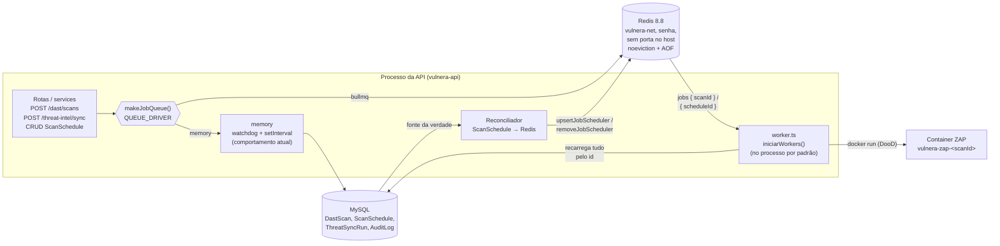

<!-- Registra por que e como o Vulnera troca a fila DAST em memória e o setInterval da Threat Intel por BullMQ + Redis, com worker que pode sair do processo da API sem mudar código, e como os scans DAST agendados por aplicação são guardados, reconciliados e conferidos na execução; consumido pelos mantenedores e pela banca. -->

# ADR-056: Fila BullMQ com worker desacoplável e scans DAST agendados

> [!info] Origem
> Issue #76 ("Fila de mensagens e jobs agendados"), refinada com o Rafael em
> 2026-11-18. Base: `dev` em `95f3252` (merge do PR #81). Branch da Fase 0:
> `feat/fila-fase0-adr`. O número 055 já estava ocupado pelo ADR do terreno da
> landing, por isso este é o 056.

> [!warning] Status: PROPOSTA
> Este ADR descreve o desenho antes da implementação (Fases 1 a 6). Ele passa a
> `vigente` quando a Fase 4 (fila DAST) for aprovada com o padrão
> `QUEUE_DRIVER=bullmq`. Até lá, o comportamento em produção continua o do
> ADR-030/031/053.

> [!warning] Supersede PARCIALMENTE o [[ADR-030 - Execucao assincrona sem fila]]
> **Continua valendo:** estado do scan no banco, polling da UI, expiração
> preguiçosa onde dá, e o próprio modo sem fila (`QUEUE_DRIVER=memory`), que
> vira o caminho de rollback. **Deixa de valer**, com `bullmq` ligado: "sem
> Redis", "fila só na memória" e "todo QUEUED no boot é órfão".

> [!warning] Supersede PARCIALMENTE o [[ADR-053 - Threat Intel com inventario de tecnologias e sincronizacao agendada]]
> Só o §4 (o `setInterval` do `agendador.ts`). Fontes, inventário,
> notificações, triagem e permissões continuam iguais.

## Contexto

A Fase 0 (investigação somente leitura, 2026-11-18) confirmou no código:

- **Fila DAST em memória.** `dast-watchdog.service.ts` guarda uma fila FIFO no
  processo, com concorrência `DAST_MAX_CONCURRENT_SCANS` (padrão 1), pulso por
  `DAST_HEARTBEAT_TIMEOUT_MS` e um anel de 20 alertas exposto em
  `GET /api/dast/scans/status`. No boot, `recoverOrphanedScans()` marca
  **todo** QUEUED/RUNNING como FAILED (`server.ts`, sem `await`).
- **Threat Intel com relógio próprio.** `agendador.ts` usa `setTimeout` (1 min)
  e `setInterval` (`THREAT_INTEL_SYNC_INTERVAL_MIN`, piso de 15 min). Ninguém
  chama a função de parada. A trava de "uma execução por vez" é uma flag do
  processo mais a linha RUNNING no `ThreatSyncRun`.
- **Falha real não vira simulado.** Desde o [[ADR-042 - DAST explicito e baseline passivo]],
  o modo é escolhido na criação e `runScan` devolve FAILED no modo REAL. O
  comentário do schema sobre "fallback" está desatualizado.
- **Persistência idempotente.** Findings têm `@@unique([scanId, fingerprint])`
  com `createMany({ skipDuplicates })`, e os contadores são recalculados por
  `groupBy`. Sensores usam `upsert`, e ativos usam `@@unique` com `skipDuplicates`.
  A persistência é **aditiva**: um segundo run não apaga o que o primeiro gravou.
- **Sem tenant no scan.** `DastScan` só tem `targetUrl` e `requestedById`. Um
  PENTESTER vê só os scans que ele pediu, e o ADMIN vê todos.
- **Simulado fica de fora por tabela.** Métricas, SLA, VRS, notificações e
  Exposure Graph leem `Vulnerability`, e a promoção recusa finding de scan
  simulado. Nenhum desses serviços filtra `simulated` de forma explícita.

A issue #76 listava **quatro** problemas (o texto dizia "três"): a fila se
perde num restart, não há retry nem histórico, não há agendamento e o worker
não escala separado da API. Parte dos casos de uso dela (NVD, KEV, EPSS, OSV e
aviso de CVE nova) **já foi entregue** pelo ADR-053. Para esses itens, o que
resta é trocar o motor.

## Decisão

### 1. Arquitetura

Três filas, uma por assunto:

| Fila | Job | Agendamento | Concorrência | Tentativas |
|---|---|---|---|---|
| `dast-scan` | `{ scanId }`, `jobId = scanId` | nenhum | `DAST_MAX_CONCURRENT_SCANS` | 1 (ver §4) |
| `threat-intel` | `{ trigger, assetIds? }` | scheduler fixo `threat-intel-sync` (`every`) | 1 | 3, backoff exponencial (ver §5) |
| `dast-schedule` | `{ scheduleId }` | um scheduler por linha: `dast-schedule:<id>` (`pattern` + `tz`) | 1 | 1 |

O job de `dast-schedule` não roda o ZAP. Ele confere a autorização (§6), cria o
`DastScan` e enfileira em `dast-scan` como qualquer scan manual. Existe um só
caminho de execução de scan.

### 2. Driver por flag e factory (rollback)

- `QUEUE_DRIVER=memory|bullmq`, com padrão **`memory`** até a Fase 4 ser
  aprovada. Com `memory`, o watchdog e o `setInterval` rodam exatamente como
  hoje.
- Uma interface pequena (`JobQueue`), escolhida por factory (A1). O driver
  `memory` embrulha o watchdog atual, e o driver `bullmq` fala com o Redis. Ela
  não generaliza além de DAST, Threat Intel e agendamentos.
- Para voltar ao modo atual, basta `QUEUE_DRIVER=memory` e reiniciar a API. Não
  há migration a desfazer, porque o schema novo é só aditivo.

### 3. Worker desacoplável

- `src/worker.ts` exporta `iniciarWorkers()`. O `server.ts` chama essa função
  só quando `QUEUE_DRIVER=bullmq` e `WORKER_IN_PROCESS` não é `false`. O
  `app.ts` **nunca** inicia worker (A6), porque os testes importam o `app`.
- O script `npm run worker` roda o mesmo arquivo como processo próprio. Separar
  o worker no futuro exige só mudar o compose: um serviço com
  `command: npm run worker` e `WORKER_IN_PROCESS=false` na API.
- O payload leva **só ids**. O worker recarrega scan, agendamento e aplicação
  do banco. Nada de URL, token ou segredo no Redis.
- O worker usa uma conexão ioredis com `maxRetriesPerRequest: null`, e o
  encerramento fecha workers e filas em `SIGINT`/`SIGTERM` (guia "Going to
  production" do BullMQ).

### 4. Fila DAST

- `POST /dast/scans` continua criando o registro QUEUED. Em seguida, enfileira
  `{ scanId }` com `jobId = scanId`. O BullMQ ignora um segundo `add` com o
  mesmo `jobId`.
- **Guarda de idempotência:** no início do job, o worker recarrega o scan e só
  segue se o status for QUEUED. Qualquer outro status encerra o job sem efeito.
- **`attempts: 1`.** A persistência é idempotente, mas um retry automático
  tornaria a disparar um scan ativo contra o alvo, e o ADR-042 limita esse
  impacto. Além disso, a guarda acima já faria um retry virar no-op, porque o
  scan sai de QUEUED na primeira tentativa. Uma falha vira FAILED visível, e o
  pentester decide se dispara de novo. Uma falha real **nunca** vira simulado.
- **`maxStalledCount: 0` na fila DAST.** O padrão do BullMQ (1) devolveria para
  `waiting` um job cujo worker morreu. Com o worker no processo da API, isso
  significa que a API caiu e o container ZAP ficou órfão. O job vai direto
  para `failed`, e o boot (abaixo) dá o veredito no banco.
- **Boot com `bullmq`** (substitui o `recoverOrphanedScans` atual):
  - RUNNING → mata o container `vulnera-zap-<scanId>` e marca FAILED, como hoje.
    Nenhum worker sobrevive com o processo.
  - QUEUED → **sobrevive**. Se o job não existir no Redis (Redis apagado),
    reenfileira com o mesmo `jobId`, porque o MySQL é a fonte da verdade.
  - A recuperação passa a ser aguardada antes de os workers começarem a
    consumir. Hoje ela não tem `await`.
- **Cancelamento:** se o job está `waiting`/`delayed`, `job.remove()`; se está
  `active` (job travado, que o BullMQ não remove), aborta o `AbortController`
  do job no worker e roda `docker rm -f`. O registro vira CANCELLED como hoje, e
  `markFinished` continua descartando resultado tardio.
- **Watchdog continua:** o pulso, o aborto por silêncio e o anel de alertas
  passam a ser alimentados pelo worker. O banner da tela DAST lê o mesmo
  `snapshot()`, e a posição na fila vem do Redis (`getWaiting`).
- **Lock "1 scan por alvo"** continua o mesmo `findActiveForTarget` antes de
  criar. O lock é check-then-create e não é atômico. Isso é uma limitação já
  existente, registrada e não corrigida aqui (I3).
- Os limites de CPU e memória do ZAP (`DAST_ZAP_MEMORY`, `DAST_ZAP_CPUS`) não
  mudam.

### 5. Threat Intel

- Com `bullmq`, o `agendador.ts` sai de cena e entra
  `upsertJobScheduler("threat-intel-sync", { every: max(15, N) min })`. O id
  fixo faz o upsert no boot não duplicar o agendamento.
- "Sincronizar agora" enfileira `{ trigger: "MANUAL" }`, e o `ThreatSyncRun`
  guarda o gatilho como hoje. O backfill de tecnologia (`ASSET`) também passa
  pela fila, com `assetIds`. A concorrência 1 substitui a flag `rodando` do
  processo, e a linha RUNNING no banco continua como segunda trava.
- **Retry:** uma fonte que falha continua virando PARTIAL dentro da execução
  (ADR-053), sem retry de job. O job só lança erro, e só então é retentado
  (`attempts: 3`, backoff exponencial), quando a execução inteira cai por causa
  transitória (rede ou banco). Erro de programação usa `UnrecoverableError`.
- O espaçamento das chamadas ao NVD **não é token bucket**: é um intervalo
  mínimo global no processo (`fontes.ts`, 6,5 s sem chave e 0,7 s com chave).
  Ele continua igual. Com o worker em outro processo, a busca de CPE da tela e o
  sync deixariam de compartilhar o espaçamento (ver riscos).
- Jobs que falham ficam retidos (`removeOnFail: { count: 50 }`), o equivalente
  a uma DLQ, e o `ThreatSyncRun` correspondente fica FAILED com o motivo.
- **Comportamento observado na Fase 3 (2026-11-18, BullMQ 6.7.7, compose):**
  - criar o scheduler, ou mudar o intervalo dele, dispara uma execução
    **na hora**. Isso equivale ao "1 min após o boot" do agendador em memória.
  - Reiniciar a API com o mesmo intervalo **não** dispara de novo nem muda o
    próximo horário, que continua guardado no Redis.
  - Matar a API (SIGKILL) no meio de um sync manual: no boot, o worker marca a
    linha RUNNING como FAILED ("interrompida"). Depois de ~30 s, o BullMQ
    detecta o job travado e o roda de novo, e o pedido manual não se perde.
  - Payload inválido falha na 1ª de 3 tentativas (`UnrecoverableError`) e fica
    retido no conjunto de falhas.
  - Uma exceção inesperada no meio da execução agora fecha a linha RUNNING
    como FAILED. Antes ela ficava até 2 h travando a próxima.

### 6. Scans DAST agendados

- **MySQL é a fonte da verdade.** A tabela `ScanSchedule` (Fase 1) é editada
  pela UI e auditada. O reconciliador, no boot e após cada criação, edição ou
  remoção, faz upsert de `dast-schedule:<id>` para cada linha habilitada e
  remove do Redis os schedulers sem linha correspondente. Rodar duas vezes dá o
  mesmo resultado, e apagar o Redis não perde agendamento.
- **Sem cron livre.** O usuário escolhe `frequency` (DAILY|WEEKLY), `hour`,
  `minute`, `dayOfWeek` e `timezone` (padrão `America/Sao_Paulo`). O servidor
  gera o `pattern` e passa `tz`.
- **Modo fixo na criação:** REAL ou SIMULATED. Um REAL que falha vira FAILED e
  gera notificação, nunca simulado.
- **Autorização do alvo é dado**, guardada na `Application`:
  `dastAuthorizedAt`, `dastAuthorizedById`, `dastAuthorizedUntil` e
  `dastAuthorizedHost` (só o host, normalizado).
- **Conferida na execução**, não só no cadastro. O job confere o agendamento
  habilitado, a Application ativa e da mesma empresa, a autorização vigente com
  o host igual ao da URL e nenhum scan ativo no alvo. Se alguma falha, o scan
  não roda: grava `lastOutcome`, notifica e registra `AuditLog`.
- O scan criado leva `trigger=SCHEDULED`, `scheduleId`, `companyId`,
  `applicationId`, `projectId` e o `mode` do agendamento. O `companyId` vem da
  Application (SEC2), nunca do body.

### 7. Quem pode o quê (respostas do Rafael em 2026-11-18)

| Pergunta | Decisão |
|---|---|
| Visibilidade dos scans | **Não muda.** O PENTESTER vê os scans que pediu, e o ADMIN vê todos. O scan agendado é registrado em nome de quem criou o agendamento (`requestedById = createdById`). |
| Criador inativo ou fora do projeto na hora de executar | **Bloqueia.** O scan não roda, e o motivo vai para `lastOutcome`, para a notificação e para o `AuditLog`. |
| Registrar ou revogar a autorização do alvo | **ADMIN** e **PENTESTER membro de um projeto da aplicação**. |
| `projectId` no agendamento | **Obrigatório para o PENTESTER**, que precisa ser membro do projeto. O ADMIN pode omitir. |
| CLIENT | Vê os blocos "Autorização DAST" e "Agendamento DAST" da aplicação da própria empresa **somente para leitura**. O resto do módulo DAST continua 403. |
| Editar/remover agendamento de outra pessoa | **Pode** (decisão de 2026-11-19): qualquer ADMIN, ou PENTESTER membro de um projeto da aplicação, edita e remove os agendamentos dela, não só quem criou. Toda mudança gera AuditLog. |
| Tela web | Página própria **`/agendamentos`** (decisão de 2026-11-19), **adiada**. |

## O que muda / o que continua

| Assunto | Com `QUEUE_DRIVER=memory` | Com `QUEUE_DRIVER=bullmq` |
|---|---|---|
| Onde a fila DAST vive | memória da API | Redis (`dast-scan`) |
| Scan QUEUED num restart | vira FAILED | **sobrevive** e roda depois |
| Scan RUNNING num restart | vira FAILED, container morto | igual |
| Concorrência DAST | `DAST_MAX_CONCURRENT_SCANS` | igual (concorrência do worker) |
| Retry de scan | não há | não há (`attempts: 1`, de propósito) |
| Falha real | FAILED | FAILED |
| Banner, pulso, alertas | watchdog | watchdog alimentado pelo worker |
| Relógio da Threat Intel | `setInterval` | job scheduler `threat-intel-sync` |
| Sync manual | chamada direta em segundo plano | job `MANUAL` |
| Scan agendado | não existe | `ScanSchedule` + scheduler por linha |
| Worker | n/a | no processo da API; `npm run worker` para separar |
| Dependências novas | nenhuma | Redis no compose e `bullmq` |

## Infraestrutura

- **Redis `redis:8.8.4-alpine`** (decisão do Rafael, 2026-11-18, pela
  velocidade e pelo desempenho da linha 8). O Redis Open Source 8.x é
  tri-licenciado (RSALv2, SSPLv1 ou **AGPLv3**), e o Vulnera adota a
  **AGPLv3**. O Redis roda sem modificação, como serviço separado na stack, e o
  código do Vulnera não é derivado dele. A alternativa considerada foi
  `redis:7.2.17-alpine`, a última linha sob BSD-3-Clause.
- `--requirepass ${REDIS_PASSWORD:-<padrão de dev>}` (mesmo padrão dos
  `JWT_*`), `--appendonly yes`, `--maxmemory 128mb`,
  `--maxmemory-policy noeviction`, healthcheck com `redis-cli ping`, volume
  próprio e **nenhum** `ports:`. A API recebe `REDIS_URL` e `QUEUE_DRIVER`.
- O BullMQ fixado é o **6.x** (6.7.7 em 2026-11-17), que exige Redis 6.2 ou
  mais novo.

> [!danger] Redis não é exposto
> Ninguém fora da rede `vulnera-net` alcança o Redis, e mesmo dentro dela é
> preciso senha. Quem chega ao Redis consegue enfileirar job, mas o payload é
> só um id, e o worker recarrega e reconfere tudo no banco.

## Riscos

> [!warning] Demo do TCC
> O padrão é `memory` até a Fase 4 ser aprovada. Se algo der errado na banca,
> `QUEUE_DRIVER=memory` e um restart devolvem o comportamento atual.

> [!warning] Redis fora do ar com `bullmq`
> `POST /dast/scans` não consegue enfileirar. O scan fica QUEUED no banco e a
> resposta indica erro. O boot seguinte reenfileira, porque o MySQL é a fonte
> da verdade. Não há fallback automático para `memory`, que esconderia a falha.

> [!warning] Worker no processo da API
> Divide o event loop com o HTTP. O runner do ZAP é I/O (polling HTTP), então
> o lock de 30 s do BullMQ não deve expirar. Separar o worker continua sendo
> só uma mudança de compose. O `docker.sock` continua na API enquanto o worker
> morar nela (ADR-031). Tirá-lo dali é item de backlog.

> [!warning] Uma instância só
> O watchdog, o anel de alertas e o espaçamento do NVD são por processo. Com o
> worker separado, o banner da tela precisa ler o estado pelo Redis
> (`QueueEvents`), e a busca de CPE da tela deixa de dividir o espaçamento com
> o sync. Isso não entra nesta entrega.

## Alternativas consideradas

- **RabbitMQ.** Não tem cron embutido e pede retry manual (DLX + TTL). A stack
  é toda Node, então foi descartado, como a issue já recomendava.
- **`repeat` no `queue.add`.** Foi depreciado no BullMQ 5.16 e **removido** no
  v6. Job Schedulers (`upsertJobScheduler`) é a API atual.
- **Guardar o agendamento só no Redis.** Seria mais simples, mas sem auditoria,
  sem edição pela UI com validação e com perda total se o Redis for apagado.
- **Retry automático de scan.** Bateria de novo no alvo sem decisão humana e
  conflita com a guarda de status. Descartado (§4).
- **Fallback automático para `memory` se o Redis cair.** Mascararia uma falha
  de infraestrutura. Descartado.

## Comportamento observado na Fase 4 (2026-11-18, compose isolado, `bullmq`)

- **Guarda atômica:** a tomada do scan virou `UPDATE … WHERE status = QUEUED`
  (`claimQueued`). Job entregue duas vezes executa uma vez; scan cancelado
  antes de o worker pegar não volta a RUNNING.
- **Fila:** com `DAST_MAX_CONCURRENT_SCANS=1`, o segundo scan espera (o banner
  mostra a posição lida do Redis) e roda depois do primeiro.
- **SIGKILL da API com 1 rodando e 1 na fila:** no boot, o worker marcou o que
  rodava como FAILED ("interrompido por reinício") e preservou o da fila, que
  rodou até COMPLETED. O job morto foi para `failed` ("job stalled more than
  allowable limit") cerca de 1 min após o SIGKILL, por causa do
  `maxStalledCount: 0`. O listener de falha não tocou o scan, que já estava FAILED.
- **Redis fora do ar:** `POST /dast/scans` responde 503 `QUEUE_UNAVAILABLE` em
  5 s (antes do prazo explícito eram 27 s, o tempo de reconexão do ioredis). O
  scan fica QUEUED e roda quando a fila volta: o `add` pendente entra na
  reconexão ou o boot do worker reenfileira com o mesmo `jobId`.
- **Rollback para `memory`:** mesmos cenários com o mesmo resultado.
- Visto também com `memory` (comportamento pré-existente, fora do escopo): um
  scan cancelado em execução pode ficar com fase `SIMULATED`/100% por uma
  gravação de progresso tardia; o status permanece CANCELLED.

## Pendências

> [!warning] Antes de mudar o status para `vigente`
> 1. **Scan REAL pela fila `bullmq` não validado.** Os cenários da Fase 4 usaram
>    scans simulados. O Rafael fará a validação depois, com alvo a escolher.
> 2. **Padrão de `QUEUE_DRIVER`:** continua `memory`. Trocar para `bullmq` é
>    decisão pendente, depois do item 1.
> 3. **Fase 5:** API e worker de agendamentos implementados, suíte 917/917 e
>    validados no compose em modo SIMULADO (2026-11-19). Falta a tela web:
>    página própria `/agendamentos`, adiada por decisão do Rafael. Em aberto para
>    quando for feita: caminho no host autorizado e frequências extras.

## Fora do escopo (BACKLOG)

Rescan de verificação, monitor de SLA, resumo semanal, PDF em background, Bull
Board protegido por ADMIN, mobile, worker em container separado com o
`docker.sock` saindo da API e lock atômico "1 scan por alvo".

## Fontes

- Job Schedulers: <https://docs.bullmq.io/guide/job-schedulers>, que traz
  `upsertJobScheduler`, `removeJobScheduler`, `getJobSchedulers`, `pattern`,
  `every`, `tz` e upsert sem duplicar.
- Repeatable (legado, removido no v6):
  <https://docs.bullmq.io/guide/jobs/repeatable>
- Going to production (`noeviction`, AOF, `maxRetriesPerRequest: null`,
  shutdown): <https://docs.bullmq.io/guide/going-to-production>
- Eventos e `QueueEvents` (Redis Streams): <https://docs.bullmq.io/guide/events>
- Stalled (`maxStalledCount` padrão 1, checagem a cada 30 s):
  <https://docs.bullmq.io/guide/jobs/stalled>
- Retry e backoff: <https://docs.bullmq.io/guide/retrying-failing-jobs>.
  `UnrecoverableError`: <https://docs.bullmq.io/patterns/stop-retrying-jobs>
- `jobId` customizado: <https://docs.bullmq.io/guide/jobs/job-ids>. Remoção (job
  ativo não sai): <https://docs.bullmq.io/guide/jobs/removing-job>
- Remoção automática (`removeOnFail`):
  <https://docs.bullmq.io/guide/queues/auto-removal-of-jobs>
- Requisito Redis 6.2+: README de <https://github.com/taskforcesh/bullmq>
- Licenças do Redis: <https://redis.io/legal/licenses/> e `LICENSE.txt` do
  repositório `redis/redis`
- Versão: `npm view bullmq` (6.7.7) e tags no Docker Hub (`redis`, 2026-11-12)

## Relacionado

[[ADR-028 - Execucao do ZAP via Docker spawn]] ·
[[ADR-030 - Execucao assincrona sem fila]] ·
[[ADR-031 - ZAP em modo daemon por scan e DooD na stack Docker]] ·
[[ADR-042 - DAST explicito e baseline passivo]] ·
[[ADR-053 - Threat Intel com inventario de tecnologias e sincronizacao agendada]]
