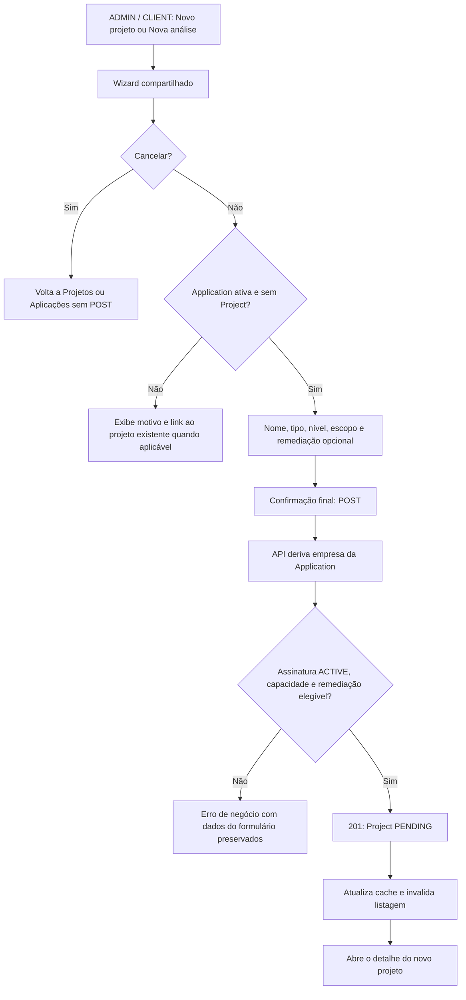
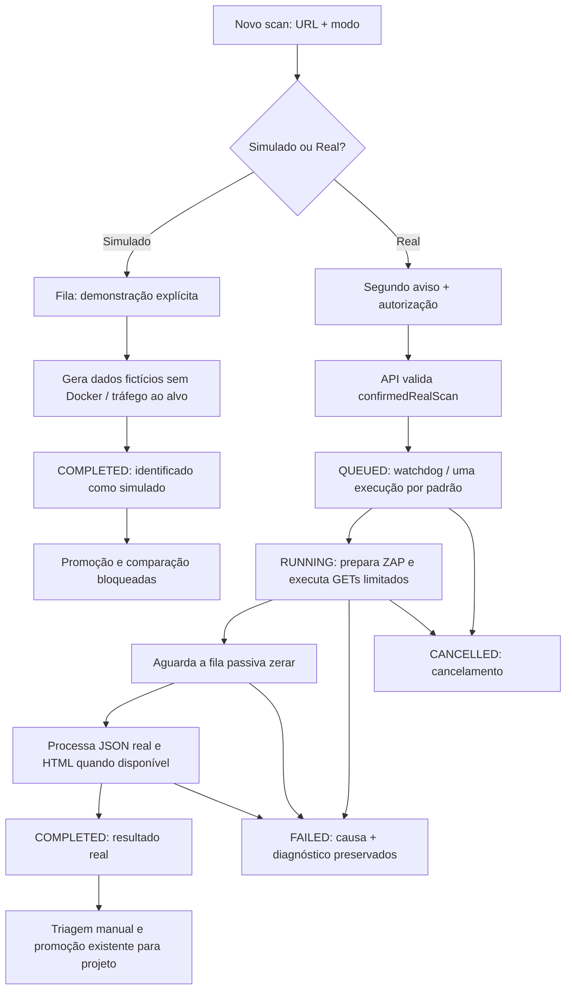

<!--
O QUE FAZ: fornece título e descrição detalhada para a release de dev para main.
POR QUE EXISTE: torna o escopo dos commits revisável antes da abertura manual do PR.
QUEM CONSOME: Rafael, revisores do GitHub e banca do projeto Vulnera.
-->

<!-- Título sugerido do PR: release: experiência unificada, DAST explícito e criação de projetos -->

# Vulnera — Release de outubro de 2026


## Resumo da release

Esta release integra a evolução da experiência web e dos fluxos de análise do Vulnera: nova landing com preview interativo, login e cadastro redesenhados, identidade visual compartilhada na área autenticada, criação administrativa de aplicações, melhorias na criação de projetos e recuperação de consultas durante a navegação.

O DAST passa a distinguir explicitamente demonstração e execução real. Uma falha real permanece visível como falha, com diagnóstico, e o novo perfil utiliza navegação GET limitada e análise passiva do OWASP ZAP.

**Nome sugerido:** Experiência unificada e DAST explícito.

### Escopo confirmado

| Referência | Valor |
| --- | --- |
| Branch de origem | `dev` |
| Branch de destino | `main` |
| Snapshot da origem | `33f6438f74864b99ff6951de6e149d844bd5cba5` |
| Snapshot do destino | `195e85de2b656e0865ae7ae2dc185d43c8eff45d` |
| Data da comparação | 06/10/2026 |
| Commits exclusivos da origem | **31**, sendo **21 sem merge** e **10 merges** |
| Diferença no snapshot | **176 arquivos**, **11.867 inserções** e **2.483 remoções** |
| PRs incorporadas | **#44, #45, #46, #47, #48 e #49** |

Os números descrevem o snapshot remoto acima, antes de qualquer novo commit de preparação desta mensagem. A árvore de `main` coincide com a base comum da comparação; os dois commits exclusivos de seu histórico são merges de releases anteriores.

O produto já possui busca global de findings, SLA, VRS, aceite de risco, playbooks, remediação, relatórios, maturidade e mobile. Esta release amplia a experiência e os fluxos que usam essa base. O diff não contém alterações de schema, migrations ou arquivos do mobile.

## Funcionalidades e melhorias

### 1. Landing pública e apresentação do produto

- Nova composição para a rota `/`, com introdução 3D, partículas e apresentação visual do Vulnera.
- Introdução com opção de pular, execução uma vez por sessão e tratamento de falha de WebGL.
- Navbar com versão compacta durante a rolagem, links alinhados e navegação corrigida para as seções.
- Seções de problema, funcionalidades, funcionamento, comparação, maturidade, planos, equipe, perguntas frequentes e chamada final para cadastro.
- Fotos reais da equipe incluídas nos assets da landing.
- Ajustes de layout e navegação para desktop e telas estreitas.

Os planos da landing são conteúdo fixo, sem sincronização com a API. As seções comerciais apresentam a proposta do produto; não introduzem cobrança ou pagamento real.

### 2. Preview interativo sem autenticação

- Navegação local entre Dashboard, Aplicações, Projetos, Maturidade e Configurações.
- Abas de postura, evolução, insights e comparativo no dashboard demonstrativo.
- Filtros por severidade, abertura de detalhes e simulação da resolução de findings.
- Seleção de aplicação, projeto e domínio de maturidade para explorar informações do exemplo.
- Controles demonstrativos de configurações e reinício do preview.
- Estados, feedback e gerenciamento de foco para as interações.

**Os dados são fictícios e locais.** As ações do preview não criam aplicações, projetos ou findings na API e não persistem alterações no banco.

### 3. Login e cadastro redesenhados

- Layout de autenticação compartilhado entre entrada e registro.
- Revisão de tamanhos, alinhamentos, contraste visual e composição dos formulários.
- Login com ação de mostrar/ocultar senha; troca de formulário com foco no título.
- Fundo com resposta ao ponteiro e animações ajustadas para reduzir trabalho repetido.
- Rótulos interativos nos botões da landing e da autenticação, com animações de letras refinadas.
- Fluxos de autenticação existentes integrados à nova apresentação.

### 4. Experiência visual unificada na área autenticada

- Atmosfera compartilhada no `AppLayout`, com fundo CSS e uma cena Three.js lazy quando o ambiente permite.
- Dashboard e Findings reutilizam a cena global, evitando montar um segundo canvas nesses módulos.
- Cabeçalhos e superfícies coerentes em aplicações, projetos, findings, DAST, playbooks, maturidade, SLA, remediação e aprovações.
- Transições de etapas em Nova análise e Onboarding usando os componentes Motion e tokens existentes.
- Na área autenticada, movimento reduzido evita montar a cena WebGL e interrompe os loops decorativos; o fundo CSS mantém a apresentação.
- Correção do hash CSP do script de tema: normalização de CRLF/CR para LF permite o primeiro paint correto em checkout Windows.

### 5. Criação administrativa de aplicações — Issue #19

- ADMIN escolhe uma empresa existente no modal de criação, inclusive quando não possui empresa pessoal.
- A API valida o alvo escolhido e aplica assinatura ativa e capacidade do plano dessa empresa.
- O modal trata carregamento, ausência de empresas, erro e nova tentativa; também reinicia os campos e bloqueia envio duplicado.
- Seletor nativo dentro do diálogo permite seleção por teclado e mantém o foco no modal.
- CLIENT continua usando a empresa do usuário no banco; um `companyId` forjado no corpo não troca o tenant.
- PENTESTER continua sem permissão para criar aplicações.
- `companyId` permanece imutável na atualização da aplicação.
- A listagem é atualizada depois da criação, sem reload manual.

**Exemplo:** um ADMIN sem `companyId` pessoal consegue cadastrar a aplicação do cliente B, selecionando B explicitamente e respeitando o plano contratado por essa empresa.

### 6. Fluxo de criação de projetos — Issue #20

- Ação **Novo projeto** disponível no cabeçalho e no estado vazio para ADMIN e CLIENT.
- Entrada pelo portfólio de Projetos ou por uma Application pré-selecionada em Aplicações.
- Wizard compartilhado verifica elegibilidade e identifica aplicação inativa, indisponível ou já vinculada a um projeto, com motivo e link para o registro existente.
- Nome sugerido e editável, validado após `trim`, com tamanho entre 1 e 191 code points.
- Cancelamento nas quatro etapas retorna à origem permitida, sem POST ou registros parciais.
- Foco, controles por teclado, feedback de erro e proteção contra reenvio durante a criação.
- Após sucesso, abre o detalhe do novo projeto, insere o resultado no cache e invalida a listagem.
- A empresa do projeto é derivada da Application, inclusive para ADMIN sem vínculo pessoal.
- A criação exige assinatura `ACTIVE` e usa o plano da empresa da aplicação.
- A cota `maxProjects` conta `PENDING`, `IN_PROGRESS` e `IN_REVIEW`; projetos `COMPLETED` liberam capacidade simultânea.
- Remediação é opcional e exige `includesRemediation` no plano; habilitá-la em atualização também passa pelo gate comercial.
- A atualização usa campos permitidos explicitamente, impedindo trocar empresa, aplicação ou status por esse endpoint.

**Regra preservada:** cada Application pode ter somente um Project, inclusive quando ele está `COMPLETED`. A vaga liberada permite criar um projeto para outra aplicação. A concorrência dessa regra permanece uma limitação descrita adiante.

### 7. DAST explícito, resultado real e baseline passivo

- Escolha **Simulado** ou **Real** antes da criação; Simulado é o padrão do formulário.
- Demonstração identificada desde a fila, sem iniciar Docker ou enviar tráfego ao alvo.
- Segundo aviso para execução Real, com URL, impacto e checkbox de autorização obrigatório; a API também exige confirmação.
- Remoção do fallback automático: erro real resulta em `FAILED`, com causa, sem findings fabricados.
- Daemon ZAP em modo Protected, com GETs sequenciais limitados a **30 páginas**, **profundidade 2** e mesma origem/subárvore.
- Perfil sem JavaScript, formulários, URLs com query ou active scan; redirecionamentos são validados antes do próximo acesso.
- Publicação do resultado real após drenagem da fila passiva e processamento do JSON; HTML é preservado quando disponível.
- Até três tentativas por padrão para leituras transitórias de status/relatório, respeitando deadline e cancelamento. Ações de navegação não são repetidas automaticamente.
- Diagnóstico de falha preservado antes da remoção do container, com fase, causa, recursos e logs com a chave do ZAP saneada.
- Padrão de **um ZAP por vez, 2 GiB e 2 CPUs**, mantendo a fila FIFO e o watchdog existentes.
- Promoção, rascunho de promoção e comparação de resultados simulados bloqueados pela API e refletidos na interface.
- Triagem manual continua disponível; resultados reais podem seguir o fluxo existente de promoção para um projeto.

**Análise passiva ainda gera tráfego GET.** Esse perfil reduz o escopo de execução e não equivale a um pentest completo ou a uma garantia de ausência de vulnerabilidades.

### 8. Recuperação de carregamento e navegação

- Leituras com falhas transitórias podem receber até duas retentativas.
- HTTP `429` respeita `retryAfterSeconds`/`Retry-After`, com margem de 250 ms; espera superior a 30 s encerra a recuperação automática.
- Cache fresco por 30 s reaproveita leituras recentes ao alternar páginas.
- Gravações invalidam os recursos afetados; logout ou troca de usuário limpa o cache, preservando o isolamento de sessão.
- Métricas de Insights e Comparativo são consultadas quando suas abas são abertas, reduzindo o fanout inicial.
- Transição de rota preserva o contexto da página em saída.
- Indicador de carregamento aparece após 200 ms, com espaço reservado e anúncio acessível.
- A ação **Tentar novamente** no detalhe de finding executa um novo GET.

Cancelamentos e falhas definitivas não entram no retry. Gravações não são repetidas automaticamente.

## Casos de uso cobertos pela release

| ID | Perfil | Caso de uso | Resultado esperado |
| --- | --- | --- | --- |
| UC-01 | Visitante | Conhecer proposta, módulos, equipe e planos | Percorre as seções públicas e encontra as ações de acesso/cadastro. |
| UC-02 | Visitante / banca | Explorar o produto sem conta | Usa o preview local com dados fictícios, sem alterar a base real. |
| UC-03 | Usuário | Entrar ou cadastrar-se | Utiliza formulários com apresentação compartilhada e feedback dos fluxos existentes. |
| UC-04 | ADMIN | Criar aplicação para cliente sem possuir empresa pessoal | Escolhe a empresa e cria dentro de sua assinatura e cota. |
| UC-05 | CLIENT | Criar aplicação da própria empresa | A API deriva o tenant do usuário, mesmo com corpo adulterado. |
| UC-06 | ADMIN / CLIENT | Iniciar projeto pela lista de Projetos | Encontra o CTA, seleciona a aplicação elegível e preenche o wizard. |
| UC-07 | ADMIN / CLIENT | Iniciar análise pela Application | Abre o mesmo fluxo com alvo pré-selecionado. |
| UC-08 | ADMIN / CLIENT | Encontrar uma aplicação ocupada ou inativa | Recebe o motivo; quando ocupada, pode abrir o projeto existente. |
| UC-09 | ADMIN / CLIENT | Cancelar antes da confirmação final | Retorna à origem sem criar registros parciais. |
| UC-10 | ADMIN / CLIENT | Solicitar remediação para um projeto | A API verifica se o plano da empresa inclui o serviço. |
| UC-11 | ADMIN / CLIENT | Criar projeto para outra aplicação após concluir um anterior | O concluído deixa de consumir capacidade simultânea; RN05 permanece sobre o alvo anterior. |
| UC-12 | PENTESTER | Acompanhar projetos acessíveis | Mantém o acesso de acompanhamento, sem CTA ou permissão de criação. |
| UC-13 | ADMIN / PENTESTER | Demonstrar DAST sem acessar o alvo | Cria execução Simulada identificada, sem tráfego externo do scanner. |
| UC-14 | ADMIN / PENTESTER | Executar baseline em alvo autorizado | Confirma a execução Real e recebe findings passivos reais quando ela conclui. |
| UC-15 | ADMIN / PENTESTER | Diagnosticar alvo inacessível ou falha do motor | Visualiza `FAILED` e a causa, sem substituição por demonstração. |
| UC-16 | ADMIN / PENTESTER | Incorporar um achado real à gestão do projeto | Usa a promoção existente; resultados simulados são rejeitados. |
| UC-17 | Usuário autenticado | Navegar durante um `429` recuperável | A leitura aguarda o prazo informado e tenta novamente dentro dos limites. |
| UC-18 | Usuário autenticado | Voltar a uma página recente ou trocar de conta | Reaproveita cache fresco na sessão e limpa dados ao trocar de usuário. |

## Arquitetura e fluxos principais

### Arquitetura mantida e pontos de integração

```mermaid
flowchart LR
    Visitante["Visitante"] --> Landing["Landing + preview local"]
    Landing --> Auth["Login / cadastro"]
    Auth --> Layout["AppLayout + atmosfera compartilhada"]
    Layout --> Paginas["Aplicações / Projetos / Findings / DAST"]
    Paginas --> Query["TanStack Query: cache, invalidação e retry"]
    Query --> Rotas["Rotas Express + autenticação / permissões"]
    Factory["Factory Method"] -.-> Controller["Controllers"]
    Rotas --> Controller
    Controller --> Service["Services: domínio e ownership"]
    Service --> Repo["Repositories"]
    Repo --> Prisma["Prisma / MySQL"]
    Service --> Runner["Runner DAST + watchdog existente"]
    Runner --> ZAP["Docker: ZAP passivo"]
    ZAP --> Alvo["Alvo autorizado: GET limitado"]
```



### Criação de projeto



### Execução DAST



Os diagramas resumem caminhos principais. Validação de entrada, autorização e limites também podem interromper a criação antes de iniciar a execução.

## Contratos e compatibilidade

### Novo contrato de criação DAST

Consumidores de `POST /api/dast/scans` devem informar `mode`. Execuções reais também precisam de `confirmedRealScan: true`.

```json
{
  "targetUrl": "https://alvo-autorizado.example/",
  "mode": "REAL",
  "confirmedRealScan": true
}
```

Para demonstração, usar `"mode": "SIMULATED"`. Modo ausente/inválido retorna `400 INVALID_SCAN_MODE`; modo Real sem confirmação retorna `400 REAL_SCAN_CONFIRMATION_REQUIRED`.

`DAST_FORCE_SIMULATE=true` passa a bloquear execuções reais. O perfil real anterior, com spider/active scan, é substituído pelo baseline passivo; resultados antigos e novos podem ter coberturas diferentes.

### Gates de criação e atualização

| Operação | Situação relevante | Resposta |
| --- | --- | --- |
| Application — ADMIN | Empresa não informada | `400 MISSING_COMPANY_ID` |
| Application — ADMIN | Empresa inexistente | `404 COMPANY_NOT_FOUND` |
| Application | Assinatura inativa ou cota esgotada | `422 NO_ACTIVE_SUBSCRIPTION` / `PLAN_LIMIT_REACHED` |
| Project | Nome inválido | `400 INVALID_NAME` |
| Project | Application já possui projeto | `409 APPLICATION_ALREADY_HAS_PROJECT` |
| Project | Application inativa | `422 APPLICATION_INACTIVE` |
| Project | Sem assinatura, capacidade ou remediação contratada | `422 NO_ACTIVE_SUBSCRIPTION` / `PROJECT_LIMIT_REACHED` / `REMEDIATION_NOT_INCLUDED` |
| Application / Project | PENTESTER tenta criar | `403 FORBIDDEN` |
| Project | CLIENT tenta usar alvo de outra empresa | `403 FORBIDDEN` |

Esses gates alteram o comportamento de requisições que antes podiam passar sem todas as verificações comerciais. Não há mudança de schema ou migration no diff desta release.

## Alterações técnicas e operacionais

- API preserva camadas, injeção por factories, validação de entrada nos controllers e regras de negócio/ownership nos services.
- Configuração DAST ajustada no `.env.example` e no Compose: concorrência padrão 1, memória 2 GiB, CPUs 2, timeout HTTP 45 s, três tentativas de leitura e janela padrão de navegação de um minuto.
- Configurações interpoladas do Compose devem ser definidas no ambiente do Compose ou no `.env` da raiz; editar somente o `.env` da API não altera valores definidos no serviço.
- Dependências web adicionadas: fonte Inter, GSAP/integração React, React Three Fiber/Drei e Lucide. Three.js, Motion e TanStack Query já faziam parte da stack.
- Nenhuma alteração no workflow de CI neste diff. O workflow existente para PRs destinadas a `main` executa testes da API com cobertura e análise SonarQube; não cobre todos os gates Web desta mensagem.
- Documentação técnica e de domínio atualizada, com relatórios de validação, screenshots, evidências DAST, guias `CLAUDE.md`/`GOTCHA.md` e ADRs sobre atmosfera, baseline DAST, alvo administrativo e criação/recuperação de consultas.
- Há dois documentos numerados **ADR-044** com assuntos distintos; suas referências usam o título completo para evitar ambiguidade.

## Validação e evidências registradas

**Os resultados abaixo pertencem às entregas incorporadas.** Eles não são uma nova execução unificada no HEAD desta release, não devem ser somados e não substituem os checks do PR atual. Nesta preparação da mensagem foram lidos commits, diffs, testes e relatórios; a suíte não foi reexecutada.

| Entrega | Evidência registrada | Ressalva |
| --- | --- | --- |
| Atmosfera autenticada | **237/237** testes Web versionados, contraste **66/66**, build Docker e inspeção em **1440/768/375 px**, claro/escuro e movimento reduzido | A rodada completa local tinha dois testes não rastreados com falha; alguns estados sem dados foram revisados apenas no código. |
| Landing integrada | **268/268** testes Web, contraste **66/66**, build e capturas Chrome em **1440×900 / 375×812** | Resultado da integração da landing, não total do HEAD atual. |
| DAST explícito | API focal **81/81**, novos testes UI **3/3**, builds API/Web Docker | As suítes completas daquela rodada tinham ressalvas; não houve execução do E2E DAST completo. |
| DAST em navegador e stack real | Real `COMPLETED` em **45,5 s**, **11 findings reais**; Simulado em **3 s**; alvo inacessível `FAILED`, com zero findings | ZAP observado **2.17.0**; amostra controlada e cobertura passiva limitada. |
| Application — Issue #19 | Web **257/257**, API focal **42/42**, API completa **588/588**, smoke Chrome **44/44**, builds e contraste aprovados | Check global da API mantém os dois imports não usados. |
| Project — Issue #20 | Web **297/297**, API focal **24/24**, smoke real **1/1**, duas criações `201` e vínculos conferidos no banco | API completa **598/601**: três falhas ambientais `spawn EPERM` no DAST; repetição isolada **17/17**. |
| Recuperação de carregamento | Web **286/286**, Chrome **17/17**, contraste **66/66**, build no container | Smoke de navegação usou ADMIN; o retry real de métricas recuperou após **6,276 s**. |

Cobertura registrada dos services alterados nos fluxos de criação: **ApplicationService e ProjectService com 100% de linhas/funções**, e **85,71% / 84,31% de branches**, respectivamente.

Evidências para revisão:

- [Relatório do frontend autenticado](https://github.com/guimunizzz/Vulnera-TCC/blob/33f6438f74864b99ff6951de6e149d844bd5cba5/output/frontend-visual-overhaul-report.md).
- [Validação DAST de 28–29/09](https://github.com/guimunizzz/Vulnera-TCC/blob/33f6438f74864b99ff6951de6e149d844bd5cba5/docs/DAST-VALIDACAO-2026-09-28.md) e [evidência da interface real](https://github.com/guimunizzz/Vulnera-TCC/blob/33f6438f74864b99ff6951de6e149d844bd5cba5/docs/evidencias/dast/ui-2026-09-28.json).
- [Validação da Issue #19](https://github.com/guimunizzz/Vulnera-TCC/blob/33f6438f74864b99ff6951de6e149d844bd5cba5/output/issue-19-validation.md).
- [Matriz de QA da Issue #20](https://github.com/guimunizzz/Vulnera-TCC/blob/33f6438f74864b99ff6951de6e149d844bd5cba5/output/issue-20-qa-report.md).
- [Validação da recuperação de carregamento](https://github.com/guimunizzz/Vulnera-TCC/blob/33f6438f74864b99ff6951de6e149d844bd5cba5/output/page-loading-validation.md).

## Limitações e pontos de atenção

1. **Gate global da API com ressalva:** `npm run check` continua documentado como bloqueado por `UserEntity` e `UserResponseDTO` não usados em `vulnerability.service.ts`. Não se declara lint/check global verde.
2. **Concorrência de projetos:** duplicidade por Application e cota são verificadas separadamente da criação, sem garantia de serialização. Requisições concorrentes ainda podem violar RN05 ou `maxProjects`.
3. **Elegibilidade de remediação no wizard:** a API aplica a regra do plano; o formulário não consulta assinatura/plano para desabilitar antecipadamente o checkbox.
4. **Escopo DAST limitado:** sem login, navegação SPA/JavaScript, formulários, queries ou active scan. Imagem `stable`, retenção de relatórios e proteção contra DNS rebinding/egress por IP resolvido permanecem pontos de evolução.
5. **Rede e cache:** a falha de refresh por indisponibilidade da API ainda pode deslogar o usuário. Mudanças de outros usuários podem aguardar a revalidação de 30 s.
6. **Build e acessibilidade visual:** persistem aviso de tamanho do bundle, dependências incompletas em alguns ambientes host e limites de reprodução do build já registrados no backlog. A landing tem controles e fallbacks, mas esta mensagem não afirma redução universal de toda animação 3D/cursor.
7. **Segurança pendente:** a documentação registra dois alertas SAST HIGH em relatório HTML DAST e download de evidências como `needs_review`. Não se afirma exploração confirmada, falso positivo ou correção nesta release. O plano referenciado pelos docs não está presente no snapshot versionado comparado.

## PRs e rastreabilidade

| PR incorporada | Entrega | Merge na dev |
| --- | --- | --- |
| [#44](https://github.com/guimunizzz/Vulnera-TCC/pull/44) | Unificação visual da área autenticada | `f5bf05f` |
| [#45](https://github.com/guimunizzz/Vulnera-TCC/pull/45) | DAST Real/Simulado explícito e baseline passivo | `57da3b9` |
| [#46](https://github.com/guimunizzz/Vulnera-TCC/pull/46) | Criação administrativa de aplicações — Issue #19 | `36fcaec` |
| [#47](https://github.com/guimunizzz/Vulnera-TCC/pull/47) | Landing, autenticação e preview interativo | `993ca20` |
| [#48](https://github.com/guimunizzz/Vulnera-TCC/pull/48) | Recuperação do carregamento na navegação | `dcc8619` |
| [#49](https://github.com/guimunizzz/Vulnera-TCC/pull/49) | Criação de projetos — Issue #20 | `d699e6c` |

<details>
<summary>21 commits sem merge que entram nesta release</summary>

| Commit | Data | Mensagem original |
| --- | --- | --- |
| `4c916f6` | 17/09/2026 | test(application): cover admin company creation rules |
| `b59d68b` | 17/09/2026 | fix(application): allow admin to select target company |
| `7bce6be` | 22/09/2026 | fix(landing): corrige alinhamento horizontal dos links |
| `beb81b8` | 22/09/2026 | feat(landing): adiciona navbar compacta durante a rolagem |
| `e90e36f` | 22/09/2026 | feat:new design login page |
| `98dea9d` | 23/09/2026 | feat: new design login/register |
| `cec51fc` | 24/09/2026 | feat(web): unificar visual da area autenticada |
| `e85143e` | 24/09/2026 | fix: Ajusta tamanhos e alinhamentos das telas de login e cadastro |
| `e071159` | 26/09/2026 | perf(auth): otimiza animação do fundo ao mover o mouse |
| `d08cfdb` | 26/09/2026 | style(auth): simplifica visual dos formulários de acesso |
| `1d75f29` | 26/09/2026 | feat(ui): adiciona animações de texto nos botões da landing e autenticação |
| `325ccc0` | 26/09/2026 | ix(landing): corrige navegação e rolagem dos links da navbar |
| `cf653b2` | 26/09/2026 | fix(auth): suaviza animação de letras nos botões |
| `929aca8` | 26/09/2026 | feat(landing): transforma painel demo em preview interativo |
| `36926db` | 29/09/2026 | feat(dast): executa ZAP real passivo com modo explicito e retries |
| `f301fd0` | 30/09/2026 | add CLAUDE.md and GOTCHA.md |
| `7b847c4` | 30/09/2026 | fix(application): complete admin company selection flow |
| `b013cd7` | 30/09/2026 | docs: record local completion of issue 19 |
| `ac40b98` | 01/10/2026 | feat(projects): add project creation flow |
| `92f00b5` | 01/10/2026 | fix(web): recover throttled page loads during navigation |
| `33f6438` | 06/10/2026 | sync docs |

Os outros dez commits são merges, incluindo seis PRs e quatro integrações entre branches. Datas anteriores à última release representam commits de branches que ainda não estavam integrados à `main`.

</details>

## Revisão final do PR

- [x] Escopo limitado aos commits da `dev` ainda ausentes na `main` no snapshot indicado.
- [x] Funcionalidades, casos de uso, mudanças de contrato e evidências documentados.
- [x] Badges estáticos representam escopo e stack; não certificam CI aprovado.
- [ ] Conferir o resultado do CI/SonarQube deste PR e a nova validação dos gates API/Web no HEAD a integrar.
- [ ] Avaliar as ressalvas de lint, concorrência e SAST antes do merge.
- [ ] Confirmar nome/tag da release, se houver publicação de uma tag; esta proposta usa um nome e não altera versões dos pacotes.
